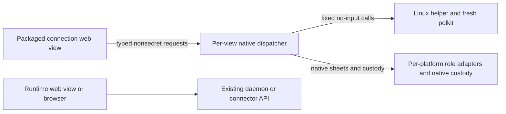

# Web UI to native connection bridge

18 November 2026 · TASK-17162 / TASK-17170 · root TASK-17160 · founder THR-379 seq2, seq10, seq12, seq23; Product seq21 · **Design proposal, not implementation or operating authority**

## 1. Scope, evidence and assumptions

**Linux S7-L1 cutover (THR-387 seq86):** Main always serves installed `web/dist` at `happyranch-app://app`, with native local/remote API forwarding and the reviewed Connection commands admitted on its current document. The opt-in, plain HTTP Main, GUI loopback proxy and separate Linux Connection window are retired. Foreground Client CLI retains ClientSession.open_runtime/RuntimeProxy. Failures retain honest error and installed CLI recovery; no native connection-screen fallback. Mac remains unchanged. See the [Linux loader contract](../operations/linux-release-handbook.md#main-app-scheme-and-connection-dialog-s7-l1).

**Historical Settings S1b-B build preparation (TASK-18101 / THR-387):** the main build
also emits the v1 `resource-manifest.json` (sorted path/bytes/SHA-256 inventory,
entry `index.html`, manifest excluded), using the same helper as the separate
connection build. Its theme bootstrap is a same-origin blocking classic
`/theme-boot.js`, leaving the built entry free of inline scripts and event
handlers. This supports the opt-in main loader's `script-src 'self'`;
its `style-src 'self' 'unsafe-inline'`, `connect-src 'self'`,
`img-src 'self' data: blob:` and `font-src 'self'` are unchanged. The existing
Linux main loader inventoried the manifest as a normal dist file; packaging
consumption was later cutover work. S7-L1 now validates the Main manifest during
Debian packaging with the trusted Assets reader. This preparation changed
neither the separate connection bundle's bytes/CSP nor native bridge admission.

**Historical Linux Settings S2b PR-A (TASK-18097):** the opt-in loader additionally accepts
a native-selected local daemon, one active remote `ClientSession` with an
explicit connecting/ready state, or no target. Remote requests use a
listener-free binary HTTP adapter and the existing pinned-peer/credential
callbacks; the loopback proxy shares the header policy and remains available.
Transfers bind their target and are cancelled on native selection. Shared
pre-header errors use `{"detail":{"code":C}}`: 503 `no_target`,
`target_starting`, `target_unreachable`, `busy`; 409 `target_changed`.
S4b-Linux PR-B adds the compatibility gate below; candidate switching belongs
to S5 and remote window/default cutover to S7. This adds no page control command
or daemon security change. The then-opt-in launcher chose local; S7-L1 now
attaches Main to ClientModel, which owns active/candidate target selection.

**Linux Settings S4b PR-B (TASK-18122):** before any API transfer (including
native's dummy page bootstrap), the selected target performs a bounded native
`GET /api/v1/health`. Local health precedes bearer bootstrap on the verified
loopback port; runtime health is unauthenticated. Remote health uses the existing
listener-free `RemoteCall` / pinned `ClientSession` and its device credential,
without remote bearer bootstrap. `CLIENT=1`, `MIN_DAEMON=1`: `api_contract` must
be an object with integer (not Boolean) `current` and `min_client`, with
`min_client <= 1 <= current` and `current >= 1`. Missing/invalid metadata,
unparseable/non-200/truncated/oversized health or a reachable peer exceeding the
five-second health deadline yields exactly 503
`{"detail":{"code":"incompatible","side":"host"}}`; valid integer
`min_client > 1` yields `side:"app"`. `unknown` is unused. Connect/pinned-dial
failure stays `target_unreachable` and is retryable. The 64 KiB cap and original
health deadline span headers/body; stop/reset interrupts the probe with the
existing 499/409 cancellation contract. No credential/health diagnostics enter
native errors or logs; incompatible instances forward no API or token fetch.

Results are cached per target and reset by native `select_target` (including
same-instance reselection), navigation STARTED, web-process loss, close, and
remote `ready` transitions. The launcher's `message`/`show_web` close/recreate
sequence gives Restart, retry and reattachment a fresh Main. S7-L1's
ClientModel reattaches the committed local/remote target and selects candidates
through AppScheme; same-instance reselection or readiness changes invalidate
admission. The earlier S4b opt-in launcher had no remote reconnect owner; that
stage limitation no longer describes Main. See the
[Linux loader contract](../operations/linux-release-handbook.md#main-app-scheme-and-connection-dialog-s7-l1).

Move connection presentation into shared web components while retaining native custody, permission prompts and exact-device approval. Use the selected in-process script-message bridge in a **separate, locally packaged connection web view**. Never attach this bridge to the runtime SPA web view, including the Mac's loopback proxy of a remote runtime. The connection view can work before connection and during daemon failure. It reuses the web build/design system; it is not fetched from the computer being connected to.

The original spec PR #1643 updated this document only. Slice 1a now adds the web-only shell/build and closed v1 schema (§7), under its separate implementation brief. Slice 1b-LINUX adds the separate Linux loader and packaging boundary (§2). Slice 1b-MAC adds the isolated Mac client read-only loader and bundle packaging; native qualification remains pending. Slice 3a-T adds the unprivileged memory-only Linux client helper transport described below; slice 3a.1 now supplies native session/pairing/runtime modules, while GTK integration and public client capabilities remain pending 3a.2. Authentication decisions, permissions, dependencies, existing native connection screens, TASK-16779, installations and deployments remain unchanged. Source inspection and synthetic facade evidence are not native or cross-device acceptance.

Source facts below remain pinned to **`87e4bea4220525712ffab7e751867feecfecd975`**. Source `file:line` references throughout refer to that tree. The original UX design merged as #1565; [2026-11-16-one-click-remote-access.md](2026-11-16-one-click-remote-access.md), especially §§6–8, retains its trust/R2 requirements. **Current Product authority is handoff v2.1, TASK-17171 (THR-379 seq30)**, in Product's `output/TASK-17171/`: **`00-claude-design-prompt-v2.1.md`**, SHA-256 **`5522966ffab941cd6412df5859c69c1ab94cb417c4ad035575c13a5a768a2c95`**, and **`01-state-acceptance-appendix-v2.1.md`**, SHA-256 **`69410101c8b1b364f50527c13aed8d90859e812b5fcd435568c58823da8598ae`**. It supersedes v2.0's opening, roles, A20/four-pair first-delivery and old-owner wording while retaining all 51 H/C/X inputs and A01–A20 with active/required-gap/deferred annotations.

**Immutable earlier mapping provenance:** handoff v2.0 (P2), shared artifact **`product_lead-2026-11-18-task17161-remote-connection-handoff-v2.0.md`**, SHA-256 **`7657953112c1f70d6b8b7fdf017ed2e49cf382bf63baa4c01f69969256babe98`** (retrieve with `happyranch artifacts get product_lead-2026-11-18-task17161-remote-connection-handoff-v2.0.md --output /tmp/handoff-v2.0.md`). P2 §§6/10 supplied the state/acceptance mapping carried in §8; retained P2 citations identify that earlier artifact, with v2.1 controlling current applicability. H01–H20 are Host states, C01–C23 Client states, X01–X08 shared states; legacy L01–L20 map one-for-one to H01–H20 and M01–M23 to C01–C23, with X unchanged. Neither Product document nor historical source review proves execution.

**Founder option B controls current delivery (THR-379 seq23, 2026-11-18T03:42Z, “go with B first”): Linux HOST plus Mac CLIENT and Linux CLIENT. Mac-as-host is deferred.** Product v2.1 carries this first-delivery boundary while retaining the eventual four-pair role model. Mac host source facts remain in §2 as deferred inventory, with future needs summarized in §5. No Mac host helper, signing requirement or implementation slice is in B. All other settled rulings and Product seq21's lifecycle/acceptance requirements remain. The KB ruling `one-click-remote-access-fixed-operator-service-ruling` continues to prohibit custom-server selection and keeps home and outside-home acceptance separate.

**Account-first sequencing remains in force (THR-327 seq547 / THR-378; v2.1 prompt, “Users and first-delivery scope”).** Accounts and real sign-up/sign-in remain the next delivery priority; this bridge plan does not restore home-first scheduling or start a second account design. The technical home-network path does not require a Services account. Outside-home delivery still requires Services authentication → authenticated user token → authorized service-side join-key issuance, with administrator credentials server-side, plus separately proven operator controls and operating acceptance.

### Settled requirements and explicit assumptions

- **Settled:** `call(command, data: string) -> Promise<string>` rejects with an error string; `on(eventName, handler(data: string))` returns unsubscribe. Native owns closed command/event allowlists (§7).
- **Settled:** a separate static connection web app is bundled inside **both** native apps (`app/mac/` and `packaging/linux/desktop/`) and opened from native controls. It runs without the daemon. The daemon-served SPA, plain browsers and remote paired runtime views get no bridge and hide this feature.
- **Settled role model:** HOST is the machine running the daemon being reached; CLIENT is the machine connecting remotely. The role model is platform-independent; B implements Linux host and both clients, while Mac host is explicitly deferred by seq23. Public commands/events use `host.*` and `client.*`; platform names select native adapters, never product roles. Existing source names such as HOME, HomeInviteModel and Linux-specific UX IDs are historical implementation names, not restrictions on the target design.
- **Settled:** host invite display/copy, client invite paste/accept and device approval remain native, preferably small dialogs. Genuine OS permission UI shows the captured approval identity. Linux uses fresh polkit per mutation. Mac host authorization is deferred (§5); Mac client keeps its existing native consent and Keychain protections.
- **Settled:** web screens replace the existing native connection screens. Those screens stay during development, then are removed when the web replacement ships (§10); they are not fallback screens. An unsupported/unsafe bridge is disabled and the **new** `happyranch connection` CLI supplies the same role actions (§9). No dependency-floor increase, web-process-extension substitution or loopback command API.
- **Assumption A1:** source at the pin above, not unmerged TASK-16779 work, defines what exists. R2's approved future methods are not assumed implemented. Missing methods remain unavailable until their authorized owner delivers them.
- **Assumption A2:** reuse existing React/TypeScript/Vite dependencies and design tokens, with a separate entry/build output; do not import authenticated runtime providers. Slice 1a defines the web entry/build below; slice 1b-LINUX adds Linux loader/packaging admission, and slice 1b-MAC adds the isolated Mac client loader/packaging.
- **Assumption A3:** native OS, installed executable/bundle and protected backend are trusted. Web documents (including XSS in packaged content), network replies and labels are adversarial. Compromised administrators or arbitrary same-user native-code execution are outside the web-isolation claim.
- **Assumption A4:** supported native test venues and TASK-16779 backend/package deliverables will be available for implementation. Source inspection proves neither installed WebKit versions nor native/cross-device acceptance. No install, privileged registration or production change is authorized here.
- **A5 / Q3 approved (THR-379 seq60):** Linux CLIENT saved access uses the system keyring (Secret Service), with exact native binding and no plaintext/substitute store. Missing, locked, unavailable or denied storage leaves the app working session-only with truthful “access not saved” state. Slice 8a adds only memory state export/restore and the native session seam; 8b owns keyring custody, GTK reconnect, packaging and acceptance. Existing UI callers stay session-only until 8b. Ordinary joins remain ephemeral; explicit native save intent requests a non-ephemeral node. An unsaved/failed-save non-ephemeral node stays registered/offline on the host until revoked; host authorization/revocation is unchanged. No replacement node may inherit its saved grant. Unsigned Mac client reconnect remains required without a privileged-helper/signing dependency.

## 2. Step 0: current shells verified from source

| ID | Verified fact and source evidence |
| --- | --- |
| F1 | Linux verifies a release daemon port before returning `http://127.0.0.1:<port>/`: `packaging/linux/desktop/happyranch_window.py:548–559`. `show_web` creates `WebKit2.WebView`, connects `load-failed`, and calls `load_uri(url)`: same file `1027–1049`. It loads HTTP from the daemon, not a file/custom-scheme SPA. That construction passes no bearer or credential into the URL. |
| F2 | Linux selects GTK 3.0 and WebKit2 **4.1**: same file `902–907`. Debian packaging depends on `gir1.2-webkit2-4.1` without an engine-version lower bound: `packaging/linux/build-deb.sh:201–202`. “4.1” is the API/ABI namespace, not an engine version such as 2.40. |
| F3 | `runtime/remote_access/helper_control.py:27–30` defines only ApprovePending, RejectPending and RevokeSelected mutations. `runtime/remote_access/remote_access_helper.py:40–43` adds Status and NextDevice; generated D-Bus introspection has only an output string, no input. Dispatch rejects nonempty signatures/FDs and unknown methods at `145–152`. `scripts/test_remote_access_helper.py:249–254` explicitly expects unknown-method for Enable, Disable, ReplaceFailed, RefreshHomeAddress, IssueInvite and RetryPolicyRenewal. These approved future lifecycle methods are **not implemented D-Bus methods at this pin**. |
| F4 | Helper access checks the release UID, maintains a per-bus-caller selection cursor and captures the pending/selected protected record: `remote_access_helper.py:155–187`. Its polkit message includes the captured label, stable-ID fingerprint and comparison phrase; CheckAuthorization follows at `186–193`. After authorization it rechecks UID, snapshot, target and deadline before mutation: `233–245`; final precommit checks are at `254–264`. Policy uses `auth_admin`, not a keep authorization: `packaging/linux/polkit/ai.happyranch.remote-access.policy:4–18`. |
| F5 | The Linux card merged in [#1583](https://github.com/t-benze/happyranch/pull/1583) (`013c03905…`). Its `RemoteAccessPanel` is in `packaging/linux/desktop/happyranch_window.py:663–676`; it uses a dedicated bus connection and sends no supplied device identity. Request allowlist and zero-input `connection.call(..., None, ...)` are at `753–780`; pending/device buttons are at `854–877`. It is attached to startup/error content at `928–954` and around the runtime view at `1027–1042`. It is not a complete enable/invite/turn-off UI. |
| F6 | Mac `WebView` creates a JavaScript-enabled WKWebView with a navigation delegate and plain URLRequest: `app/mac/Sources/HappyRanchApp/ContentView.swift:55–71`. Local runtime URL construction is `http://127.0.0.1:<port>/`: `app/mac/Sources/HappyRanchSupervisor/RuntimeTransport.swift:16–22`. Healthy local probing sets `webViewURL`: `app/mac/Sources/HappyRanchApp/AppDelegate.swift:907–922,939–948`. The home-invite model's URL is observed into the same property at `87–90`. |
| F7 | Mac's managed client runtime is also HTTP loopback, but through **ClientBridge, an HTTP/SSE/WS proxy**, not a JS command bridge: `app/mac/Sources/HappyRanchSupervisor/ClientBridge.swift:43–64`. It intercepts bootstrap locally, strips SPA Authorization before forwarding (`1028–1042`), and returns a session credential (`1049–1063`). Device credential storage/injection remains native (`111–124,1145–1151`). Do not equate this proxy's loopback origin with locally authored content. |
| F8 | Mac navigation is unrestricted by this delegate when `verifiedHome` is false. When true, action URLs must match scheme/host/port; main-frame responses must be 2xx, match that origin and initially equal the expected root. Finish reports load only after that gate: `ContentView.swift:19–44`. There is no path/resource-bundle pin for all subsequent same-origin navigation in this gate. The flag is enabled for the managed client at `85–87`. |
| F9 | Neither shell currently installs a script-message handler or JS command bridge. Inspection of the web-view constructors (F1/F6), plus targeted searches across `packaging/linux`, `app/mac` and `web` for `WKScriptMessage`, `userContentController`, `UserContentManager`, `script-message`, `register_script`, `evaluateJavaScript`, `evaluate_javascript` and `webkit.messageHandlers`, found no registration/dispatch implementation. Linux's view construction has only the load-failed signal (F1); Mac has no WKUIDelegate/create-window implementation in `ContentView.swift:4–73`. There is no explicit Linux navigation/new-window/create policy in `show_web:1027–1057`, nor an explicit Mac popup policy in that wrapper. This describes app code, not a claim that framework defaults open or allow all popups. |
| F10 | The merged Mac connection work is [#1575](https://github.com/t-benze/happyranch/pull/1575) (`91ff3b7ae…`). `RemoteConnectionView.swift:178–231` contains the invite form, countdown, comparison phrase and cancellation. `HomeInviteModel.swift:8–27,35–65` owns home-client state with private credential/session members; `78–105` discovers saved homes and reconnects one saved home; `188–239` joins, pairs, waits, saves and opens. Its native load callback alone moves Opening to Connected (`334–350`). |
| F11 | `ManagedJoinModel.swift:9–54` is the older managed-network state model; do not mistake joined/online there for the home invite flow's loaded-UI criterion. `ManagedConnectionHealthView.swift:11–39` refreshes a native health record only while visible/active, on demand or every 60 seconds. The current home overlay is `HomeSessionStatus`, preserving save-failure UI over WKWebView: `ContentView.swift:285–313`. These are distinct seams to adapt, not evidence that all health presentation is already unified. |
| F12 | Saved credentials bind home/control-plane/stable-node identity, not display names, and keep the bearer private/redacted: `app/mac/Sources/HappyRanchSupervisor/SavedDeviceAccess.swift:4–49`. `LoginKeychainDeviceStore.swift:10–21,40–79,93–110` uses the login Keychain, a current-executable trusted-app ACL, nonsynchronizing records, create-only ordinary save and readback validation. No new JS serialization of these types is acceptable. Native removal stops the session, removes network state, then deletes the exact Keychain binding and records partial failures: `HomeInviteModel.swift:440–457`. |
| F13 | The web bundle is shared, not selected by shell detection: `runtime/daemon/routes/web_static.py:81–110` mounts assets, serves index at `/`, and falls back to index for SPA routes. `web/src/lib/auth.ts:21–39` bootstraps a relative `/api/v1/auth/bootstrap` and caches its bearer in sessionStorage; `web/src/lib/api/client.ts:81–92` sends it on same-origin requests. Targeted searches of `web/src` found no WebKit handler/native-host/UA-based shell capability detection. “Shell” in AppShell is web layout, not native authority. |
| F14 | Local daemon bootstrap already returns the master bearer to loopback SPA JS: `runtime/daemon/routes/auth.py:31–45`. The new bridge must not claim to remove this existing exposure. Remote gateway processing strips remote headers, reads the daemon bearer only for the verified loopback hop, and forwards through tracked streams: `runtime/remote_access/gateway.py:310–355`; injection is in `runtime/remote_access/forwarding.py:258–260`. Allowed HTTP relays response bytes: `runtime/remote_access/httpd.py:149–169`. Together with F13 this is how the same SPA/assets reach paired remote devices without embedding a native command channel. |
| F15 | Mac `SurfaceAllowList` is a method/route-sensitive **HTTP remote-surface** gate (`app/mac/Sources/HappyRanchSupervisor/SurfaceAllowList.swift:5–17,318–361`), denying bootstrap/registration remotely at `62–71`. It is not an origin/frame/navigation or JS-message gate. The Linux gateway similarly applies current policy and route matching (`runtime/remote_access/gateway.py:219–224,255–287`). Preserve both independently of the proposed bridge. |

### Inventory by role and platform: existing code versus missing work

These are source findings, not runtime verification. In addition to the cited definitions, targeted searches of `app/mac/Sources`, `packaging/linux/desktop`, `app/linux`, `runtime/remote_access` and `cli` covered host/client, invite, pairing, saved access, script handlers, SMAppService, XPC and Authorization Services. A reusable codec or installer does not prove a complete role adapter exists.

| Role / platform | Exists at the source pin (file:line) | Missing for this design / explicit qualification |
| --- | --- | --- |
| **Linux HOST** | `remote_access_helper.py:40–43,145–176` and `helper_control.py:27–30` expose **Status, ApprovePending, RejectPending, NextDevice, RevokeSelected** only. Native card dispatch is `happyranch_window.py:753–773`. `runtime/remote_access/invite_issuer.py:128–139` has an issuance core; `home_minter.py:107–110,217–235` has bounded mint/recovery logic. | Expected inventory **confirmed at the D-Bus seam**: **Enable, TurnOff (backend spelling Disable), IssueInvite are missing**. A core issuer/minter is not a wired IssueInvite method. No complete lifecycle UI, bridge adapter or native invite dialog. TASK-16779 owns lifecycle/security/recovery integration; this bridge must not call raw installer/admin paths to fill the gap. |
| **Mac HOST — deferred by founder (THR-379 seq23)** | Local HOME role exists (`ConnectionRole.swift:24–41`). **Legacy DIY host support exists:** `AppDelegate.swift:1058,1090–1138` starts/stops HomeConnector, generates a pairing code and revokes a credential; `RemoteConnectionView.swift:29–148` shows address, code, devices and revoke. `HomeConnector.swift:208,246,300,441–469` owns listener lifecycle, live revoke and code redemption; `RealPairingStore.swift:97,108,134,178` owns code/pair/revoke/list. Separate current-user managed launchd installation exists (`runtime/remote_access/launchd_installer.py:1–6,560–572`). | **Not an empty host implementation, but not the required managed host ceremony.** No managed single-invite Enable/TurnOff/IssueInvite + pending-device Approve/Reject adapter, no trusted captured-device OS authorization prompt, no SMAppService/XPC/Authorization Services implementation in `app/mac/Sources`. DIY Generate Pairing Code is not IssueInvite, Start/Stop Connector is not managed Enable/TurnOff, and credential-parameter revoke cannot become a JS command. Future managed host backend integration, protected selection and approval mechanism would be needed; all are deferred from B. The launchd installer requires pre-provisioned config and is not an app-driven invite ceremony. |
| **Linux CLIENT** | GTK desktop lifecycle and runtime view exist (`happyranch_window.py:902–907,1027–1049`); its remote panel is the **host's** five-method D-Bus client (`663–676,753–773`). Shared invite/remote protocol modules exist, but their presence does not supply a Linux connecting-client app. | No Linux desktop invite accept/join/pair/wait/load state model, saved remote-access custody/reconnect/removal, client transport adapter or native paste dialog found in that source surface. New Linux client implementation is required; do not miscount the host panel as this role. Current slice 3a-T supplies `bin/happyranch-home-bridge --home-session-v1` (memory-only enrollment and peer relay), and 3a.1 adds native `client_session.py` / `client_runtime.py` owners with private launch, pair/complete/health and runtime forwarding. GTK invite/target dialogs, state/load/cancel integration and public capabilities remain pending 3a.2. B first delivers session-only native custody, with no saved-access/reconnect claim. System-keyring (Secret Service) persistence remains a founder-reserved open decision (§11) and a gated late slice, not a prerequisite to join/wait/load/cancel/disconnect. |
| **Mac CLIENT** | **Expected models confirmed:** HomeInviteModel phases/custody (`HomeInviteModel.swift:8–60`), saved discovery/auto-reconnect (`78–105`), invite join/pair/save/open (`111–239`), reconnect (`260–286`), save retry (`290–318`), native loaded-UI gate (`336–350`), cancel/retry (`395–422`), staged removal (`431–457`). Older ManagedJoinModel exists (`ManagedJoinModel.swift:9–54,171–200,265–299`); saved access/Keychain are F12. HomeInviteSession is `HomeInviteSession.swift:111–123`. | Needs bridge adapter, nonsecret projection and small native paste/target dialogs replacing the full connection form. Preserve unsigned saved reconnect, exact bindings, partial cleanup, persistent save failures and native loaded-UI criterion. Older managed/DIY models are not a substitute for the current single-invite flow or permission to expand manual-server UI. |

Neither app has the proposed JS bridge or separate static connection app (F9). Mac host inventory is retained source history, not an in-scope B deliverable or proof of the managed Host ceremony. **Inventory surprise versus a simple platform rename:** Mac already has legacy host behavior, while managed Mac host and Linux client need substantial new work. No source finding contradicts the brief's expected Linux-helper or Mac-client inventory. Existing strings such as “Awaiting Linux approval” (`HomeInviteModel.swift:19`) expose the old platform assumption; the later role-adapter/web slices must replace them with host terminology, without editing that code in this PR.

### Static app build and packaging boundary (slices 1a / 1b; native qualification pending)

| Boundary | Concrete target and existing packaging seam |
| --- | --- |
| Shared source/build | Slice 1a puts the independent entry, facade adapter and shell under **`web/connection/`**, with `index.html`, `src/` and `vite.config.ts`, and defines **`npm run build:connection`** in the existing `web/package.json`. Lifecycle screens remain slice 4. Use existing React/TypeScript/Vite (`web/package.json:8–11`), the existing lockfile and self-contained local fonts/styles. Emit **`web/dist-connection/`** plus a literal resource manifest; never merge it into `web/dist/`, import `web/src/App`/auth bootstrap/router, or register its entry with the daemon. Shared pure components/tokens are permitted; audited imports must not drag in runtime network providers. No top-level dependency addition. |
| Mac bundle | Slice 1b-MAC runs **`npm run build:connection`** in **`app/mac/scripts/build-app.sh`**'s existing isolated producer and copies the entire independent output to **`HappyRanch.app/Contents/Resources/Connection/`** before sealing. It reuses the trusted source-side Linux `Assets` validator to reject inventory/size/SHA-256 mismatches, stray files and symlinks. No manifest-listed resource is stripped; daemon **`Resources/web/dist`** remains separate. SwiftPM needs no resource target because assembly owns this directory. `ConnectionAssets` resolves only this app-bundle directory and repeats no-follow reads and digest validation at delivery. This is source delivery, not Mac package/native acceptance. |
| Linux package | Slice 1b-LINUX builds/copies the independent output to **`share/happyranch/desktop/connection/`** beside `happyranch_window.py`. Both payload creation and `build-deb.sh` validate the exact manifest inventory, byte counts and SHA-256. `connection_contract.py` resolves only installed-prefix assets, independent of `HAPPYRANCH_WEB_DIST`/daemon state. The native titlebar Connection button opens a separate view with its own ephemeral context, CSP response headers and manifest-only content filter. Admission checks the pinned entry/origin, empty frame tree and named/page-world channel separation without creating forbidden frames. CSP, the manifest filter, TOP_FRAME scripts and native refusal/teardown on every subsequent navigation construct the frame boundary. Isolated frame-insertion/CSP observation also revokes through rejected input on the existing channel when CSP acts before native policy. WebKitGTK 2.52.6 enables read-only hello/Status; child/parent and non-pinned navigation refusal require separate native evidence. Missing APIs or failed admission unregister the entire bridge and show native unavailable/future-CLI copy. No dependency-floor change. Minimum-engine and cutover acceptance remain pending. |
| Native loading / isolation | Both native apps register the dedicated asset-only **`happyranch-shell://connection/index.html`** on a separate connection view. Mac slice 1b-MAC uses `ConnectionWindow` with its own `WKWebViewConfiguration`, non-persistent data store and content controller, a manifest-only `WKURLSchemeHandler`, CSP response headers and a manifest URL content filter. The native **Connection / 连接** menu works independently of runtime state. Native admission requires exact view/controller, main frame, frame request, canonical security origin and generation on every message; first hello additionally probes structured named-world execution, canonical JS origin/entry, no child frames and absence of the page-world native channel before dispatch. Reload/navigation, redirects, popups, load failure, process loss, role/lane change and window close invalidate/unregister; reopening creates a fresh view. Failed admission replaces the view with bilingual native unavailable/future-CLI copy without action controls. No daemon/user preference path or `file://` access. Mac custom-scheme/CSP/frame and runtime checks remain NOT RUN until native qualification. |
| CSP / network boundary | Package a CSP enforced by the loader: `default-src 'none'; script-src 'self'; style-src 'self'; img-src 'self'; font-src 'self'; connect-src 'none'; frame-src 'none'; object-src 'none'; base-uri 'none'; form-action 'none'`. Only manifest-local external scripts/styles; no inline/eval, remote resources, service workers, HTTP/WS API, iframe or popup. Native resource policy independently restricts requests to the manifest. Test engine-specific custom-scheme CSP/origin serialization; never authorize an opaque `null` origin. The daemon serves only its ordinary SPA (F13), with no injected facade or connection route. |

## 3. Selected transport and compatibility boundary

Use in-process script messages in the separately packaged view: WithReply on Mac and a named-world UserContentManager on Linux. The custom scheme serves assets only. Loopback HTTP/WS commands, daemon-mediated bridge routes, OS deep-link commands and an additional web-process extension are not selected alternatives. If an existing supported engine cannot prove isolation/structured delivery, disable its bridge and use the new CLI; do not raise dependency floors.

API evidence: Apple documents [WithReply](https://developer.apple.com/documentation/webkit/wkscriptmessagehandlerwithreply), [frame information](https://developer.apple.com/documentation/webkit/wkframeinfo) and [content worlds](https://developer.apple.com/documentation/webkit/wkcontentworld). The target is macOS 14 (`app/mac/Package.swift:25`), so use a named content world, a main-frame-only user script and WithReply. A plain handler plus structured callback is an internal transport alternative; either preserves the same §7 `call`/`on` facade.

On GTK API 4.1, ordinary [script-message-received](https://webkitgtk.org/reference/webkit2gtk/stable/signal.UserContentManager.script-message-received.html) dates from engine 2.8; [named-world registration](https://webkitgtk.org/reference/webkit2gtk/stable/method.UserContentManager.register_script_message_handler_in_world.html) from 2.22. [register_script_message_handler_with_reply](https://webkitgtk.org/reference/webkit2gtk/2.40.2/method.UserContentManager.register_script_message_handler_with_reply.html) and [script-message-with-reply-received](https://webkitgtk.org/reference/webkit2gtk/stable/signal.UserContentManager.script-message-with-reply-received.html) are available from **2.40**, including asynchronous replies. F2 does not guarantee that engine on every supported installation. Probe GI method/signal availability; use WithReply on qualifying targets, otherwise named-world messages plus correlated native delivery into that same world. Neither callback signature supplies Mac-style frameInfo. Never pretend `view.get_uri()` alone authenticates the sending frame. Test the isolation construction in §4 on minimum supported GTK targets before enabling mutations; missing proof/support disables the bridge and directs the operator to the new CLI (§9), without a dependency upgrade or network command API.

## 4. Recommendation and load-bearing threat model

### Placement and lifetime

Create a dedicated connection view with its own content manager/controller, web context/data store and local asset loader. Serve the fixed packaged entry at `happyranch-shell://connection/index.html`; this spelling is proposed, not an existing scheme. Resolve only a literal, bounded bundle manifest, never arbitrary filesystem paths, network fetches or caller URLs. No runtime API auth/bootstrap runs in this entry point. Use a separate origin and storage partition from daemon and ClientBridge content; no runtime cookies, service workers, web caches or authenticated app providers belong here.

The runtime WebView continues to load the existing local daemon or remote proxy. **It has no handler, injected facade, message forwarder or reference to the control view**, even when its URL is 127.0.0.1. A native menu/button opens the connection view while the runtime is loaded, starting, disconnected or failed. Keep the native Connection menu/button as the entry point, never a replacement native connection screen. On bridge failure it shows a short unavailable notice and CLI instructions, with no connection action controls. The normal browser-served SPA does not mount the connection feature or receive the facade.



### Native admission rules

1. **View identity:** register exactly on the connection view created by native code. Never on a shared default controller/manager. Native stores a document generation and loader identity. JS-provided origin, platform, frame flag, nonce, capabilities or request ID cannot grant access.
2. **Origin and resource pin:** accept only the exact canonical scheme/host/port and fixed entry resource loaded from the packaged manifest. No wildcard suffix, `localhost` alias, dynamic port heuristic, remote alias, file URL, `about:blank`, `data:`, `blob:`, inherited-origin document or arbitrary same-origin path. Hash-only UI state may stay in-document; it grants no navigation authority. Verify custom-origin serialization on both engines rather than accepting a generic opaque `null` origin.
3. **Frames/content worlds:** inject the facade/relay only into the main frame at document start. Use named isolated worlds; no direct page-world native handler. The small page facade exposes only §7 `call`/`on` and intentionally relays the closed schema to the isolated relay. Its fixed event dispatcher and transport callbacks stay internal, not additional page-visible methods. Accept relay messages only from the same top-level window and exact admitted document; no cross-window forwarding. On Mac also check native `message.webView`, `frameInfo.isMainFrame` and frame request/security origin on **every** message. Keep the generation/dispatch capability in native/isolated state, not in DOM or localStorage.
4. **GTK frame gap:** top-frame injection alone does not restrict where a globally registered channel could be used. Bind the handler only in the named world, inject relay code only in the admitted main frame, and allow no child frames at all in this control view. Enforce packaged CSP `default-src 'none'`, manifest-local script/style assets, `frame-src 'none'`, `object-src 'none'`, `base-uri 'none'`, `form-action 'none'`, `connect-src 'none'`; forbid inline/eval/remote scripts. Native navigation/resource policy must also refuse subframes, popups and embedded documents, including same-origin, srcdoc and inherited-origin cases. The GTK feasibility case must show no child frame can reach the handler/relay, including by accessing parent objects. If GTK cannot enforce this on a supported target, disable that bridge and report the gap; do not replace frame provenance with a JS `isTop` claim. Mac uses these document restrictions too.
5. **Navigation/popup pin:** cancel all out-of-manifest navigation, redirects, form targets, new-window and popup requests. Never copy a privileged configuration to a popup. Help links require an explicit native allowlisted external-open action and a separate unprivileged browser, not an arbitrary `openURL` bridge command. Any navigation start, redirect attempt, load failure, process crash, role change or view destruction immediately suspends admission, unregisters/detaches handlers and subscriptions, and invalidates its generation. Returning/back or loading the same URL does not restore authority: create a fresh connection view after a successful native loader admission. Check again before delivering every result/event.
6. **Execution lifetime:** serialize mutations; no prompt queue. Exempt `client.cancelAttempt` from the busy refusal for the attempt it targets: Cancel stays reachable during join, wait and load, with native confirmation and safe-point handling as specified in §7. Revalidate captured native target and generation before invoking the backend. A navigation cancels uncommitted work where safe and disconnects its dedicated bus caller; it is not proof an already-started mutation rolled back. Committed/uncertain effects stay in native state for an explicit new snapshot. Never deliver a stale completion to a replacement document or automatically replay it.

Content-world separation protects relay variables, **not the shared DOM or the user's interpretation of web UI**; Apple explicitly documents that distinction. Frame/origin rules constrain reachability, not XSS inside the admitted main document.

### Concrete adversaries and residual effects

| Scenario | Required result / residual risk |
| --- | --- |
| Paired device loads the same SPA through the connector, including inside its Mac runtime view | No native command channel. The Mac's native Connection menu opens its separately packaged local controls. Remote web scripts cannot create/open/control that privileged view or post messages into it. Existing paired runtime privileges remain governed by connector policy; pairing does not grant Linux helper authority or access to Mac credentials. |
| Plain browser opens the local daemon or guesses the control scheme | No registered native view/handler or injected facade; hide the connection feature. A scheme string, UA, global flag, matching bundle, facade presence or spoofed hello response is UX only, never admission. No HTTP route or port exposes these commands. |
| A malicious page is reached by navigation/redirect or tries window.open | Deny before content commits; suspend the old generation on the attempted transition. No inherited handler after redirect, history restore, blank popup, scheme switch or crash recovery. No response is sent into the new page. |
| Iframe or other window sends a forged envelope | Deny by native frame check on Mac and the tested frame-free/isolated-world construction on GTK. Never use claimed origin/frame fields. Same-origin parent access is included in tests, not assumed safe. |
| XSS in the ordinary runtime SPA | Can misuse the runtime privileges already held there, including existing local bootstrap exposure (F14). Cannot reach the native bridge in a separate view/partition. This proposal does not solve the daemon's existing bearer/XSS model. |
| XSS in the packaged connection UI | Can use `call`/`on` to read allowed status/labels, falsify web presentation, request allowed actions and cause prompt/availability pressure. String payloads still require closed-schema validation; event names remain fixed and data never becomes JS source. It cannot read invites, keys or Keychain bearers through this schema, supply arbitrary helper identity/parameters, swap the captured target after authorization starts, bypass fresh native permission or silently confirm destructive Mac client actions. Allowed `host.nextDevice` can cycle the helper-owned selection while idle; the actual-target OS prompt and precommit revalidation protect the mutation. Bounds/no queue and native confirmations limit abuse; they do not make XSS harmless. |
| Malicious label or lookalike approval UI | Render labels as bounded text with controls/bidi handled; never HTML. An XSS/lookalike page can spoof any web approval prompt, comparison phrase or green badge. Actual approval must show the helper-captured device in native trusted UI (§5). Do not ask for OS credentials in HTML. |

## 5. R2 and native approval stay authoritative

For Linux, map each advertised command to one literal helper method and always call it with **zero inputs**. No device ID, fingerprint, label, address, URL, path, argv, config, environment, enrollment key, policy or auth flag supplied by JS crosses into D-Bus. Request IDs and UI metadata stop at the unprivileged dispatcher. The helper's protected release identity, fixed paths, caller UID checks, cursor and captured-record checks remain unchanged (F3–F5).

Use the dedicated bus connection per connection view; NextDevice cycles its helper-owned cursor. The web screen (including XSS) can cycle selection while idle through allowed `host.nextDevice`, but cannot supply an arbitrary identity or swap the captured target after authorization starts. The actual-target OS prompt and precommit revalidation protect approval/revoke. Disable cursor changes while an operation is in flight; the helper still enforces its own invariants. Each mutation starts a **fresh polkit prompt**, never a cached grant, remembered permission or bundle-level blanket consent. Enable/turn-off/issue and recovery commands can only be advertised after TASK-16779's separately authorized native lifecycle slices provide their fixed authenticated methods. The bridge never implements them with shell commands or alternate daemon routes.

**Chosen trusted approval indicator: the genuine polkit dialog's helper-composed text.** Preserve the actual captured OS-derived label, stable-ID fingerprint and comparison phrase currently supplied at `remote_access_helper.py:183–193`. Show the selected release runtime in native shell context; future helper lifecycle work must ensure the dialog or a tightly bound native confirmation identifies that runtime too. A web screen can explain the comparison, but its “Approve” click only requests the native ceremony. The protected record shown natively is the one revalidated/committed; a web label or screenshot is never the authority. Native qualification must demonstrate the supported desktop polkit agent actually renders that text accessibly; if it does not, hold approval and return the native-indicator gap to EM rather than silently falling back to HTML. A GTK sheet alone that trusts a JS-supplied identity is not an equivalent substitute.

For CLIENT on either platform, accepting an invite opens a small native paste/target-confirmation dialog. Remove saved computer and explicit saved-access replacement use a native default-Cancel sheet showing the captured local computer/binding description and precise local-only effect; connect/disconnect/cancel requests must receive native confirmation when initiated from web content. The dispatcher resolves any client saved-computer reference against its current native snapshot and revalidates after confirmation. A stale ref fails `stateChanged`. Existing automatic reconnect at native app startup can remain a native policy (F10); read/subscribe calls must not start new custody prompts or connections.

### Deferred by founder (THR-379 seq23)

Mac-as-host is outside option B. Retain §2's legacy HomeConnector/pairing/revoke and current-user launchd inventory as source facts; none proves the managed Host ceremony. A later Mac host brief would need managed enable/invite/disable and recovery, protected exact-device selection/approval/revocation, native secret custody, an identity-bearing genuine OS prompt with fresh per-action authorization and precommit revalidation, CLI parity, and independent home/different-network acceptance for Mac → Linux and Mac → Mac.

The earlier **SMAppService/XPC privileged helper plus Authorization Services** proposal, privileged-service distribution/update/removal and any **signed-Mac-host requirement** are deferred design questions, not selected mechanisms, B dependencies or current implementation slices. Revisit the privilege/peer-identity threat model and distribution choices under a future authorized brief. Mac client, including ordinary unsigned saved reconnect, proceeds without any Mac host helper or signing requirement.

## 6. Secrets and data minimization

| Material | Custody and web exposure |
| --- | --- |
| HOST invite, pair secret, join/enrollment key (Linux in B; Mac host deferred) | Keep issuance result in native memory; display/copy the complete invite in a native sheet. Bridge returns only issuance outcome and authoritative expiry when supported. No raw invite/QR bytes in DOM, request/reply, event or clipboard-read command. Native Copy is an explicit user action; clipboard history/other apps are a residual risk, not erased by closing a sheet. Never automatically reissue after delivery uncertainty. |
| CLIENT accepted invite (both platforms) | **Require a small native paste/accept dialog**, not a web textarea. JS requests `client.acceptInvite` with the string `"{}"`. Native reads clipboard only after an explicit user paste, parses/validates and confirms the target; it clears the draft and reports nonsecret stage/outcome. Do not auto-read the clipboard. Native deep-link intake remains native and obeys the same confirmation path. A web invite field is technically feasible but would expose its complete enrollment authority to XSS, extensions, form instrumentation and errors; there is no strict need, so reject it for v1. |
| Saved device bearer, pending completion handle, private keys, home CA signing material, Keychain record bytes | Never serialize into bridge types. Keep SavedDeviceCredential/LoginKeychainDeviceStore and strict home transport behind native adapters. Linux client credentials stay in native memory for the session; persistence requires the founder's store decision and slice 8 (§11). No “debug”, get-secret, export-key, arbitrary clipboard or generic fetch/execute escape hatch. Public status must be a hand-written projection, not Codable/JSON serialization of internal models. |
| Existing web bearer | Existing runtime SPA bootstrap/sessionStorage exposure (F13/F14) remains in its unprivileged runtime view. It does not authenticate native commands and never enters the packaged control entry. Changing daemon auth is outside this proposal. |
| Display metadata | Allow bounded computer labels, home-network/operator context, deadlines, coarse state, comparison phrase where needed, and local opaque computer refs. Keep device fingerprints in privileged native comparison/details UI. Do not emit endpoints, node keys, internal paths, CA DER or full trust records to web diagnostics. Labels are not identity proof. |

No request/response bodies, invite fragments, bearer values, raw native exceptions, decoded invite fields or clipboard contents in logs, telemetry, console, accessibility announcements or error strings. Use closed error codes and localized web-owned copy. No analytics/session-replay instrumentation in the control entry. Crash/error handling must redact before serialization; debug builds do not get an exception. An optional support export needs a separately reviewed existing redacted channel; none is added here.

## 7. Shared typed protocol v1

See the maintained [command/event inventory](connection-bridge-inventory.md) for source-verified platform status, CLI mappings and landing PRs at its pinned origin/main snapshot. The slice descriptions below retain their historical delivery context.

The language-neutral closed schema at `protocol/native-connection-bridge.v1.json` defines v1 payloads for TS and future Swift/Python adapters without a new dependency. Slice 1a supplies the web validator and TS projections; slice 1b-LINUX independently validates the read-only Linux boundary, and slice 1b-MAC independently validates the Mac client read-only boundary. Lifecycle adapters remain pending. Keep transport code separate from commands and model projections. Native code must validate independently even when TS types pass.

### Slice 1a schema/build implementation

The web-only first delivery defines `protocol/native-connection-bridge.v1.json`
and `web/connection/` (see its [import/build audit](../../web/connection/README.md)).
`npm run build:connection` emits only `web/dist-connection/` and its literal
`resource-manifest.json` (version, entry, exact path/bytes/SHA-256 resources).
Slices 1b-LINUX and 1b-MAC add platform asset admission and packaging. These
source deliveries are not shipped lifecycle, CLI or engine-isolation acceptance.

Concrete v1 hello representation: `capabilities` is a list of
`{command,availability}` with unique command IDs (omitted means unavailable);
`observationLimits` is `{host:[HostSnapshot field names],client:[ClientSnapshot
field names]}` listing limited/unsupported observations. Roles are unique;
available commands require their advertised role, and Mac advertises no host
role/command. Payloads reject duplicate keys and depth over 16. Labels/phrases
are bounded to 256 UTF-8 bytes without controls/bidi overrides; opaque refs and
request IDs are 1–64 ASCII letters/numbers/underscores/hyphens. UTC timestamps
use real `YYYY-MM-DDTHH:mm:ss[.sss]Z` values. These are first-schema details for
future native consumers, not a change to an existing native wire contract.
Native must independently enforce all schema/budget/authority rules.

Linux host display labels are HTML-decoded before bounding: labels within 256
UTF-8 bytes are unchanged; longer labels keep the longest whole-code-point prefix
within 253 bytes and append `…` (3 bytes). This applies to devices, pending and
selected in the public bridge projection only; stored labels and native identity
are unchanged, and one oversized label does not invalidate host status.

### JS-facing API (founder THR-379 seq2)

A native-injected object exposes exactly these two functions as the **only page-visible bridge surface**, in the admitted control document's page world only (§4). Its native transport/relay lives in the named isolated world; no facade is injected into runtime, browser, remote, child-frame or replacement documents. The object name is an implementation choice.

```ts
call(command: string, data: string): Promise<string>
on(eventName: string, handler: (data: string) => void): () => void
```

`call` sends a closed command ID asynchronously. `data` carries the proposed versioned schema's JSON `args` text (for example, `"{}"`); the resolved string carries its JSON `result` text. Native parses and strictly validates against the negotiated version, command and unchanged size bounds below. The facade/transport owns the envelope and `requestId`/version correlation internally, with no extra caller parameters. Failure rejects with a **string** carrying a closed JSON error object (`code`, `effect`, `recovery`), never an Error object or free-form backend message. Normalize facade/transport failures to that vocabulary with truthful effect semantics.

`on` accepts only the closed native event list: **`host.stateChanged` and `client.stateChanged` in v1**, plus Linux Main’s additive `host.enableFinished` described below. The handler receives the proposed versioned snapshot/event JSON as a string. Unknown names throw/refuse locally before transport; native never emits names outside the list. The returned unsubscribe function detaches the listener; `on`/unsubscribe manage the existing one-per-view native stream internally, subject to generation teardown. The fixed dispatcher stays internal; no page-supplied callback name or executable string.

Absence of the facade means plain-browser behavior: hide the feature. Facade presence and a hello result are UX detection only, never authorization; native admission still governs every real request and delivery.

### Mapping the facade to native transports

These are adapter choices under §4, not additional JS APIs. Both deliver into the fixed isolated-world dispatcher, which relays only to the admitted control facade/listeners. Pass event names and JSON strings as structured arguments; never concatenate/interpolate command, result, event name or data into JavaScript source.

| Platform | `call` request/reply | Native event delivery for `on` |
| --- | --- | --- |
| Mac | Slice 3b-2a (merged #1668 at `4850fa38`) retains the isolated-world `WKScriptMessageHandlerWithReply` and duplicate-free bounded parser. It backs `bridge.hello`, `client.status`, `client.savedComputers`, `client.health` and ordinary non-replacement `client.retrySave` using closed HomeInviteModel projections. Saved listing observes existing native discovery; health observes the native cadence. Retry save awaits the existing Keychain write/readback under the mutation ledger and one-prompt slot. Only the verified native RELEASE UI-load gate can publish Connected. Host commands remain deferred; accept/connect/remove/disconnect/cancel/retry remain unavailable until 3b-2b supplies native confirmations. | `client.stateChanged` is implemented with bounded full snapshots, revision/document fencing, coalescing and idempotent unsubscribe, delivered through structured `callAsyncJavaScript` arguments into the admitted main frame/named world. No host event is advertised. |
| Linux | The named-world [`register_script_message_handler_with_reply`](https://webkitgtk.org/reference/webkit2gtk/2.40.2/method.UserContentManager.register_script_message_handler_with_reply.html) handler receives `postMessage` via `script-message-with-reply-received` and replies asynchronously. The same internal envelope validation and facade string/error conversion apply. | [`webkit_web_view_call_async_javascript_function`](https://webkitgtk.org/reference/webkit2gtk/2.42.3/method.WebView.call_async_javascript_function.html) invokes fixed dispatcher code with `eventName` and event JSON in its `GVariant` arguments dictionary and named `world_name`, targeting the main frame (or equivalent structured delivery). Recheck generation before delivery. |

The GTK reply handler and `call_async_javascript_function` require engine 2.40; the 4.1 namespace alone proves neither. Preserve §3's installed-method/signal probes, named-world correlated-reply fallback and §4's frame-isolation proof. An older target needs equivalent structured delivery in that same world; if unavailable or unproven, disable the bridge and use the new CLI (§9). No interpolated-JS fallback, dependency-floor change or network command API is authorized. The facade adds no third function or change to the existing bounds.

### Internal transport schema

Illustrative wire shapes, with synthetic nonsecret values; these envelopes are internal to the facade/transport, not extra `call` parameters or resolved objects:

```json
{"protocol":"happyranch.connection","version":1,"requestId":"r1","command":"host.status","args":{}}
{"protocol":"happyranch.connection","version":1,"requestId":"r1","ok":true,"result":{"setup":"ready","runtime":"available","observation":"known","devices":[],"pending":null,"selected":null,"inviteState":"unknown","expiresAt":null}}
{"protocol":"happyranch.connection","version":1,"requestId":"r1","ok":false,"error":{"code":"permissionDenied","effect":"none","recovery":"explicitRetry"}}
{"protocol":"happyranch.connection","event":"client.stateChanged","data":{"version":1,"sequence":7,"observedAt":"2026-11-18T02:00:00Z","snapshot":{"stage":"opening","runtime":"unknown","savedAccess":"saved","route":"unknown","observedAt":"2026-11-18T02:00:00Z","observation":"known","computers":[{"computerRef":"c1","label":"Home computer"}],"activeComputerRef":"c1","expiresAt":null,"comparisonPhrase":null}}}
```

These are envelope examples; command results are discriminated types, not one arbitrary object. Reject extra keys, missing keys, invalid enum values, nested unknown fields and noncanonical types; booleans are not integers. Strings are bounded UTF-8 plain text. No executable callback strings or interpolated JS. Native event/reply delivery uses structured serialization and a fixed receiver, addressed to the admitted world/document.

| Native command allowlist | Parsed `data` / resolved string contents | Per-platform native adapter |
| --- | --- | --- |
| `bridge.hello` | `{"minVersion":1,"maxVersion":1}` → `{version:1, platform, roles, capabilities, observationLimits}` | Both native dispatchers; `platform` is `mac` or `linux`. In B, Linux advertises implemented host/client capabilities; Mac advertises client only. No permission prompt or implicit role switch; no Mac host capability. |
| `host.status` | `{}` → HostSnapshot | Linux Status; readiness is never inferred from process presence. Mac host deferred (§5). |
| `host.enable` | `{}` → legacy ActionResult or unknown-effect admission with native operationId | Linux fixed Enable; subscribed Main receives one separate host.enableFinished event. Mac host deferred. |
| `host.turnOff` | `{}` → ActionResult | Linux future fixed Disable; not daemon Stop or legacy connector Stop. Mac host deferred. |
| `host.createInvite` | `{}` → ActionResult with `inviteState` and authoritative `expiresAt` or null | Linux future fixed IssueInvite; Mac host deferred; native display/copy only. Never invite bytes in the result. |
| `host.approveDevice`, `host.rejectDevice` | `{}` → ActionResult | Linux ApprovePending/RejectPending with protected capture and genuine OS approval; Mac host deferred. |
| `host.nextDevice` | `{}` → HostSnapshot | Linux NextDevice. No supplied device ID/cursor. Mac host deferred. |
| `host.revokeDevice` | `{}` → ActionResult | Linux RevokeSelected; Mac host deferred. Never pass a credential or web-selected device identity. |
| `client.status` | `{}` → ClientSnapshot | Mac model projection; Linux new client owner. Read-only, without starting credential reads, prompts or reconnect. |
| `client.acceptInvite` | `{}` → ActionResult | Mac native paste/target dialog → HomeInviteModel.accept; Linux new native dialog and client owner. Native owns the raw invite throughout. |
| `client.savedComputers` | `{}` → `{computers:[{computerRef,label}], savedAccess, observation}` | Mac saved discovery projection; Linux native Secret Service discovery; unreadable items preserve healthy peers. Neither returns trust blobs or credentials. |
| `client.connectSaved`, `client.removeSaved` | `{"computerRef":"c1"}` → ActionResult | Mac reconnect/staged removal; Linux saved reconnect and exact local removal over Secret Service custody (8b source implemented; native qualification pending). Ref ≤64 bytes, bound to current native snapshot/view, never a path/bearer/host device ID. Resolve and revalidate in native after confirmation. |
| `client.disconnect`, `client.cancelAttempt`, `client.retry`, `client.retrySave` | `{}` → ActionResult | Mac existing model functions with required confirmation/cancel semantics; Linux native session, disconnect, cancel, retry and retry-save owners are source implemented (3a.2/8b; native qualification pending). Disconnect preserves saved access; remove is local-only; retry never reuses spent authority. |
| `client.health` | `{}` → `{access,runtime,route,observedAt,observation}` | Mac F11 adapters; Linux new client health projection; unsupported/stale fields stay unknown. |

The entries above are the **entire initial v1 page-callable command allowlist**. There is no `state.read` shortcut, generic execute/fetch or platform-namespaced command. Mac host is unavailable/deferred in B; Linux saved-access capabilities use native custody; storage failure stays explicit. A role capability is exposed only when its actual backend is available, never because that OS usually plays that role.

**Initial schema delivery is not lifecycle acceptance.** Host invite invalidation/replacement (H09), recognized failed-install replacement (H04/X02), same-home address refresh (H20) and fixed-policy renewal (H19/X07) are required for B, not optional work hidden behind disabled controls. Proposed reserved names `host.cancelInvite`, `host.replaceFailed`, `host.refreshHomeAddress` and `host.retryPolicyRenewal` are **not v1 callable names**; native rejects them until a separately versioned fixed schema and the corresponding TASK-16779 zero-input authenticated backend actions exist. In B slice 2, Engineering must settle the bounded action/result mappings, include these in the bridge and CLI, and qualify invalidation, preservation and partial/unknown outcomes before lifecycle acceptance or cutover. For H20, exit evidence across the bridge, TASK-16779 backend and CLI must demonstrate fresh native authorization, native address derivation (no JS-supplied address), invalidation of old invites, and a fresh invite for updated details. New-invite replacement must invalidate prior invite/pending authority; Close merely hides the dialog and discloses continued expiry. No arbitrary target/config argument or raw installer route fills a gap. Existing native keep-running/runtime controls stay separate app functions, with their actual behavior tested under A14.

The v2.1 appendix's “Action and preservation semantics” constrains both the bridge and CLI mappings; these are not new backend policies:

| Lifecycle action | Required effect, preservation and honest result |
| --- | --- |
| Host Cancel / replace invite | Confirm invalidation of prior issued/pending authority before claiming cancellation or delivering a replacement. Preserve other approved devices; do not claim unenrollment or revoke an already approved grant. Close only hides the dialog. |
| Recognized failed-install replacement / interrupted recovery | Act only on positively recognized owned state. Preserve release runtime/org data and unrelated installations; invalidate obsolete remote authority and require new invites/approval. Unknown residue stays unavailable/operator recovery, never broad deletion. |
| Same-home address refresh / fixed-policy renewal | Host H20 requires fresh native authorization, native address derivation (no JS-supplied address), invalidation of old invites, and a fresh invite for updated details; bridge/TASK-16779 backend/CLI exit evidence must prove each effect, including old-invite rejection and the fresh invite's updated details. Distinct Client C19 metadata-only recovery verifies the same home/CA/node and live saved grant, never redeems unused join/pair material, and requires fresh approval if identity or grant validation fails; a Client update never claims Host-wide invalidation. Renewal applies only the identical valid shipped policy, preserving revocations. No arbitrary address/policy inputs, trust reset or hidden new grant. |
| Client Disconnect / local Remove | Disconnect closes the session and fences late callbacks; it retains actually saved access (including successfully saved Linux access). Remove erases the exact local credential/trust/network state, reporting incomplete cleanup honestly; it does not revoke on Host. Mac web removal stops the captured local session before custody reread; a failed reread authorizes no deletion and retains an incomplete/unknown outcome and exact-target retry. |
| Host Revoke selected device | Fresh authorization binds the captured exact device. Confirm denial/stream closure separately from network cleanup; leave other devices intact. A timeout is not confirmed revocation or local erasure. |
| Host Turn off / re-enable | Invalidate all old invites, pending approvals and grants; remove only positively owned remote services/state while retaining the release runtime, org data and app/helper. Separate confirmed denial from incomplete/unknown cleanup. Re-enable needs new invites; old authority never revives. |

Closed result projections (JSON object syntax describes the parsed contents; **all facade payloads remain strings**):

- **HostSnapshot:** `{setup, runtime, observation, devices, pending, selected, inviteState, expiresAt}`. `setup` is `off/pending/ready/paused/failed/unknown`; `runtime` is `available/offline/restarting/unknown`; `observation` is `known/stale/unavailable`. Devices (≤32), pending and selected expose only `{label, comparisonPhrase}`; unavailable lists are null rather than empty. No credentials, IDs, fingerprints or internal paths. `inviteState` is `none/issued/expired/used/unknown`, and `expiresAt` is an authoritative UTC string or null. A backend without a signal returns unknown/null, never a guessed expiry/reason.
- **ClientSnapshot:** `{stage,runtime,savedAccess,route,observedAt,observation,computers,activeComputerRef,expiresAt,comparisonPhrase}`. Stage and custody enums are below; `computers` uses the saved-computers projection, null if unavailable; active ref and optional deadline/phrase are null unless known. A phase-only backend does not invent a separate saving stage.
- **ActionResult:** `{effect,hostDenial,hostCleanup,localCleanup,networkCleanup,inviteState,expiresAt,host,client}`. Effect is `none/confirmed/unknown`; each cleanup and host-denial dimension is `confirmed/incomplete/unknown/notApplicable`. Host/client are fresh snapshots or null when not relevant/observable; invite metadata is null/unknown unless supported. Opening a dialog is acknowledged with `effect:none`; a subsequent event or completed native result records the outcome. Never call dialog-open, request dispatch or an optimistic web change a completed mutation.
- **Health:** access is `allowed/accessDenied/revokedConfirmed/unknown`, route is `direct/relay/unknown`; observation time is a native UTC value or null. Connected requires the native expected release-UI load gate, not just allowed access or network join.

**Native event allowlist:** `host.stateChanged`, `client.stateChanged`, plus
additive Linux Main `host.enableFinished`. The latter has closed alternatives
{version:1,operationId,method:Enable,outcome:failed,error} and
{version:1,operationId,method:Enable,outcome:completed,result}; it is not a state
snapshot. Enable admission may include a native-generated 32-hex operationId
only for a subscribed original document. Its separate observer survives
admission cleanup, delivers once after the reply barrier and retires on original
document/context/listener loss or a newer Enable. No replay or broadcast exists.
Preparation error is enablePreparationFailed/category/unknown/nativeRecovery
(B9's exact 19 tokens); completed result is enableCompleted/unknown/refresh.
Neither proves effects, state or cleanup. A genuinely fresh known status owns
Off/Ready, while failure copy survives unavailable reads. Older peers keep
unknown fallback. Existing state events retain their snapshot contract. `on` data is a JSON string containing `{version:1,sequence,observedAt,snapshot}`, with the corresponding HostSnapshot or ClientSnapshot. Sequence is a positive, monotonically increasing integer per role/view generation; observation time is native UTC. Native starts each role subscription with a full snapshot, coalesces changes and keeps one underlying stream per view; unsubscribe is idempotent and detaches only that listener, stopping the native stream when no listeners remain. Unknown event names synchronously throw the closed `unsupportedCommand` error **string** and cannot create a native subscription. No JS callback name or code is forwarded. Teardown detaches all listeners.

Capability discovery reports exact page-callable command IDs (as listed above), supported observation fields and `availability` (`available`, `unavailable`, `unsupportedVersion`). It is UX information, never authorization. A capability is advertised only if its native backend exists and view admission succeeds. Permission is requested per action, not during hello; missing capability disables that action with an honest native-app/update explanation. Unknown commands fail closed rather than falling through to strings passed to an executor.

Bounds/lifetime: request ≤4 KiB, response/event ≤32 KiB, device count ≤32 (existing helper bound), one ordinary mutation and one native prompt at a time (attempt-targeted cancellation below bypasses only the mutation slot), at most eight concurrent reads, bounded subscriptions (one per view). Reject excess with `busy`/`invalidRequest`, without queueing; `client.cancelAttempt` is exempt from the one-mutation busy refusal for its captured attempt and never queues prompts. Request IDs are correlation only: bound them to 64 ASCII characters and the native document generation. Retain up to 64 admitted mutation IDs/outcomes, counting archived cancellation replays within the same bound, without eviction during a generation; same-ID/different-body refuses, exact duplicate returns the recorded outcome without repeating effects. At the bound, refuse further ordinary mutations; retain reads and one separate current cancellation record for the active attempt. A first cancellation can use that separate slot even at saturation. In-flight Cancel requests share that record without repeating effects or stacking/queueing prompts. A settled Keep/expiry permits a new request ID to admit a fresh confirmation for the same attempt while archiving the previous cancellation fits within the shared 64-entry bound. At saturation, a new cancellation ID requiring archival refuses with the ordinary journal-full error (`busy`, `effect:none`, `recovery:refresh`); never evict a retained reply to make room. Retained exact-ID replay and body-conflict checks still apply, as do pending/confirmed/unknown cancellation replay. The existing native stop path (closing the Connection window or app Disconnect) remains outside this journal. Require native reopening with refreshed state for further ordinary mutations, never silently rotate generations or replay work. Client loss leads to state read and an explicit new user action after reconciliation. Set deadlines natively, including the helper's existing 120-second authorization bound (F3/F4), with a bounded transport margin. A client timeout is not cancellation or `effect:none`.

Native pushes full nonsecret snapshots as the fixed role events `host.stateChanged` / `client.stateChanged` to `on` listeners when model state changes. A host adapter may coalesce bounded Status polling while visible; a client adapter observes its native model. No new SSE/WS server. Each stream starts with a snapshot, increasing integer sequence and native observation time. Missing sequence, process restart or suspended view requires a new snapshot; no applying stale deltas. Events never replay secrets, auth decisions or pending handles. The native generation binds delivery; any identifier exposed to JS carries no authority. After mutations, reread backend state rather than optimistically editing lists. Health refresh respects native visibility/cadence and exposes stale/unknown after failure.

### Local attempt cancellation (C04–C08/C23)

Cancel stays reachable during `joining`, `pairing`, `waitingApproval` and `opening`, including while join/pair replies or the release UI load are pending. Native captures the current attempt and admitted document generation for `client.cancelAttempt`; `{}` supplies no target authority. Cancellation bypasses the targeted attempt's mutation slot, not native admission or confirmation. A stale attempt/generation fails `stateChanged`/`documentChanged` with `effect:none` and cannot cancel a newer attempt.

For web-initiated Cancel in those states or interruptible `saving`, show a genuine native confirmation naming the captured computer and explaining the local-only effect; default to keeping the attempt. Hold progression to Connected while that confirmation is open. If an **app-owned** native sheet already holds the one-prompt slot (for example invite paste/target confirmation or remove/replacement consent), focus that sheet and use its own Cancel; do not stack or queue a second app-owned prompt. An OS-owned Keychain ACL/unlock dialog is not app-observable or focusable through a supported app interface. LoginKeychainDeviceStore reports only final SecItem results; no prompt-observation mechanism exists. While a Keychain write/readback is in flight, apply the saving rule unconditionally: present the app's own native window-modal cancellation confirmation on the connection window, default Keep, naming the captured computer and explaining the local-only effect and uninterruptible storage step. It owns the app prompt slot and is never queued. Do not try to focus or dismiss any simultaneously visible OS Keychain dialog. The answer there is solely the observed save outcome (needsPermission/notSaved/unknown), never attempt cancellation. Dismissing or expiring the cancellation confirmation keeps the still-current attempt with `effect:none`; revalidate before any continuation. A later explicit Cancel with a new request ID must admit a fresh default-Keep confirmation for that unchanged attempt. Exact-ID replay returns its original outcome, including after a later confirmation, while in-flight repeats continue sharing the pending record. A Cancel chosen directly in the native attempt sheet needs no second confirmation.

Confirmed Cancel clears the local attempt, pending handle and sensitive drafts, invalidates its native attempt token within the captured document generation, and stops join/pair/wait/load work where safe. Every join, pair, save and load completion must recheck that token and generation before changing state or starting follow-on work; a late completion is discarded and can never reconnect or reach Connected. **Interrupting a Keychain write/readback in `saving` is unsafe:** cancellation confirmation remains reachable, but after confirmation defer native teardown to the safe point after that write/readback. Keep the attempt invalidated and show `stopping` with an explanation that the storage step cannot be interrupted; never advance to opening/Connected. Preserve the observed save outcome and any incomplete/unknown cleanup; cancellation does not erase already saved access. Report `effect:confirmed` only for confirmed local cancellation; an unconfirmed stop/cleanup uses `outcomeUnknown`/`effect:unknown` and explicit recovery, without automatic reconnect. Local cancellation never promises host-side invalidation, unenrollment or rollback of dispatched/committed work; host denial and cleanup remain independently observed or unknown. Early remote rejection remains indistinguishable from pending/lost completion as recorded in C23.

### Error and state semantics

Use separate dimensions: host setup (`off/pending/ready/paused/failed/unknown`); client stage (`idle/validating/joining/pairing/waitingApproval/saving/opening/connected/stopping/failed`); runtime (`available/offline/restarting/unknown`); saved access (`none/saved/notSaved/needsPermission/removalIncomplete/unknown`); route (`direct/relay/unknown`, plus freshness); effect (`none/confirmed/unknown`); host denial and local/host/network cleanup each (`confirmed/incomplete/unknown/notApplicable`). An unavailable observation is not an empty list, Off, Removed, Revoked or Ready.

Closed error vocabulary: `invalidRequest`, `unsupportedVersion`, `unsupportedCommand`, `notLocalShell`, `documentChanged`, `busy`, `permissionDenied`, `stateChanged`, `expired`, `unavailable`, `outcomeUnknown`, `invalidInvite`, `newInviteRequired`, `networkUnavailable`, `trustMismatch`, `identityChanged`, `runtimeUnavailable`, `accessDenied`, `revokedConfirmed`, `keychainLocked`, `keychainDenied`, `saveFailed`, `removalIncomplete`. Recovery is an enum: `refresh`, `explicitRetry`, `newInviteOnHost`, `nativePermission`, `nativeRecovery`, `operatorRecovery`, `none`. No free-form backend error string.

Map helper `invalid-request/unknown-method` to the corresponding schema errors, `wrong-uid` to unavailable native capability (never another credential path), `busy` to busy, `changed` to stateChanged, `expired` to expired, and confirmed `denied` to permissionDenied with no mutation. Do not call an ambiguous transport failure “cancelled — no change”: disconnected/unavailable/timeout **after dispatch** carries unknown effect until independently resolved. An early local validation/admission refusal has effect none. A successful request acknowledgement is not completion; report confirmed only from the native operation's supported result. AccessDenied is not proof of explicit revocation; Revoked requires a positive authoritative signal. Native web-load callbacks, never JS `connected:true`, own Connected.

Linux Main retains the command for each pending page call. CSP/frame revocation
and `pagehide` reject pending mutations with `documentChanged`, effect `unknown`
and recovery `nativeRecovery`, without replay. Posting to the relay alone cannot
establish no effect, so this applies conservatively before native admission too.
Read-only `app.status`, `client.status`, `client.savedComputers`, `client.health`,
`host.status` and `host.nextDevice` retain effect `none` / recovery `refresh`.
New calls after retirement are refused before dispatch with effect `none`.

## 8. UX state coverage, acceptance and current signal gaps

**The v2.1 state and acceptance appendix (TASK-17171; §1 filenames/digests) is current Product authority**, carrying founder seq23's B scope. Legacy L01–L20 → H01–H20; M01–M23 → C01–C23; X IDs are unchanged. The table below retains all 51 inherited states. Host rows apply to Linux in B; Client rows apply to Mac and Linux, with saved-access states on Linux explicitly gated and unresolved, not omitted. Mac host rows remain deferred requirements, not an implied implementation. “Existing”/“Adapter” identifies source-backed Linux host or Mac client behavior in §2; replacement lifecycle screens and native adapters remain unimplemented and unexecuted; slice 1a supplies only the web shell/schema. The design cannot manufacture unsupported readiness, expiry, early rejection or cleanup signals. V2.0 remains the earlier mapping artifact; v2.1 controls current presentation/acceptance, while the one-click spec's trust/R2 and action-preservation invariants remain.

| UX ID | Bridge projection / action | Gap or preservation requirement |
| --- | --- | --- |
| H01 | Setup status + Enable entry | Status can show coarse off/unavailable; absence, never-configured and completed cleanup are not distinguished. |
| H02 | Explanation → native Enable | Enable not wired (F3); disabled until backend available. |
| H03 | Operation progress → ready | No Enable stage/readiness transaction API at helper seam; cannot emit detailed progress or fabricate percent. |
| H04 | Recognized failure → ReplaceFailed | No helper method or recognized-replacement result; reserved dependency. Never infer failure from stopped service. |
| H05 | Ready / Add device | Status exists; Add requires absent IssueInvite. Ready is not a connected client. |
| H06 | Create invite/auth/rate limit | Method and authoritative retry-time result absent. |
| H07 | Native invite sheet + web expiry | Issuance/delivery/expiry metadata absent from current helper; Copy stays native. |
| H08 | Expired/used | Helper public pending metadata omits expiry and consumed reason; no exact deadline/cause from Status. |
| H09 | Replace/cancel invitation | Replacement issuance not wired; explicit host cancellation lacks a supported method. Offer Close with expiry disclosure, never “cancelled”. |
| H10 | Pending approval → genuine OS prompt | Linux polkit backend exists; Mac host is deferred by founder (§5); public status has label/fingerprint/phrase but no pending deadline (`helper_control.py:54–56`). Actual identity remains native. |
| H11 | Rejected/expired/cancelled pending | A successful native Reject can confirm that action; Status alone cannot explain disappearance or distinguish expiry/cancellation. |
| H12 | Device list / NextDevice | Existing bounded list/cursor; no per-device live connection evidence. Do not add ID selection inputs to Linux. |
| H13 | Native selected-device revoke | Existing backend; lost/failing reply cannot separately prove denial vs stream closure/cleanup from coarse Status. Preserve unknown. |
| H14 | Turn-off explanation/confirmation | Fixed Disable not wired; no runtime Stop substitution. |
| H15 | Denial + cleanup progress/result | Helper lacks these component outcomes; cannot claim full Off or cleanup success. |
| H16 | Off / re-enable | Coarse off is observable, complete prior disable cleanup is not; Enable absent. |
| H17 | Remote setup / runtime availability | Helper phase+ready can support coarse offline/restarting copy; exact cause not guaranteed. Runtime controls stay native and separate. |
| H18 | Keep-running availability | Outside this schema/helper. Keep existing native opt-in, default off and partial-state repair; do not hide it when restyling remote settings. |
| H19 | Paused + policy recovery | Coarse paused exists; renewal cause/deadline and RetryPolicyRenewal are absent at seam. |
| H20 | Address changed + refresh | Host address observation and fixed RefreshHomeAddress absent at seam. Required bridge/TASK-16779 backend/CLI delivery and exit evidence: fresh native authorization; native address derivation with no JS-supplied address; old invites invalidated and unable to complete; a fresh invite carrying updated details. This Host action is distinct from Client C19 metadata-only recovery (§7). |
| C01 | Role choice / open local controls | Native entry opens the packaged app without daemon; B offers Linux host/client and Mac client; Mac host is deferred, never advertised as ready. Role selection alone grants no capability. No role-switch privileged command in v1. |
| C02 | Accept invite → native paste | Adapter; validation errors are categories, never reflected input. |
| C03 | Native target confirmation | Native sheet must be added/adapted; current parsed target details alone do not establish separate consent (F10). Labels are not attestation. |
| C04 | Joining + deadline | Adapter; model joining exists. Bound operation; elapsed time is not percent complete. Cancel remains reachable with §7 native confirmation; late join cannot resume a cancelled attempt. |
| C05 | Pairing/requesting approval | Adapter over pairing stage; network join alone is not access. §7 Cancel bypasses the targeted busy operation; late pairing cannot reopen it. |
| C06 | Waiting/phrase/deadline | Adapter; preserve actual expiresAt and §7 native-confirmed local Cancel, clearing the attempt without promising host invalidation. |
| C07 | Authorizing/saving | Save mechanism exists; a distinct transient saving phase is not currently in Phase (F10). Can show coarse securing/opening plus persistent save outcome, or add native nonsecret stage later. §7 Cancel invalidates the attempt; unsafe Keychain write/readback finishes before teardown, with save/cleanup outcomes preserved. |
| C08 | Opening release UI | Adapter; native authorized navigation/load gate only (F8/F10). §7 Cancel stays reachable during load; a late load cannot reach Connected. |
| C09 | Connected + health line | Adapter; unify existing distinct health seams. Direct/relay only if observed/fresh; otherwise checking. No available source signal means unknown, not inferred route. |
| C10 | Expired/used | Expiry supported; exact used/invalidation cause may be indistinguishable before expiry. Do not invent “used” from a denial. |
| C11 | Authorization incomplete/new invite | Adapter; preserve spent authority and separate partial-node cleanup. |
| C12 | Network unavailable | Adapter; cannot positively infer away-from-home or exact proxy cause from timeout. |
| C13 | Trust mismatch | Adapter; no Trust anyway or changed trust roots. |
| C14 | Runtime unavailable | Adapter only where native distinguishes runtime failure; otherwise generic home/network unavailable. Preserve saved grant. |
| C15 | Saved reconnect | Mac adapter preserves exact saved binding/native Keychain and load gate; one unreadable home must not hide others. Linux 8b source implements exact login-keyring custody and no-invite same-node resume; live/packaged qualification remains pending. |
| C16 | Needs protected-storage permission | Mac Keychain unlock/consent stays native; never broaden ACL or silently recreate inaccessible item. Linux 8b maps Secret Service locked/denied to needsPermission, unavailable discovery to unknown, and failed saving to notSaved; no substitute store. |
| C17 | Not saved + Retry save | Persistent, visible, accessible, nonsecret native-app-chrome banner over the loaded runtime, including with the connection view closed; explains reopening may need a new invite and opens static Retry save. No runtime bridge. Linux 8b source adds the native banner and capability-gated static Retry save; session-only consent or failed saving retains truthful guidance. |
| C18 | Revoked/re-pair | Only positive native revocation evidence allows this label; generic access denial remains accessDenied/new-invite guidance. Local erasure may fail independently. |
| C19 | Same-home address recovery | Linux native GTK/web acceptInvite and foreground accept-invite route one exact saved home/control-plane/connector/CA binding with changed address metadata through native updated-target confirmation, exact protected-item reread, existing v3 same-node resume and authenticated saved-grant health. Save/readback updates address metadata only after validation; no join key or pair material is redeemed. Identity/grant failure requires separate fresh consent and normal Host approval; failed recovery never overwrites the saved record. Mac native reference: HomeInviteModel.swift; Mac web/CLI recovery has its separate owner. No Client update claims old-invite invalidation. Real-network C19 acceptance: slice 7 NOT RUN. |
| C20 | Identity changed / legacy trust | Adapter; new invite/approval and native replacement consent, never repin from label/address. |
| C21 | Disconnect | Retain saved access only where actually saved (Mac and Linux 8b); session-only Linux joins still need a fresh invite after teardown. Stopping failure remains visible and late callbacks cannot reopen. |
| C22 | Remove / removal incomplete | Mac adapter over staged erasure (F12); verify exact local absence, with no claim of host revoke. Linux 8b deletes the exact local binding and verifies absence; failures report removalIncomplete and unknown effect without claiming host revoke. |
| C23 | Cancel / approval rejected | §7 native-confirmed Cancel clears the local attempt and fences late completions; it promises no host invalidation or rollback. **Early remote rejection is not distinguishable from pending/lost completion** per v2.1 appendix C23; without local cancellation, remain waiting until supported expiry/error, without a fabricated event. |
| X01 | Independent denial/local/host/network cleanup | Mac removal has some categories; complete host/component split absent. Unknown stays visible, not generalized to Off/Removed. |
| X02 | Interrupted replacement/upgrade | Protected transaction detail and resume method not exposed by current helper. Reserved integration. |
| X03 | Installation conflict | Current helper lacks a bounded ownership/conflict projection. Operator recovery only when positively classified, not raw exception text. |
| X04 | Second device / individual revoke | Existing list/cursor/per-device operations; invite creation missing, two-device native acceptance still needed. Duplicate labels require native identity comparison. |
| X05 | Permission cancelled vs unknown effects | Helper denial before commit supports no-change; transport failure cannot supply that certainty. Preserve separate outcomes, no queued retry. |
| X06 | Turn off / re-enable / offline client | Disable/Enable methods and full cleanup evidence absent. An offline client cannot report local deletion; host denial and client cleanup remain independent. |
| X07 | Policy expiration/renewal | Coarse paused status only; missing renewal action and detailed cause, plus client may only see access loss. |
| X08 | Signed storage migration | **Deferred annotation only**, not a v1 capability or precondition for unsigned reconnect. |

Additional acceptance constraints: preserve single-use ≤five-minute native deadlines (spec `282–325`); lost issuance/delivery needs a fresh authorized ceremony, not replay. Never reset protected identity/revocations to repair a screen. No custom-server, manual key, endpoint or environment-selection controls; v2.1's network/operating boundaries and the fixed-operator-service KB ruling control stale alternatives. Home-network success is labelled accordingly and does not establish outside-home acceptance. Build web-owned English and Simplified Chinese strings together per `AGENTS.md:167–173,229–237`; v2.1 does not lower the repository delivery requirement. Keyboard/focus/error/contrast and meaningful stage announcements follow the v2.1 appendix's accessibility acceptance; persistent save warnings follow its C17/A09 and the native-chrome requirement above; sensitive invite text is never automatically announced.

### V2.1 A01–A20 acceptance mapping and B applicability

All cases below are **requirements, NOT RUN** here. Capture exact build/OS/Host→Client pair, fresh state, native/system-prompt evidence, actual loaded release UI, known/unknown effects and result. Source inventory, old sign-off, mocks, merges or a schema milestone establish no acceptance. V2.1 A20 explicitly scopes first delivery to the two Linux-host pairs for B; the eventual Mac-host pairs stay deferred. Linux C15–C17/C19/C22 saved-binding cases (including applicable A06/A08–A11) remain outstanding until slice 8b acceptance, while the session-only path proceeds; do not mark them passed or silently drop them. X08 remains a deferred annotation.

| Case | State mapping | Required observable behavior |
| --- | --- | --- |
| A01 Fresh home-network setup | H01–H07/H10; C01–C09 | Normal app-only journey, one invite, genuine per-action permissions, actual device approved, authorized RELEASE UI loaded before Connected. |
| A02 Recognized failed setup | H04; X02–X03; A01 | Bounded recognized FAILED-SETUP replacement preserves runtime/orgs, invalidates old authority, requires fresh invites and exposes unknown residue. This is not a device-replacement feature; backend/bridge/CLI remain required gaps. |
| A03 Permission cancellation / uncertainty | H02/H06/H10/H13–H15; C16; X05 | Confirmed no-effect cancellation differs from unknown effects; fresh observation/auth, no prompt queue or optimistic edits. |
| A04 Invite deadline / used / replacement / cancellation | H07–H11; C04–C06/C10/C23 | True countdown continues in waiting; old authority invalidated; Close ≠ cancel; spent authority needs new invite. Native custody throughout. |
| A05 Join consumed / delivery lost | C04–C08/C11; X01 | Join alone never Connected; no replayed key/handle; fresh invitation/approval when needed, separate membership cleanup. |
| A06 Trust / certificate / identity | C03/C13/C19/C20 | Fail closed; same-home address recovery requires valid bound grant, changed identity requires reapproval, no trust bypass. |
| A07 Network timeout / runtime offline | H17; C08–C09/C12/C14 | Honest location/health uncertainty, known daemon failure distinguished; bounded retry; no DEV fallback or unnecessary reset. |
| A08 Quit/reopen with saved access | C15–C17 | Same valid protected binding reconnects without new invite, native storage consent when needed, loaded UI still gates Connected. Ordinary unsigned Mac behavior remains an explicit platform test, not Linux proof. |
| A09 Update/storage/save failure | C16–C17/C20; X08 annotation | Warning persists over runtime, explicit replacement consent/new invite where necessary; no plaintext/ACL downgrade. Signed-release migration remains deferred. |
| A10 Second Client / revoke only one | H10–H13; X04; C18/C22 | Distinct identities despite duplicate labels; A denied/closed while B works. New Client needs its own invite/approval. |
| A11 Disconnect / local Remove / Host Revoke | C15/C18/C21/C22; H13 | Exact retention/erasure/denial semantics, no Host-revoke claim from local deletion. |
| A12 Turn off / re-enable | H14–H16; X01/X06 | All old remote authority invalidated, runtime/orgs retained, precise cleanup results, no revival for offline Clients. |
| A13 Interrupted upgrade / policy expiry | H19; X02/X07 | Closed while unsafe/expired, protected bounded recovery with preserved revocations; no trust reset or policy editor. |
| A14 Keep-running / availability | H18/H17; C14 | Separate default-off opt-in; actual platform close/logout behavior qualified; no always-on promise after sleep/power/network loss. |
| A15 Outside-home service | Shared journey; C09; X04/X06 | Independent genuine different-network run; authorized UI and revoke; network/relay/outsider restrictions proven separately; no custom server/test selector. |
| A16 Privacy/accessibility | All states | Native secret custody, synthetic design data, no diagnostic leakage; keyboard/focus/screen-reader/contrast/resize behavior including native dialog transitions. |
| A17 Bundled static app / cutover | H01/H17; C01/C08/C09 | Loads with daemon down; reachable app entry at startup/offline/recovery; runtime stays separate; final apps replace native connection screens without retaining fallback screens. |
| A18 Bridge / cancellation isolation | C04–C08/C21–C23; X05 | Exact async string call/on contract, fixed native validation, trusted top-level context only; unsubscribe/teardown and late-result cancellation; no bridge in browser/runtime/paired pages/frames. |
| A19 Bridge-unavailable CLI exception | V2.1 appendix “Unsupported bridge and CLI exception” / this §9 + applicable H/C/X states | Honest unavailable/build guidance; actual documented secure CLI parity on applicable OS/role, genuine authorization and no native connection-screen fallback. CLI opening/loading the runtime must be qualified; only the same expected authorized RELEASE UI loaded gate allows Connected. |
| A20 Role coverage | Entire mapping + four-pair matrix | V2.1 first delivery requires separate home and genuinely different-network evidence for Linux host → Linux client and Linux host → Mac client. Both Mac-host pairs are deferred by founder seq23; the eventual role model remains. No completion inferred from old sign-off, command renaming or one pair. No simultaneous-role requirement. |


### Four-pair matrix (Host → Client)

**None is accepted today.** Each in-scope pair needs separate home-network **and genuinely different-network** evidence plus applicable A01–A20 lifecycle, security, static cutover and CLI evidence. One context or one pair never substitutes for another. Outside-home operating acceptance may have a separate owner, but remains an outstanding gate; it is not waived by this estimate or by home-network success.

| Host → Client | B scope and capability limit | Home-network evidence | Genuinely different-network evidence |
| --- | --- | --- | --- |
| Linux → Linux | In scope: Linux host full lifecycle + new Linux client; session-only until slice 8b, with saved-access acceptance still open. | NOT RUN / not accepted | NOT RUN / not accepted; Services/issuance/operator restrictions and revoke remain outstanding. |
| Linux → Mac | In scope: Linux host full lifecycle + existing Mac client refactored; unsigned Keychain reconnect, native prompts/dialogs and CLI need execution. | NOT RUN / not accepted | NOT RUN / not accepted; Services/issuance/operator restrictions and revoke remain outstanding. |
| Mac → Linux | **Deferred by founder (THR-379 seq23)**. Legacy Mac host inventory does not prove managed Host ceremony. | Deferred / NOT RUN / not accepted | Deferred / NOT RUN / not accepted |
| Mac → Mac | **Deferred by founder (THR-379 seq23)**. Mac client source does not qualify Mac hosting. | Deferred / NOT RUN / not accepted | Deferred / NOT RUN / not accepted |

## 9. Browser hiding and the NEW CLI fallback

The daemon-served SPA does not mount this feature and receives no native handlers, facade or connection assets. Plain browsers and remote paired runtime views hide it. The packaged connection entry uses bounded hello negotiation (for example one second for hello only); presence/version negotiation is UX detection, never authorization. Do not probe ports, infer authority from UA/OS/127.0.0.1, ask the daemon if it is native, or accept a JS-origin claim.

When bundle loading, version negotiation, structured delivery or frame isolation cannot be established, **disable/unregister the entire bridge**. The native Connection entry shows only an unavailable explanation and the local CLI command/help. It does not expose old or new native fallback connection screens. This includes older WebKitGTK with unproven frame isolation; neither dependency-floor changes nor a new loopback API are allowed.

**Slice 5a (TASK-17564, source implemented; genuine helper/polkit qualification pending):** `happyranch connection status` and Linux `host status|devices|next-device|approve-device|reject-device|revoke-device` now exist. The CLI and connection window share the fixed native transaction and closed projection in `connection_contract.py`. The Linux payload ships `connection_cli.py` beside that owner, launched with fixed system Python `-I`; it needs no web engine or healthy daemon. Availability reports platform/role support only, never host health. Enable/turn-off/create-invite are registered but return closed unavailable without dispatch; the recovery placeholders `cancel-invite`, `replace-failed`, `refresh-home-address` and `retry-policy-renewal` also return closed unavailable. Linux Client CLI is added by 5b below. Mac host returns unavailable/deferred. `happyranch-connector`, DIY and installer/admin paths are never substitutes.

Local grammar (Linux host subset and foreground Linux/Mac clients source implemented; native/live qualification pending): **`happyranch connection host <action>`** and **`happyranch connection client <action>`**, plus `happyranch connection status` for nonsecret platform/role availability. These commands work without a healthy daemon or web view and call the **same native role services**, not the bridge or daemon API. Role names mean the current machine's role, independently of OS; B delivers Linux host/client and Mac client only. Mac host commands report deferred/unavailable, never route to legacy DIY actions.

| New CLI commands | Linux path | Mac path |
| --- | --- | --- |
| `host status`, `host devices`, `host next-device` | Fixed Status / Status / NextDevice on a dedicated D-Bus connection. | Deferred by founder (THR-379 seq23); no B Mac host CLI. |
| `host approve-device`, `host reject-device`, `host revoke-device` | Fixed ApprovePending / RejectPending / RevokeSelected, **zero inputs and a fresh polkit prompt for every mutation**. | Deferred; no B Mac host mutation. |
| `host enable`, `host turn-off`, `host create-invite` | Future fixed Enable / Disable / IssueInvite, once TASK-16779 supplies them. No direct installer/systemd/admin bypass. | Deferred; legacy launchd/connector actions are not a managed substitute. |
| `client status`, `client accept-invite`, `client saved-computers`, `client connect-saved`, `client disconnect`, `client cancel-attempt` | 5b uses the same ClientSession/RuntimeProxy/SecretStore. Hidden terminal invite, explicit target consent, foreground lifetime. Status observes only this invocation; separate control actions return unavailable/notOwned. | 5c foreground mode in the existing app executable uses ManagedHomeInviteSession/LoginKeychainDeviceStore. Hidden terminal invite, explicit target/save consent; status is notOwned and separate controls return unavailable/notOwned. No IPC. |
| `client remove-saved`, `client retry`, `client retry-save`, `client health` | 5b remove-saved selects/confirms/revalidates in one invocation. Separate retry/retry-save/health calls return unavailable/notOwned without effect; GUI sessions are never controlled. | 5c selects/confirms/rereads the exact saved binding/trust/profile/bearer before connect/remove. Separate retry/retry-save/health return unavailable/notOwned. Same Keychain custody; no bearer export. |

The CLI is a new local consumer/adaptor, not another authorization service. For Linux `next-device`/`revoke-device`, keep the same D-Bus connection alive through native selection/confirmation and mutation: a new process per command cannot inherit the helper's per-bus cursor. `revoke-device` therefore performs a bounded interactive Status/NextDevice selection in its own invocation and then invokes RevokeSelected with no arguments; never add `--device-id` or a generic D-Bus method parameter. Other Linux host mutations also capture natively. Mac host is deferred. `connect-saved`/`remove-saved` use bounded native selection with current binding validation, not a credential/path flag. Linux 5b and Mac 5c use the controlling terminal, at most 32 saved records and a 120-second deadline per input, with explicit confirmation and exact-item reread before connect/remove.

B must also deliver documented, versioned fixed CLI actions for recognized failed-install replacement, invite cancellation/replacement, same-home address refresh and fixed-policy renewal, consuming the same TASK-16779 zero-input/fresh-polkit methods and results as §7. H20 CLI qualification must provide exit evidence for each shared bridge/backend effect: fresh native authorization, native address derivation (no JS-supplied address), invalidation of old invites with old-invite rejection, and a fresh invite for updated details. Distinct C19 Client metadata-only recovery must verify the same home/CA/node and live saved grant, never redeem unused join/pair material, require fresh approval if identity or grant validation fails, and never claim Host-wide invalidation. Exact safe action mapping is an Engineering dependency of slice 2/5, not an optional later omission. Unknown/unavailable methods stay unavailable at an early milestone; that milestone cannot claim full CLI/lifecycle parity. Qualify the CLI's actual authorized runtime open/load gate, cancellation and late-result behavior; session join or an “open requested” acknowledgement is not Connected.

Host invite commands open the required small native display/copy dialog and require a desktop for genuine OS prompts. Headless Host mutation returns unavailable/nativePermission without mutation. Linux Client 5b and Mac Client 5c instead read a bounded hidden invite directly from the controlling terminal with explicit target consent; target/comparison phrase stay only there. Missing terminal fails closed before launch. No raw invite in argv, environment, files, stdout, shell history, piped stdin or JS; no invite/device/path/credential flags or automatic clipboard read. Secret Service may be unavailable without a desktop; Mac retains normal login-Keychain unlock/consent UI and exact-executable ACL validation. Session-only fallback is explicit. No web engine is required. Closed status/errors never expose credentials or diagnostics; post-dispatch loss never retries automatically. 5b/5c add no IPC, control socket, daemon route or service; existing session-owned runtime forwarding is reused unchanged. Native access checks remain authoritative.

## 10. Ordered B delivery, removal and effort

**The v2.1 appendix and §8's A01–A20/four-pair matrix govern acceptance; founder seq23 limits B to Linux HOST plus Linux CLIENT and Mac CLIENT.** Account-first sequencing (THR-327 seq547 / THR-378) remains controlling for allocation. Estimates are engineering days, not calendar commitments. They assume A1–A5, existing locked build tools and separately delivered TASK-16779 backend interfaces. The original spec PR added no implementation. Slice 1a adds the web shell/schema/build. Slice 1b-LINUX adds Linux packaging, asset admission and the separate native entry, with capability-gated read-only hello/Status dispatch and unavailable Linux-client capability. GTK admission checks the exact document, empty frame tree and world separation while CSP/filter/native navigation refusal enforce the frame-free construction. The probe no longer defeats that policy by creating forbidden frames. Isolated frame-insertion/CSP observation revokes even attempts blocked before native policy, without adding a command. Installed WebKitGTK 2.52.6 enables read-only hello/Status; missing APIs or failed admission still disable the whole bridge. Separate child/parent and origin-refusal evidence is required; minimum-engine qualification remains pending. Slice 1b-MAC adds Mac bundle packaging, the separate native Connection entry, manifest-only loading and capability-gated client-only hello/status. Merged 3b-2a now supplies closed model projections, saved listing, health, ordinary Retry save and client events; consent-dependent web actions and runtime qualification remain pending. Slice 5c adds the foreground CLI separately; existing native Mac screens and the Linux card stay unchanged during development. No dependency, CI trigger or installation is added. Future implementation verification uses supported native/standalone venues and lint/static lanes, with no retired unit suite, ad hoc Product E2E or live host installation.

| Order | B slice | Days | Exit evidence / dependency |
| --- | --- | --- | --- |
| 1 | Shared closed schema/string facade + static app shell, loaders and both app packaging boundaries | **3–4** | String errors/events/unsubscribe; daemon-down entry; exact origin/resource pin; GTK frame isolation or disabled bridge/CLI guidance. Runtime/browser/paired pages have zero handlers. Mac exposes client only. |
| 2 | Linux HOST adapter and full lifecycle wiring (**2a source implemented; 2b waiting on TASK-16779**) | **3–4** | Existing five zero-input methods plus separately delivered enable/disable/issue, recognized replacement, invite invalidation/replacement, address refresh and fixed-policy renewal. Versioned fixed bridge/CLI mappings; fresh actual-target polkit, precommit revalidation and truthful component outcomes. Initial disabled controls are not exit evidence. |
| 3a-T | Linux CLIENT memory-only transport prerequisite | **1.5–2** | Additive `--home-session-v1` in the shared Go helper and unprivileged Linux payload build; closed stdin v2 trust tuple without profile/recovery, tsnet memory store, private non-credential XDG runtime scratch removed on teardown. Headscale registers persistent nodes from its non-ephemeral keys; they go offline after quit. Known limitation, no 3a dependency. No GTK adapter or saved access. Native/live qualification remains pending. |
| 3a.1 | Linux CLIENT native session/runtime seam (source implemented; qualification pending) | **2–2.5** | Private memory-only helper launch, strict pair/complete/health, native bearer custody, local bootstrap/header/HTTP/SSE/upgrade forwarding and bounded teardown. Public client capabilities remain unavailable; no saved access or GTK load/Connected claim. |
| 3a.2 | Linux CLIENT GTK model and bridge integration (source implemented; native/live qualification pending) | **2.5–3.5** | Native invite/target consent; join/pair/wait/load/cancel/disconnect/health state, actual load gate, native session-only notice and attempt/document fencing. Saved custody/reconnect is added by 8b; prior 3a.2 sessions remain session-only. |
| 3b-1 | Mac CLIENT native lifecycle fences (separately owned) | **2.5–3** | Native lifecycle fences, cancellation safe-point and retained save outcome; preserve ordinary unsigned reconnect and the actual loaded-UI gate. No Mac host helper/signing dependency. |
| 3b-2 | Mac CLIENT bridge integration (**3b-2a merged #1668; 3b-2b source implemented, qualification pending**) | **2–3** | 3b-2a backs status/savedComputers/health/ordinary retrySave, closed projections/client events, mutation/prompt bounds and document fencing. 3b-2b adds native consent for accept/connect/remove/disconnect/cancel/retry, storage safe points and native-chrome Retry save routing; cutover/native qualification remains open. Preserve Keychain custody and unsigned reconnect. |
| 4 | Shared B web screens and lifecycle/recovery states (**4a client screens and 4b Linux host screens source implemented**) | **3–4** | Linux host + both clients, current H/C/X states and unknowns; en + zh-CN, keyboard/focus/accessibility, reachable Cancel. Native secrets/approval only; Linux interim no-saved-access guidance. |
| 5 | NEW CLI fallback + native-owner packaging for B roles (5a Linux host, 5b foreground Linux client and 5c foreground Mac client source implemented; host lifecycle parity and native/live CLI qualification pending) | **3–4** | Full §9 lifecycle parity, same-bus Linux selection, native-only invite IO, per-change polkit, authorized runtime opening/loading and cancellation. Bridge-disabled/daemon-down operation. No Mac host CLI. |
| 6 | Existing native-screen replacement/removal | **1–2** | Gate below for B roles: shipping/removal requires approved Linux Client saved-access custody and its applicable acceptance, or an explicit Founder deferral permitting session-only shipment; Q3 approval is not that deferral. Retain native models, custody, sensitive dialogs and app-chrome warning. No native connection-screen fallback. |
| 7 | Integrated native/lifecycle/negative qualification for Linux → Linux and Linux → Mac | **3–5** | Applicable A01–A20; home and genuine different-network evidence separately; two devices/revoke/disable/recovery/unknown effects, CLI, product/accessibility and independent security review. Missing runs/operating acceptance stay outstanding, never PASS. Linux saved-access cases remain pending slice 8 and block replacement shipment unless an explicit Founder deferral permits session-only shipment; Q3 approval grants no session-only shipment deferral. Session-only development continues until 8b. |
| | **Current authorized slices 1–7 (includes 3a-T and all four adapter splits)** | **26.5–37** | Founder THR-379 seq54 goal-level allowance: up to 37 days; native and cross-device qualification remains outstanding. |
| | **Original B baseline before Linux persistence decision (excludes 3a-T)** | **21–30** | Work proceeds session-only on Linux; this is not full saved-access or outside-home acceptance. |
| 8a | Linux CLIENT bounded memory state export/restore + native session seam (this prerequisite) | **1.5–2** | Q3 approved, THR-379 seq60. Additive closed session v3 launch, save-intent non-ephemeral join, full memory-only state export/restore, exact same-node binding and native in-memory record. No keyring/GTK/disk persistence/Swift change. |
| 8b | Linux CLIENT Secret Service custody + GTK reconnect (source implemented; qualification pending) | **2–3** | Exact-binding nonsynchronizing save/load/delete/readback; locked/unavailable/denied outcomes, session-only fallback, GTK lifecycle, packaging/handbook, applicable A06/A08–A11. No plaintext downgrade. |
| | **Revised slice 8 estimate / full B estimate** | **3.5–5 / 30–42** | Replaces the 1–2 day persistence assumption. Founder goal ceiling remains approximately **39 actual engineering days**; the estimate's upper bound is not extra authority. Stop and report actual effort beyond that ceiling; Mac host/new privilege remain reserved. |
| | **Original full B baseline including gated persistence (excludes 3a-T)** | **22–32** | Adapter/UI/CLI/static packaging integration; Mac host excluded. |

**Slice 2a (TASK-17551, source implemented; real-helper/polkit and lifecycle acceptance pending):** the Linux packaged connection window wires the existing fixed `Status`, `NextDevice`, `ApprovePending`, `RejectPending` and `RevokeSelected` methods on one dedicated system-bus connection. 2a supplies those five host capabilities; I5c / slice 2b below adds exactly `host.enable`, `host.turnOff` and `host.createInvite`. Calls carry no device arguments; only the three mutations allow interactive authorization, with the existing 122-second transport deadline. Successful mutations are acknowledged separately from their following Status observation; no device list is predicted. Closed helper validation/projection preserves bounded §7 comparison metadata while excluding fingerprints and private fields. Polkit denial is `permissionDenied` with no effect; post-dispatch loss is unknown. Missing helper service means not set up/unavailable, with an unreadable list rather than an empty one. Subscribed documents receive bounded full `host.stateChanged` snapshots from a single three-second Status poll while visible and from command observations, with generation fencing and idempotent unsubscribe. An explicit Status arriving during a Status-origin read shares its result and original deadline within the existing eight-read cap, so subscribe-then-read startup can finish. Status during a mutation (including its follow-up read) or NextDevice remains busy; mutations are never queued. Host mutations also return `busy` before bus dispatch while Client paste/target confirmation is reserved, including asynchronous invite decoding; the reservation releases on consent, cancellation, failure or document detach. Client confirmations, including native runtime stop controls, refuse with `busy` while Host authorization is in flight. No conflicting prompt is queued. Revoke acknowledgement confirms host denial/stream closure only; network cleanup remains unknown. The native RemoteAccessPanel stays unchanged until slice 6.

**Slice 5a (TASK-17564, source implemented; native/live qualification pending):** Linux host CLI uses the same five fixed methods and deadlines as 2a, on one dedicated system-bus connection per invocation. Revoke keeps Status/NextDevice selection and RevokeSelected inside that process, with a terminal, at most 32 choices and a 120-second selection window; no device argument exists. Every mutation requests fresh interactive polkit. An unreachable desktop returns unavailable/nativePermission before bus access. Replies are closed JSON without fingerprints, invite bytes or diagnostics; loss after mutation dispatch is unknown without retry. Exit 0 means a completed read/action or selection cancelled with effect none (an unavailable observation remains explicit), 1 means a closed error, and 2 means invalid grammar. Separate next-device invocations never persist selection. Linux payload packaging includes the system-Python entry and shared owner/schema; no new dependency. Linux Client CLI is 5b below; Mac client CLI is supplied separately by 5c below. I5b now supplies seven Linux CLI lifecycle/invite mappings; address refresh remains B13-deferred. Source delivery is not full native/live lifecycle or cutover acceptance.

**Slice 2b host part (I5c / TASK-17886, source implemented; I6 native/live acceptance NOT RUN):** the Linux window adds exactly `host.enable → Enable`, `host.turnOff → Disable` and `host.createInvite → IssueInvite` over the existing dedicated system-bus connection, with zero inputs, interactive authorization and 482/302/122-second transport deadlines. Enable/Disable return an admission-only ActionResult with effect, host denial and host/network cleanup unknown; acceptance proves no completion. The window keeps its caller alive; the existing Status/host.stateChanged observation path drives the card. Status during an in-flight mutation remains busy; no mutation is queued or automatically retried after loss, timeout, cancellation or late reply. IssueInvite shares the CLI terminal-frame validator (exact three keys, bounded prefix/alphabet and integer expiry within five minutes). Native rechecks the original deadline and expiry immediately before displaying a minimal GTK sheet: visible complete invite text (non-selectable and non-focusable; explicit Copy only), Linux-owner approval explanation, absolute local expiry with m:ss countdown, explicit Copy and Close. Copy is never automatic; expiry/close best-effort clears only unchanged copied text, then drops native text. Closing does not cancel the invite; clipboard history/other apps remain a residual. Only nonsecret issuance/expiry metadata enters the v1 ActionResult, never invite bytes. A missing/closed desktop refuses before dispatch with unavailable/nativePermission. ReplaceFailed/CancelInvite/RecoverInvite/RetryPolicyRenewal remain CLI-only; address refresh remains B13-deferred, and Mac host stays closed. The v1 schema, web views and existing native screens are unchanged. Genuine helper/polkit, packaged lifecycle and cross-device acceptance remain I6 gates.

**Slice 4a (TASK-17529, source implemented; native/live qualification pending):** the packaged view renders the shared Linux/Mac CLIENT lifecycle from the existing closed v1 client commands/events only: idle/no saved, saved list with per-record Connect/Remove, validating/joining/pairing/waiting/saving/opening with a reachable Cancel, connected (only from the native snapshot) with health, stopping, failed, and closed error/effect outcomes. Unknown health/observation-limited fields render Unknown; an unreadable saved list is not shown as empty. The storage step shows done only for native `savedAccess: saved` (otherwise skipped/not saved/not confirmed). Save failure (`notSaved`/`needsPermission`/`unknown` once observed at opening or connected) keeps a persistent in-view warning through saving/opening/connected until saved is observed, with Retry save while connected; the native-chrome banner remains native. Async status reads and role loads are fenced by role selection and a native-observation revision, so a stale reply never overrides newer native state; health reads carry their own role-selection/request marker and are invalidated when the snapshot leaves connected. Recovery retries the originating command with its exact record; post-dispatch loss shows unknown with Check again, never “no change”. Comparison phrases are never rendered. Absent capabilities hide their controls with one update note. en/zh-CN, keyboard order/focus restoration and a polite live region are included. No protocol/schema, native or CLI change; host screens are 4b. Synthetic-facade screenshots are UX evidence, not native acceptance.

**Slice 4b (TASK-17543, source implemented; native/live qualification pending):** the packaged view renders the Linux HOST lifecycle from the existing closed v1 host commands/events only (`host.status`, `host.enable`, `host.turnOff`, `host.createInvite`, `host.approveDevice`, `host.rejectDevice`, `host.nextDevice`, `host.revokeDevice`, `host.stateChanged`): off/Turn on, setting up, ready/Add a device, ready with the runtime offline/restarting, invite active with an absolute local expiry, last invite expired/used, pending device request (Approve/Reject only request the genuine system prompt), devices with access, the helper-selected device with Select next/Revoke, paused, failed and unknown. Unknown setup or unavailable/limited observation is never shown as Off; a null or limited device list is unreadable, not empty. Labels are not identities, so the selected device is shown separately and rows carry no actions. Turn off and Revoke open an in-view confirmation with Cancel first, then native prompts. Outcomes keep effect and component results (host denial, owned remote services/state, network cleanup) separate; unknown effect shows Check again, never “no change” or full Off; recovery retries the same command only while the same pending/selected record is current. Status reads use the 4a selection/revision fence; a NextDevice reply overtaken by an observation received while it was pending is discarded. Every accepted host snapshot updates the card and the shell runtime line through one observation owner. An unknown effect whose reread fails marks the retained snapshot not confirmed (lifecycle controls hidden, original outcome kept, Check again) until a later authoritative observation. Invite bytes, fingerprints and comparison phrases are never rendered. Gaps with no v1 command render nothing fake: invite cancel/replace (H09; Add a device is withheld while an invite is issued and the view says closing does not cancel it), recognized FAILED-SETUP replacement (H04/X02), H20 address observation/refresh, H19 policy renewal, and web-initiated host-setup cancel. I5c makes only the three existing enable/turnOff/createInvite commands available natively; the other gaps stay CLI-only or B13-deferred as stated in slice 2b. 4b itself changes no protocol/schema, native, CLI, daemon, auth or dependency; native/live acceptance remains open.

**Current authorized split/status (THR-379 seq54/60; TASK-17464):** slices 1–7 remain estimated at **26.5–37 engineering days** under seq54. Q3 is approved by seq60: Linux client system-keyring/Secret Service custody, with session-only operation when access cannot be saved. Engineering splits slice 8 into **8a 1.5–2 days** and **8b 2–3 days**, **3.5–5 days** combined; revised full estimate **30–42 days**. The approximately **39-day actual-effort ceiling** remains controlling; exceeding it requires Founder disposition. Source implementation is not native/live or cross-device acceptance. Earlier totals/dispositions below are historical baselines.

**Slice 5b (TASK-17592; Linux C19 added by TASK-17699, source implemented; packaged/live qualification NOT RUN):** Linux registers `client status|accept-invite|saved-computers|connect-saved|remove-saved|disconnect|cancel-attempt|retry|retry-save|health`. A connection belongs only to its foreground invocation; no process inspects/controls another CLI or GUI session. Status returns `notOwned` with unavailable observation, never global health. Separate disconnect/cancel-attempt/retry/retry-save/health return closed `unavailable/notOwned`, effect none, exit 1. Ctrl-C/SIGTERM in the owning invocation cancels/disconnects; retry starts a new invocation with fresh consent. No interactive control keys or new IPC/service. ClientSession.open_runtime's authenticated health gate yields `runtimeReachable`, **never Connected**: CLI cannot verify the GUI's loaded RELEASE UI gate. The loopback URL is printed only on the terminal and lives until this invocation exits. Bounded cleanup seals the native session; unconfirmed cleanup reports `cleanupIncomplete`/unknown. Save/readback reaches its existing 15-second safe point before teardown. Login-only SecretStore, exact-binding readback, locked/denied/unavailable outcomes and explicit not-saved/session-only warning are unchanged from 8b. JSON uses closed states/effects/projections; no invite, phrase, target, URL, bearer, fingerprint, network state or diagnostics. Exit 0 completed/cancelled, 1 closed error, 2 grammar. For C19, accept-invite discovers a unique exact saved identity with changed address metadata, displays the updated control URL/dial IP/endpoint on the controlling terminal, and requires typing update. It rereads the exact saved item and uses v3 resume plus authenticated health before the existing save/readback; the invitation is not redeemed. Failed identity/grant validation requires separate connect consent for normal join and Host approval. Declining update launches nothing and changes no record. JSON states/effects and grammar are unchanged. Real-network C19 acceptance is slice 7 NOT RUN. Mac client CLI is supplied by 5c below. This source milestone does not claim full B CLI lifecycle parity or native acceptance.

**Slice 5c (TASK-17678, source implemented; packaged/live qualification NOT RUN):** Mac mirrors the ten 5b client verbs and exit codes. The frozen `Contents/Resources/daemon/happyranch` CLI execs only the fixed sibling `Contents/MacOS/HappyRanch --connection-client <action>`, before SwiftUI/AppDelegate construction. The same executable identity and native ManagedHomeInviteSession/LoginKeychainDeviceStore preserve unsigned Keychain custody; missing packaged owner returns unavailable. Source-only Python does not search for an app. Invite intake is hidden `/dev/tty` only, bounded to 5500 bytes/120 seconds, then explicit displayed-target and optional save consent. Saved selection has at most 32 records/120 seconds per input and exact protected-item reread after consent. Native profile deletion precedes exact Keychain deletion/absence verification. Status is notOwned; separate disconnect/cancel/retry/retry-save/health return unavailable/notOwned, effect none. Ctrl-C/SIGTERM cancels only this invocation, restores terminal mode, settles dispatched storage/deletion and independently stops the native session; unconfirmed teardown is cleanupIncomplete/unknown. Expiry bounds join/pair/approval; no key replay or automatic retry. Authenticated health/open yields runtimeReachable, never Connected; target/phrase/loopback URL are terminal-only and the connection lives until signal/failure. Closed stdout excludes credentials, invites, URLs, identities, trust and diagnostics. Mac host remains unavailable; 3b-2b supplies web confirmations separately; full lifecycle parity and native acceptance remain open. The unsigned workflow compiles the release app only, not Swift tests; dispatch receipt and actual outcome are task evidence, never inferred test PASS.

**Slice 3b-2b (TASK-17695, source implemented; native/live qualification NOT RUN):** Mac advertises all ten v1 client commands in the admitted managed connection view. Native secure paste and captured-target sheets retain invite bytes; saved connect rereads binding/trust/profile/bearer after consent. Retry reconnects only eligible saved access, reopens fresh invite intake when needed, and explicitly confirms freshly delivered local-item replacement (reachable from the ordinary Retry save identityChanged refusal); failed/unknown deletion never claims replacement. Removal stops the captured local session before rereading the captured record, retains exact-target retry without deletion on reread failure, and stages native-state erasure before exact Keychain deletion/absence verification with honest incomplete outcomes. Disconnect retains saved access. Attempt cancellation captures attempt/document generation, holds Connected during confirmation, immediately invalidates on confirmation, and waits for storage settlement before teardown. OS Keychain UI is neither observed nor focused; its result remains a custody outcome. The separate cancellation record survives mutation saturation/timeouts and shares repeated Cancel through stopping. The existing native runtime-chrome warning now explains that reopening may need a new invite and opens static Retry save, including when Connection was closed. Runtime content receives no handler. No ACL/custody, wire schema, IPC, signing/helper, daemon route or Mac-host change. Swift tests are not compiled by the unsigned app workflow; source/build evidence is not GUI/Keychain or cross-device acceptance.

**8b native custody:** explicit native save consent selects the non-ephemeral 8a seam. After completion, the native owner writes only the version-1 SavedRecord to GI Secret using schema `ai.happyranch.LinuxClient.v1` and SHA-256 home/control/node/profile attributes. Only the default collection at `/org/freedesktop/secrets/collection/login` is accepted; no collection creation, unlock request, synchronized collection, file or substitute store. Saving requires byte-equivalent readback; removal verifies exact local absence. Discovery is bounded to 256 schema-matching login items/32 client records and preserves readable peers; unrelated login items do not consume capacity. Malformed peers with a provably different binding do not veto save/removal; possibly matching or unreadable identities retain uncertainty. Secret Service operations have a 15-second cancellation deadline; Cancel invalidates the attempt and waits for write/readback's safe point, preserving its observed outcome. Runtime failure during Retry save also stops at that safe point and never restores Connected. Saved connect rereads the exact item after native confirmation, resumes without an invite, and retains the loaded RELEASE runtime gate. The static controls expose only opaque refs/labels and closed outcomes. Source/fake-Secret/disposable-keyring evidence does not establish packaged, cross-device or different-network acceptance.

**8a private protocol:** `--home-session-v1` retains its existing closed v2 join variant and adds closed launch version 3. Common trust fields are unchanged, with required `saveIntent` and `stableNodeID`; exactly one of `joinKey` or base64 `networkState` is present. Join requires empty `stableNodeID`; resume requires save intent and the saved node. `stateDirectory` and `recovery` remain forbidden. Launch frames are at most **128 KiB**; state snapshots at most **64 KiB**, at most **32 store entries** (individual writes at most 32 KiB). The version-1 state envelope binds `controlPlaneID`, `stableNodeID` and the complete tsnet store, including active profile and machine/node keys. Malformed, incomplete, oversized, wrong-version or wrong-binding state refuses before network startup. Resume verifies the authenticated live StableNodeID before runtime readiness; identity mismatch is closed category **-22**. After the existing ready line, save-intending sessions emit a big-endian uint32 length plus snapshot JSON on the private parent stdout pipe, then the latest complete snapshot after changes (notifications may coalesce). No state enters diagnostics, argv, environment, web projections or disk; private non-credential runtime/log scratch is removed at teardown. Native `SavedRecord` is immutable/redacted and contains only bearer, exact home/control/node binding, full trust tuple, stable profile ID/hostname and network state after successful completion. Resume uses no invite, join key, pair secret, completion handle, bootstrap token, socket path or scratch. The 8a seam itself does not implement keyring storage or expose saved-connect UI. Linux C19 (TASK-17699) reuses this unchanged resume variant with the invite's updated address metadata after native confirmation and exact 8b record reread. It preserves CA/home/control-plane/connector, saved node/profile/hostname/bearer, checks live StableNodeID and authenticated bearer health before 8b save/readback, and sends neither joinKey nor pairing material. No recovery field or protocol extension is added; arbitrary control URLs remain refused. Failed validation requires a separate normal-join consent and fresh Host approval without overwriting the saved record. Real-network acceptance remains slice 7 NOT RUN.

**Historical transport prerequisite accounting (TASK-17313):** 3a-T adds **1.5–2 engineering days** to the original totals above: **22.5–32** before Linux persistence, or **23.5–34** including the still-gated persistence estimate. These are updated estimates, not an additional Founder budget approval; the parent delivery task owns reporting the delta. The original EM disposition below is retained as its earlier baseline.

**Historical EM disposition (TASK-17169):** The approved B scope proceeding now is slices 1–7 at **21–30 engineering days**, within the founder's approximate **20–30** range (THR-379 seq23). Slice 8 (Linux saved access via system keyring) is gated on unanswered Founder Q3; its **1–2 days** are presented to the founder together with Q3 and are not approved by this document. If Q3 is approved, full B is **22–32 days**; EM judges the **≤2-day** excess over the approximate upper bound non-material, and will escalate if actual effort grows beyond **32 days** or beyond the stated slice ranges. No budget extension is inferred, and no required lifecycle or saved-access acceptance is removed. Compared with the superseded all-platform-role **28–41** estimate, removing Mac host and its privileged boundary lowers the endpoints by 6/9 days. The earlier **17–25** bridge-only estimate omitted explicit Linux-client, CLI, packaging and lifecycle scope; it is not the B commitment.

Separately owned unfinished backend/service delivery, production provisioning and outside-home operating acceptance are **excluded from these engineering-day sums but remain visible dependencies/gates**. TASK-16779 must supply complete Linux lifecycle/security/recovery/package interfaces and its own remaining estimate; unavailable methods cannot be counted as shipped. Services/account/operator owners must supply outside-home authentication/issuance, restrictions and operating evidence for each in-scope pair. Program elapsed time and total effort can therefore be greater; this spec claims no accepted pair or launch date. Consume delivered interfaces without editing TASK-16779 branches or duplicating native-only screen polish. No implementation, helper registration, install, service restart or production authority follows from this docs fix.

### Replacement/removal gate

- **What goes:** Linux #1583 `RemoteAccessPanel` card/status/list/details/buttons and its `attach_remote` presentation at `happyranch_window.py:663–900,928–954,1040`; Mac #1575 `RemoteConnectionView`/`HomeInviteForm` connection form, stages/countdown/saved-list presentation, the connection-sheet body (`ContentView.swift:314`) and ordinary connection health presentation migrated to the static web view. Save-failure presentation remains native app chrome over the runtime as specified below. Preserve unrelated daemon startup/runtime controls and the established DIY compatibility backend without expanding it. Old full native connection screens are removed, with no fallback copy. Any separately required compatibility presentation needs explicit scope; B does not add Mac host controls or a managed Mac host ceremony.
- **What stays native:** menu/button entry; small invite display/copy/paste/target dialogs; genuine OS device approval; Keychain/credential custody; protected host selection; explicit destructive consent; release-load verification and operation models. Keep a **persistent, visible, accessible, nonsecret native-app-chrome warning/banner over the loaded runtime** while access is not saved, even with the connection view closed. Explain that reopening may need a new invite; its action opens the static connection view at **Retry save**. The banner reads native failure state and needs no privileged bridge in runtime content. It is not a native fallback connection screen; a merely reachable menu/indicator is insufficient. These are owners/sensitive dialogs, not fallback connection screens.
- **When:** existing native screens remain during development. Ship the web version and remove their presentation in the same replacement release, after independent security review, product UX check and scoped native qualification demonstrate startup/daemon-down/recovery and full required lifecycle parity for Linux host + both clients, accessible Cancel and the persistent save-failure banner with connection view closed, unsigned Mac client quit/reopen, and the CLI path on bridge-disabled targets. Shipping this replacement and removing the native connection screens also requires approved Linux Client saved-access custody and its applicable acceptance, or an explicit Founder deferral permitting session-only shipment with truthful session-only status. Q3 approval (THR-379 seq60) is **not** that deferral. Session-only development continues until 8b custody/acceptance; Linux persistence remains a late slice, not permission for earlier cutover. Do not remove working screens at schema merge or preserve them as a post-ship fallback. If the gate is unmet, the replacement has not shipped. Mac-host pairs do not block B. Outside-home acceptance remains a separate gate.

Required future integrated cases: string-only payloads/rejections, unknown/extra/oversize data, role/platform capability mismatches, fixed event names/unsubscribe, fake facade in browser versus no native channel, wrong origin/path/frame/srcdoc/about/data/blob, parent access/popups/redirects, process crash/navigation/auth races, duplicate mutation IDs and bounded saturation, secret canaries in every output/log sink, fresh genuine OS prompt with actual captured identity, target/UID swap and idle NextDevice versus captured-target revalidation, no queued prompts, Mac Keychain denial/save/delete failures and a persistent accessible save-failure banner over loaded runtime with the connection view closed (Retry save opens static controls, no runtime bridge); Linux secret-store failures in slice 8b, Cancel through join/pair/wait/save/load and safe-point teardown, stale callbacks unable to reconnect/reach Connected, second-device independent revoke/turn-off/unknown cleanup, paired-runtime and plain-browser hiding, disabled old-engine bridge with CLI parity, packaged assets without daemon/network, and native-screen absence after replacement shipment. Source/static review is not behavioral acceptance; missing signals remain unknown, missing runs NOT RUN.

## 11. Genuinely open decisions and bounded assumptions

Placement, role naming, native sensitive dialogs, no native fallback screens, browser hiding, CLI recovery and **option B / Mac-host deferral** are settled. They are not choices to reopen here.

| Open decision / owner | Recommendation and dependency |
| --- | --- |
| **Settled:** Linux CLIENT saved-access storage via system keyring / Secret Service (THR-379 seq60, Q3 approved) | Slice 8a supplies the memory-only same-node prerequisite; 8b supplies nonsynchronizing exact-binding custody, locked/unavailable/denied handling and GTK lifecycle. Where saving is unavailable, show access not saved and continue session-only. No plaintext or substitute store. |

Explicit estimating assumptions: native test venues and separately owned Linux lifecycle interfaces will be available. Section 10 records the revised **3.5–5 day** 8a/8b estimate and **30–42 day** full estimate against the unchanged approximately **39-day actual-effort ceiling**. Actual effort past that ceiling, Mac host and new privileged mechanisms remain reserved for Founder. No required lifecycle or saved-access acceptance is removed. External backend/service sizing remains a dependency.

Qualification work is not another founder decision: native owners/security must prove custom-scheme origin/CSP/frame isolation, Linux actual-target fresh OS prompts/precommit checks, Mac client Keychain/unsigned reconnect, CLI parity and the persistent native-chrome save warning with connection view closed. Unproven engine means CLI as already decided; unavailable actions remain disabled at intermediate milestones, not accepted as full lifecycle delivery.

Backend signal gaps in §8 remain tracked Engineering/TASK-16779 dependencies. Settle bounded versioned action mappings for invite invalidation/replacement, recognized recovery, address refresh and policy renewal before accepting B; do not invent readiness, expiry, early rejection or cleanup proof. Account-first delivery and outstanding outside-home operating acceptance remain visible. No open item reopens R2, strict trust, fixed operator services or no-secrets-in-JS.

## 12. Settings bridge v2: status, errors and target generation

THR-387 S5-0 / TASK-18133; target contract from TASK-18102 §§1.1–1.4 and
TASK-18131. This section defines the next version. Which platforms implement
it is recorded only in [Current implementation status](#current-implementation-status)
below: Linux per PR #1769 (S5-L1), web per the S5-W1 PR (TASK-18159); Mac is
pending (no Mac work this wave). The v1 file, facade and deployed admission
remain unchanged. The proposed Main-view bridge/cutover supersedes the earlier
separate-view placement only when its separately owned implementation lands.

### v2 status payload

[`native-connection-bridge.v2.json`](../../protocol/native-connection-bridge.v2.json)
is JSON Schema Draft 2020-12. `#/$defs/appState` describes the JSON value inside
the string returned by `app.status` and pushed by `app.stateChanged` (no v1
event envelope). `#/$defs/nativeErrorBody` describes native HTTP errors. The
root accepts either kind; adapters select the corresponding definition.
The `call(command, data: string) -> Promise<string>` / `on(event, handler(string))`
facade stays the same. No new transport/dispatcher is implemented here.

Every listed key is required; nullable values are explicit. All payload and
nested objects reject additional properties. No host address, invite,
credential or fingerprint field is exposed. Names are presentation only.

| Field | Contract |
| --- | --- |
| `schema` | Exactly `2`. |
| `generation` | Nonempty opaque ASCII string, at most 32 characters. Native emits an HTTP-field-safe value, new on every active-target commit and every disconnect, never reused in one app process. Web compares only for equality. Lifetime uniqueness/header safety are semantic requirements beyond JSON shape. |
| `target` | `null` for `no_target`; otherwise exactly `{kind, id, name}`, with kind `local` or `remote`, id `local` for local or the saved-computer id for remote, and display name. |
| `state` | `no_target`, `target_starting`, `ready`, `unreachable`, `incompatible`, `busy`. Selected but stopped local service is `unreachable` with `local.running = stopped`; keep its target identity. |
| `incompatible` | `null` except in state `incompatible`, when it is exactly `{side, host_contract, client_contract, min_daemon}`. Side is `host`, `app` or `unknown`; contract constants are `1`/`1`. `host_contract` is exactly integer `{current, min_client}`, or `null` for missing/invalid metadata; null requires side `host`. |
| `local` | Exactly `{supported, mode, running, prompt_base_url}`: Boolean supported; mode `service`, `foreground`, `unsupported` or `appProcess`; running `running`, `starting`, `stopped` or `unknown`. Unsupported foreground fallback reports supported false. The base URL is the verified local daemon URL, or null; it must be null for a remote target and never disclose a remote address. |
| `candidate` | `null` or exactly `{kind, id, name, phase, deadline}`. Kind is `local`/`remote`; phase is `signing_in`, `awaiting_approval`, `ready_to_switch`, `failed` or `cancelled`; deadline is an ISO8601/RFC3339 date-time or null. Candidate identity is sanitized and separate from the active target. |
| `access_unsaved` | Boolean for the persistent native badge and Connection detail; confirmed protected save settles the matching binding's warning. Mac also settles confirmed removal of that exact binding (MAC-2b). |
| `locale` | Exactly `{current, persisted}`: locale identifier and Boolean; false means session-only. Desktop web (S8-1-W, PR #1812) treats it as the native locale authority: first `app.status` seeds the first frame, later `app.status`/`app.stateChanged` reports apply only when no local choice is pending; see "v2 app locale setter". |

### v2 native errors and HTTP mapping

The body is exactly `{"detail":{"code":C}}`. Only `C = incompatible` may
optionally add `detail.side`, restricted to `host`, `app`, `unknown`.
No other detail or top-level keys are allowed in v2, including diagnostics,
`forwarded`, retry hints or addresses. The schema validates body shape; status
and recovery classification follow this table. Existing ordinary request and
transport error codes remain outside the recovery set.

| HTTP | Code | Meaning / status mapping |
| --- | --- | --- |
| 503 | `no_target` | `state = no_target`. |
| 503 | `target_starting` | `state = target_starting`. |
| 503 | `target_unreachable` | `state = unreachable`; connection could not be established. Failures after forwarding are ordinary transport errors, not evidence of a request never sent. |
| 503 | `incompatible` | `state = incompatible`; optional side as above. |
| 503 | `busy` | `state = busy`: **host-busy only**, from target health `update_busy`. |
| 409 | `target_changed` | Request was **not forwarded**: missing/mismatched generation header, or switch detected before any byte of this request was sent upstream. |
| 429 | `too_many_requests` | Native per-view concurrency cap **or internal lock contention** (§1.4 extension 1). Ordinary per-request error; no host-busy/page recovery transition. |
| 499 class | `cancelled` | Non-recovery cancellation after forwarding when a switch interrupts a transfer; outcome may be unknown. If response streaming has begun, signal a stream error instead. |

A request already forwarded when a switch happens must **never** receive 409.
Do not infer forwarding from whether response headers reached the web: upstream
bytes can have been sent before page delivery. In-flight streams terminate with
a stream/GIO error, **not a clean EOF**. 409 itself implies not forwarded;
there is no `detail.forwarded` key. Mutations never auto-retry. A genuine
pre-forward 409 preserves the unsaved draft as not sent; an interrupted
post-forward mutation retains an unknown outcome / Check result.

### v2 generation admission and commit ordering

Web sends `X-HappyRanch-Target: <generation>` on **every scheme API request**
except `GET /api/v1/auth/bootstrap`, including direct fetches, uploads/downloads
and SSE. Native compares it before forwarding. Missing/mismatch answers 409
`target_changed` without forwarding. Strip the header before forwarding as part
of the `X-HappyRanch-*` class; page headers never become daemon authority.
Browser mode has no bridge, sends no generation header and remains unchanged.

Native refuses `client.commitSwitch` with a **named reason** while any non-GET
transfer of the current generation is in flight, or the web owner registry
(`app.ownersChanged`, S6-W2) reports pending/unknown saves. Refusal is not a completed
switch. The implementation owns the reason vocabulary; this payload schema adds
no commit command/envelope or reason field.

Once admissible, native performs this ordering:

1. Atomically swap active target **and** generation.
2. Cancel all old-generation transfers with an error under the forwarding rule
   above; never turn a cancelled stream into successful EOF.
3. Emit `app.stateChanged` with the resulting full status. Report candidate and
   cleanup outcomes truthfully; do not imply atomic cleanup success.

Web seeds its generation from `app.status` and updates it from `app.stateChanged`.
Each request captures it; a stale response is dropped with `StaleTargetError`,
without cache, toast or draft updates. On change, abort old-generation SSE,
cancel queries and remove target-scoped queries; desktop query keys include
generation. Open drafts survive recovery rereads. On 409, re-read `app.status`;
GET queries may refetch once under the new generation, mutations never retry.
SSE stops and resubscribes only after the new generation is known. Browser's
generation is the constant `browser` and does not trigger this logic. The web
implementation status is in the table below.

### v2 compatibility rule

Settled: `CLIENT=1`, `MIN_DAEMON=1`. Compatible iff health `api_contract` exists,
has valid integer `current`/`min_client` (not Booleans), and
`min_client <= 1 <= current` **and** `current >= 1`. Missing/invalid metadata
means `incompatible`, side `host`, `host_contract: null`. Valid metadata with
`min_client > 1` means side `app`; a host below the minimum means side `host`.
Check before activation and again after reconnect/Restart, invalidating cached
compatibility. Linux's current reset/reattachment behavior and remaining owner
integration are distinguished below. Metadata grants no access; existing
native credential custody and permission checks are unchanged.

### v2 validation examples

These examples validate the payload values, not transport envelopes or live
implementation. Use Draft202012Validator with format checking enabled for URI
and date-time values. The final two examples must be rejected.

#### Valid: ready local

```json
{
  "schema": 2,
  "generation": "g12",
  "target": {"kind": "local", "id": "local", "name": "This computer"},
  "state": "ready",
  "incompatible": null,
  "local": {"supported": true, "mode": "service", "running": "running", "prompt_base_url": "http://127.0.0.1:8765/api/v1"},
  "candidate": null,
  "access_unsaved": false,
  "locale": {"current": "en", "persisted": true}
}
```

#### Valid: incompatible host with missing or invalid metadata

```json
{
  "schema": 2,
  "generation": "g13",
  "target": {"kind": "local", "id": "local", "name": "This computer"},
  "state": "incompatible",
  "incompatible": {"side": "host", "host_contract": null, "client_contract": 1, "min_daemon": 1},
  "local": {"supported": true, "mode": "service", "running": "running", "prompt_base_url": "http://127.0.0.1:8765/api/v1"},
  "candidate": null,
  "access_unsaved": false,
  "locale": {"current": "zh-CN", "persisted": true}
}
```

#### Valid: active remote with a signing-in candidate

```json
{
  "schema": 2,
  "generation": "g14",
  "target": {"kind": "remote", "id": "saved-1", "name": "Studio Host"},
  "state": "ready",
  "incompatible": null,
  "local": {"supported": true, "mode": "service", "running": "stopped", "prompt_base_url": null},
  "candidate": {"kind": "remote", "id": "saved-2", "name": "Work Host", "phase": "signing_in", "deadline": "2026-11-21T03:30:00+08:00"},
  "access_unsaved": true,
  "locale": {"current": "en", "persisted": false}
}
```

#### Valid: incompatible error with optional side

```json
{"detail":{"code":"incompatible","side":"host"}}
```

#### Valid: ordinary native capacity error

```json
{"detail":{"code":"too_many_requests"}}
```

#### Invalid: extra detail key

```json
{"detail":{"code":"target_changed","forwarded":false}}
```

#### Invalid: side on a non-incompatible error

```json
{"detail":{"code":"busy","side":"host"}}
```

### Current implementation status

The historical Linux inventory baseline is main `921f126e14d6dd5befc869ae77278134b20985ab`
(PRs #1762, #1765 and #1767). The table below describes the later **PR #1769
source revision** (S5-L1, including the round-2 recovery fix); every S5-L1
file/line citation in this table refers to that PR source tree, not the historical
main baseline. The historical S6-L/S6-W3-L and temporary Connection-routing source epoch is
merged main `7535eaad416d1b0311f99796b49822bfe6220527` (#1776/#1782/#1781).
This is source inspection, not live/native acceptance. `AS` =
`packaging/linux/desktop/app_scheme.py`; `WK` =
`packaging/linux/desktop/app_scheme_webkit.py`. Mac dialog/Connection ownership and transport source status are recorded in the MAC-1/MAC-2 sections below. MAC-3 local controls/readmission source status is recorded in its row; Mac lifecycle and live locale setters remain MAC-4. Source delivery does not qualify native acceptance. Web status is summarized after the table
(S5-W1); Main Connection and locale updates are reconciled to main `59e29630` (#1811/#1812/#1813). S7-L2/DOC-5, S8-2b and S7-L3 status rows are reconciled to main `26585a430e8d0885b2984c45590284ed647555c4` (#1815/#1816/#1817/#1819); current linked citations resolve at that base, with AppScheme/window symbols replacing moved line numbers. Existing v1 bridge result errors
(`code/effect/recovery`) are a different envelope and are not reclassified here.

| Code / rule | Linux status and file:line evidence |
| --- | --- |
| `no_target` → 503 | Emitted by `WK:632–634` when captured target is absent. |
| `target_starting` → 503 | Emitted by `AS:369–374,463–466` for unchecked/not-ready targets. |
| `target_unreachable` → 503 | **L-1 retained; S5-L1 implemented.** Connect/dial refusal stays 503; after the first HTTP send, transport loss is ordinary 502 incomplete_body, never a recovery code: `WK:618–756` (`forward`). |
| `incompatible` → 503, optional side | Implemented by PR #1767: constants `AS:25`; metadata validation `AS:319–350`, envelope/side guard `AS:41–48`, `WK:544–548`. Host/app emitted; unknown reserved, not emitted. |
| `busy` → 503, host-busy only | **L-4 implemented in S5-L1.** Only health update_busy.busy produces this code; busy is rechecked and clears on successful admission: `AS:302–364` (`bootstrap`). |
| `target_changed` → 409 only before forwarding | **L-3 implemented in S5-L1.** A first-send fence records forwarding after connect/dial and before HTTP send; 409 is limited to requests not forwarded: `AS:173–182` (`_LocalConnection`), `AS:159–170` (`_SendSocket`), `WK:214–258` (`Transfer`). |
| `too_many_requests` → 429 | **S5-L1 implemented.** Native view/body caps and admission lock timeout use 429: `WK:563–616` (`handle`), `AS:302–364` (`bootstrap`). |
| `cancelled` → 499 class / stream error | **L-3 implemented in S5-L1.** Forwarded switches return 499 before page headers; established streams retain the GIO error marker. Successful EOF and cancellation share the send/swap lock: `WK:214–258` (`Transfer`), `WK:618–756` (`forward`), `WK:764–773` (`deliver`). |
| `invalid_path` → 400 | Ordinary request error emitted at `AS:52–72`. |
| `invalid_headers` → 400 | Ordinary request error emitted at `AS:75–81`. |
| `invalid_request` → 400 | Ordinary request error emitted at `AS:411–413,483–485`. |
| `invalid_request_id` → 400 | Ordinary request error emitted at `WK:588–590`. |
| `native_bootstrap_only` → 400 | Internal forwarding guard at `AS:414–415,486–487`; page GET bootstrap is handled natively at `WK:635–642`. |
| `not_found` → 404 | Ordinary asset error emitted at `AS:137–152`. |
| `method_not_allowed` → 405 | Ordinary request error emitted at `WK:569–580`. |
| `body_timeout` → 408 | Ordinary body-read error emitted at `WK:650–651`. |
| `body_too_large` → 413 | Ordinary request error emitted at `AS:416–417,488–489`, `WK:655–656`. |
| `byte_body_required` → 415 | Ordinary request error emitted at `WK:596–598`. |
| `headers_too_large` → 431 | Ordinary request error emitted at `WK:583–584`. |
| `bundle_unavailable` → 500 | Ordinary loader error emitted at `WK:613–616`. |
| `upstream_redirect` → 502 | **S5-L1 implemented.** Local and remote redirects are ordinary 502 errors after forwarding, never target_unreachable: `AS:406–437` (`LocalDaemon.send`) `AS:480–495` (`RemoteDaemon.send`). |
| `incomplete_body` → 502 | Emitted at `WK:699–704,722–732`; after streaming starts it reaches the body-error marker, not a replacement HTTP response. |
| `reader_timeout` → 504 | Emitted at `WK:707–710`; streaming body fails through the error marker. |
| Closed error envelope / side restriction | Already present at `AS:41–48`, `WK:544–548`; no other detail keys emitted. |
| app.status / app.stateChanged v2 | **S5-L1 implemented.** Shared closed status projection and event, admitted only through the probed Main document’s named world: `WK:331–351` (`status`), `WK:417–424` (`emit_state`), `WK:426–455` (`bridge_message`), `WK:457–486` (`probe_document`). |
| Generation header admission and stripping | **S5-L1 implemented.** Missing/stale header refuses before forwarding (GET bootstrap exempt); process-owned generation counter survives loader reloads. Local allowlist and remote X-HappyRanch stripping remain: `WK:38–42` (`new_generation`), `WK:563–616` (`handle`), `AS:75–81` (`request_headers`), `client_runtime.py:139–151`. |
| Atomic target+generation swap → cancellation → event | **S5-L1 implemented.** Swap under the first-send lock, cancel old generation, then emit full status: `WK:373–389` (`_replace_target`). |
| Non-GET / owner commit refusal | **S6-W3-L native summary consumer (#1782), extended by S7-L3 PR #1819, merge 26585a43, reviewed/QA head 5542618bd:** [AppScheme.bridge_message/owner_snapshot/select_target/effect_refusal](../../packaging/linux/desktop/app_scheme_webkit.py), [ClientModel.owner_saves](../../packaging/linux/desktop/client_model.py). The admitted v2 summary gates commit/disconnect in unknown → pending → dirty/failed order, then current-generation non-GET transfers; dirty/failed return `owner_edits_pending`. Invalid current-document input retires clearance; retirement with unresolved work retains an unknown latch. S7-L3 admits gate-bearing summaries and document-bound, single-use correlated close/Quit/Relaunch `app.lifecycleRequested` keep/proceed decisions, with a separate explicit recovery exit. |
| `app.ownersChanged` / `app.lifecycleRequested` (web) | **S6-W2b implemented (#1804, merge 521b0e45):** [owners.ts](../../web/src/lib/native/owners.ts), [NativeOwnersBridge.tsx](../../web/src/shared/owners/NativeOwnersBridge.tsx), [useConfigOwner.tsx](../../web/src/shared/owners/useConfigOwner.tsx). Initial + per-change all-owner summary via `call()`, serialized and deduped against the last acknowledged summary; a registered save is sent only after native acknowledged its pending summary, and a refused/lost push holds it (settled failed, nothing sent); lifecycle keep/proceed answered once per ID on the same call; browser mode no-op. **Native lifecycle requests implemented by S7-L3 #1819 (merge 26585a43, reviewed/QA head 5542618bd; code_reviewer APPROVE TASK-18579, qa_engineer PASS TASK-18581).** Maker and QA observed built-Main WebKit/Broadway dirty-owner Quit prompts with Keep/Discard, EN/zh-CN, light/dark; Keep retained dirty drafts. Synthetic API/local-profile bundle and long org names were used. Installed package / actual installed relaunch, real remote pair, systemd/logind/session-end, actual WebKit crash, long remote-computer-name web prompt, Product E2E, Mac: **NOT RUN**. Launcher BASE62/HEAD66 retains inherited **31 failures/40 errors — NOT PASS**. |
| Main Connection command admission | **S6-W3-L (#1782), S7-L1 (#1813) implemented:** [AppScheme.bridge_message](../../packaging/linux/desktop/app_scheme_webkit.py), `APP_PAGE`/`APP_RELAY` admit all eight existing v1 Host commands and ten existing v1 Client commands, plus `client.commitSwitch`, with closed args and validated v1 bodies. `host.stateChanged` remains; `bridge.hello`/`client.stateChanged` retired with the Linux shell, and Main uses v2 `app.status`/`app.stateChanged`. Main's AppScheme uses [host_bridge.HostBridge](../../packaging/linux/desktop/host_bridge.py#L116) for the bus/busy slot, bounded Status sharing and visible-Main three-second polling; errors preserve native effect/recovery. Linux S7-L1 uses the app scheme by default, retires the native Connection window and GUI proxy, and routes Connection/badge entry through `app.dialogRequested`. |
| S7-L1 Linux topology | Main always uses happyranch-app://app; Connection/badge request the SPA dialog; GUI uses only the in-process adapter. connection_window.py and Linux shell assets are retired. Foreground CLI RuntimeProxy remains. Debian packaging validates the main resource manifest. Native/live acceptance is tracked separately. |
| S7-L2 Linux local controls | Implemented PR #1815, merge **c3c473f3**, reviewed/QA'd head **fba03199**. Admitted Main dispatches all eight local commands ([AppScheme.bridge_message](../../packaging/linux/desktop/app_scheme_webkit.py)) through the existing ServiceMode queue: mutation slot reserved before native consent, named busy refusal, reads available, explicit failed-effect reconciliation ([LocalControls.request](../../packaging/linux/desktop/happyranch_window.py), [LocalControls.process](../../packaging/linux/desktop/happyranch_window.py), [run_gui.confirm_local](../../packaging/linux/desktop/happyranch_window.py)). Start/Restart recheck compatibility and refresh the cached local bearer through existing bootstrap without selecting a target or rebuilding Main ([AppScheme.local_service_changed](../../packaging/linux/desktop/app_scheme_webkit.py)). Main/dialog/owners and remote selection survive service-only Restart; Settings owns local controls ([SettingsDialogBody.tsx:151](../../web/src/features/settings/SettingsDialogBody.tsx#L151)); Main's strip/reserved height is retired ([run_gui.show_web](../../packaging/linux/desktop/happyranch_window.py)). Native/live acceptance recorded separately; see the MAC-3 row for Mac. |
| S7-L2 local readmission | Implemented PR #1815, merge **c3c473f3**, reviewed/QA'd head **fba03199**. Start/Restart replies require closed readmission for this computer: ready/unreachable/incompatible/unknown, existing incompatibility detail only for incompatible and otherwise null; the other four mutations omit it ([LocalControls.process](../../packaging/linux/desktop/happyranch_window.py), [AppScheme.local_service_changed](../../packaging/linux/desktop/app_scheme_webkit.py), [web parser:142](../../web/src/features/settings/local/localService.ts#L142)). Pre-interruption background admission is cancelled and its completion discarded; local status reads remain available ([AppScheme.local_service_changed](../../packaging/linux/desktop/app_scheme_webkit.py)). Local C6 uses app.status with named settled disagreement; remote C6 uses only local readmission ([LocalServicePage.tsx:491](../../web/src/features/settings/local/LocalServicePage.tsx#L491)). F3 retains the result during pending/failed/unreadable/timed-out local Recheck unless a fresh parsed local publication arrives after the new read is issued; preexisting reads are drained and only the same outcome is superseded ([LocalServicePage.tsx:178](../../web/src/features/settings/local/LocalServicePage.tsx#L178), [fresh read:200](../../web/src/features/settings/local/LocalServicePage.tsx#L200), [Recheck:249](../../web/src/features/settings/local/LocalServicePage.tsx#L249)). Remote appState/selection stay remote; no URL/credential or effect retry authority. Native/live acceptance recorded separately; see the MAC-3 row for Mac. |
| MAC-3 local controls / readmission | **Source implemented PR #1889; native execution/build NOT RUN by maker.** [MacLocalControls](../../app/mac/Sources/HappyRanchApp/MacLocalControls.swift) owns reservation, consent-before-effect, busy/read access, closed refusals and unknown recovery outside document lifetime. [AppDelegate](../../app/mac/Sources/HappyRanchApp/AppDelegate.swift) reuses owned children; external processes are observation-only. [AppScheme](../../app/mac/Sources/HappyRanchApp/AppScheme.swift) invalidates compatibility and fences stale local admission; Start/Restart return fresh local readmission without remote appState/selection changes. Producer-published busy survives immediate `app.status` reads without another admission. Busy from local post-effect/health admission is refreshed by Recheck through AppAPIHealth, fenced by document/readiness revision/generation; it publishes ready once health is compatible and not busy, without a lifecycle effect or Main/generation change. Credentials retain LocalTokenCredentialProvider/daemon.token custody. The Mac mode is appProcess with keepRunning unavailable; the shared page renders a plain bilingual state. ContentView’s phase strip is removed; native Main/dialog preservation and visual acceptance await QA. [Formal model](formal/mac-local-controls/README.md) covers reservation/recovery/external/C5 invariants. MAC-4 remains pending. |
| S7-L3 Linux startup/lifecycle | **Implemented PR #1819, merge 26585a43, reviewed/QA head 5542618bd; code_reviewer APPROVE TASK-18579, qa_engineer PASS TASK-18581.** [app_startup_selection.load/set/clear_reference](../../packaging/linux/desktop/app_startup_selection.py) persists local/opaque saved-remote/unsaved selection. Local launch starts the service once (an absent selection record defaults to local); saved-remote, missing/locked saved-remote entry, unsaved and corrupt/unreadable selections start none. Connection/Settings never start it. [run_gui.request_lifecycle/exit_now, lifecycle_copy/confirm_lifecycle, relaunch_assets](../../packaging/linux/desktop/happyranch_window.py) implement correlated close/Quit/Relaunch, separate Stay-default recovery exit, truthful EN/zh-CN service-consequence confirmations including already-stopped/keep-running On, and installed-assets relaunch admission: malformed bridge/policy resources refuse before shutdown. [build-payload.sh](../../packaging/linux/build-payload.sh) copies `app_startup_selection.py`. Maker evidence: 20-cell keep-running/local/remote/owner-state harness, six real WebKit/Broadway startup cases, native confirmation screenshots EN/zh-CN light/dark, TLC positive exit 0 and expected negative exit 12. Installed package / actual installed relaunch, real remote pair, systemd/logind/session-end, actual WebKit crash, long remote-computer-name web prompt, Product E2E, Mac: **NOT RUN**. Launcher BASE62/HEAD66 retains inherited **31 failures/40 errors — NOT PASS**. |
| S8-2b remote read-only enforcement | **Linux native S8-2b implemented in PR #1817 (merge 01b37dc4, reviewed/QA head 041cc479f):** Main loads the shipped v1 remote-client configuration policy and denies all 21 matching committed-remote method/path templates with HTTP 403 `remote_read_only` before generation admission, body access, bootstrap or peer I/O ([AppScheme.handle/forward](../../packaging/linux/desktop/app_scheme_webkit.py)). Local config and unmatched remote operations/GETs retain existing behavior. Schedule PATCH is configuration. Web S8-2b in the same PR: [web/src/lib/remotePolicy](../../web/src/lib/remotePolicy) imports the same policy JSON through the `@happyranch/remote-client-config-policy` build alias and, while native `app.status` reports a remote target, shows every policy-entry control visible but read-only ("Read-only on this connection. Change this on {Host}."); host-wide create organization and custom-CLI retry/forget are unavailable remotely; Capacity and Coding are named unavailable. A `403 remote_read_only` is recognised from the response itself (also across a mid-request target switch) and keeps the draft with the read-only refusal (draftless actions: "Nothing was sent."), never C3 or Result unknown; purge is unchanged. Maker evidence: native stand-in (21 denials, zero peer requests), Chromium mock bridge + temp-home stand-in peer, WebKitGTK happyranch-app://app smoke on Broadway (Xvfb absent); real remote, installed package and Mac **NOT RUN**. |
| DOC-5 status reconciliation | DOC-5 landed PR #1816, merge **59f44964**, head **df5173d9**; S7-L2 implementation/readmission status is recorded above. |
| Compatibility before activation, reconnect/Restart | **S5-L1 implemented.** Native admission progresses without page API traffic. After observed transport loss, cached compatibility/bearer cannot publish ready: fresh successful health/compatibility admission is required, with bootstrap if needed (`AS:302–364`). Reset/reselection/readiness/Restart invalidate cached compatibility: `WK:391–410` (`refresh_status`), `WK:412–415` (`invalidate_document`), `AS:198–206` (`reset`). Existing launcher reconstruction remains; active/candidate ownership remains S5-L2. |
| L-2 bearer refresh | **S5-L1 implemented and focused regression verified.** Reset clears bearer; a 401 invalidates native bearer/health admission for the next request’s bootstrap. The already-forwarded request is returned once and never replayed: `AS:198–206` (`reset`), `AS:406–437` (`LocalDaemon.send`), `test_app_scheme.py:test_reset_and_401_rebootstrap_without_replaying_mutation`. |

**Web (S5-W1, TASK-18159).** The web consumes this contract as described in
[`docs/agent-guides/web-and-cli.md`](../agent-guides/web-and-cli.md#native-bridge-v2-target-generation-thr-387-s5-w1):
generation store and `X-HappyRanch-Target` echo (`web/src/lib/native/target.ts`,
`web/src/lib/api/client.ts` `schemeFetch`, `sse.ts`, `features/jobs/jobEventsHook.ts`),
stale drop, query/stream cleanup on change (`web/src/lib/native/queryClient.ts`),
409/429/499 handling and the app.status-derived page state. W-1 (host busy is a
transient notice and clears on successful forwarding), W-2a (recovery clears on a
later successful forwarded response; stale responses neither clear nor revive it)
and W-2b (mutations never auto-retry on 409) are implemented with focused checks in
`web/scripts/native-bridge-v2.test.mjs`. Review round 1 (TASK-18178) added
per-operation generation pinning across the 401 re-send, error-body generation
rechecks, Result unknown for native mutation transport loss, Settings editor
custody across a switch and transient read recovery. Review round 3 (TASK-18189)
added a per-generation bearer bootstrap (a newer generation never shares an older
pending bootstrap) and pinning before explicit-token bearer preparation. This is source/unit evidence only. Merged
S1b-A PR #1764 is not counted as S5-W1 v2 implementation. The S5-0 schema/spec
slice itself changed no implementation, tests, required checks or CI triggers.
Live Linux, Mac and web v2 behavior is **NOT RUN** by these changes.

### v2 dialog request event

THR-387 S5-0b / TASK-18165 adds **`app.dialogRequested`**, a one-way
native-to-web event for the v2.4 Main-window dialogs. Linux retains this native
event boundary after moving header entry into the web; Mac Settings… (Cmd+,) / Connection… menu
actions request the corresponding dialog through this event. It uses the
existing `on(event, handler(string))` facade: the handler receives a JSON string
whose value is exactly `{"schema":2,"dialog":"settings"}` or
`{"schema":2,"dialog":"connection"}`. There is no call, request id, response,
reply or acknowledgement. Delivery does not prove that a dialog opened: its
owner gate may retain the current presentation.

Linux S7-L1 originally routed both native header destinations and the Access wasn't saved badge through app.dialogRequested on admitted Main. THR-387 seq146 moves these entries and their explicit Retry into the web header. Main's single-dialog owner gate still decides whether a request can change the presentation. No separate native Connection fallback remains.

**THR-387 seq146: web header replaces the native header (Linux/web).** The whole
window is the web view; no native header bar or toolbar controls sit inside the
window. The packaged web app renders the top header instead
([DesktopHeader](../../web/src/features/desktop-dialogs/DesktopHeader.tsx),
mounted above Main by `AppShell` in `web/src/routes.tsx`). It renders only
behind the detected v2 bridge (`isNativeTarget()`: document at
`happyranch-app://app` with the `happyranchConnection` facade); browser mode
renders nothing and is unchanged. It carries the former GTK `MainHeader`
entries and EN/ZH copy:

- **Connection** and **Settings** buttons open the existing web dialogs through
  the same in-document open request as `app.dialogRequested`
  (`openDesktopDialog` with `nativeDialogRequest`), so the single-dialog owner
  gate decides every transition. They are web entry actions; they emit and
  call nothing on the bridge.
- The **target/status pill** is derived only from `app.status` /
  `app.stateChanged`: name = live-locale "This computer" for `kind:"local"`,
  else the target name; detail by state (`no_target` No connection selected,
  `target_starting` Starting, `ready` Connected, `unreachable` Unavailable,
  `busy` Busy, `incompatible` by side: host Update Host, app Update app,
  unknown Check compatibility). A non-null `candidate` adds a line
  "*name* · Signing in / Awaiting approval / Ready to switch / Connection
  failed / Cancelled". With no usable status the pill reads "Interface
  unavailable".
- While `access_unsaved` is true a persistent labelled **Access wasn't saved**
  warning is shown (accessible description and tooltip: "Access wasn't saved.
  Open Connection to retry saving; a new invite may be needed."); it opens
  Connection.
- **"Connection unavailable · Retry" / "Settings unavailable · Retry"** appears
  only after a failed open and is retried only by an explicit click, never
  automatically. Inside the web an open *fails* when (a) the open request
  throws (host missing or its transition handler errors) or (b) on the next
  animation frame after the request neither the requested dialog
  (`[data-desktop-dialog]`) nor the owner gate (`[data-owner-gate]`) is
  presented. An owner-gate prompt or hold (including Keep editing) and a
  dialog that opens but shows its own data-load error are not open failures.

No bridge command, event or payload is added by this change. The native
`app.dialogRequested` event and its rules above stay unchanged for remaining
native entry points (for example Mac app-menu items). Removing the GTK header
bar controls is the Linux leg of the same PR; Mac toolbar removal is MAC-2b
(#1863).

`#/$defs/dialogRequested` in the [v2 schema](../../protocol/native-connection-bridge.v2.json)
requires both keys and rejects extra keys. In addition to the status/error
payload kinds above, the root `oneOf` now accepts this third kind. Adapters
select the definition by event name; a dialog request is never an `appState`
update. Unknown dialog values, missing/wrong schema or keys, malformed JSON and
extra keys are invalid: native never sends them; web ignores the entire event
and opens nothing, without changing the current dialog or owner state.

**Admission and authority.** Deliver only to the current admitted Main
top-level packaged document at `happyranch-app://app`, under the same document
probe, named-world relay and invalidation rules as `app.stateChanged`. No
iframe, auxiliary connection document, daemon/remote HTML or ordinary browser
receives it. Navigation, document revocation or WebKit process loss retires
the subscription; never deliver to a replaced document. The payload carries no
target, generation, page, organization or capability authority. Opening or
reopening either dialog must never start the local daemon, select/change a
target, commit a candidate, reconnect, cancel an attempt or replay an operation.
Each later action still uses its existing capability, owner and consent gates.

**One dialog and one owner gate.** Native entry, in-dialog cross-actions and
web entry use the same Main-document transition handler:

- With neither dialog open, request the named dialog without disturbing an
  unaffected Main editor or its exact owner state.
- If that dialog is already open, focus its existing presentation (or no-op
  if already focused); retain its page, drafts, operation/results and state.
- If the other dialog is open with affected unsent edits, run the single
  contextual **Keep editing** (safe default) / **Discard changes and open
  [requested dialog]** prompt. Name the original page/computer/org and exact
  unsent loss. Keep editing cancels the transition and presents the original
  owner. Discard covers only the named unsent generations; recheck all
  affected owners/current context before switching. Never silently discard,
  reset the editor, infer discard consent from the event or add Save and switch.
- With no affected unsaved edits or unresolved owners, switch the visible
  dialog. Pending saves and unknown results still hold any transition that
  would hide/retire their owner, using the same-document waiting / Check result
  UI; they are never discardable. Serialize all entry requests through this
  one gate: a repeated entry while it is active focuses the gate, without a
  second prompt or overwriting its pending transition.

Preserve Connection's existing attempt/phase/deadline/result when switching;
closing its presentation is not Cancel or Disconnect. On opening/switching,
announce the destination once and focus its heading/appropriate first control;
contain focus in the active dialog (or owner gate), with underlying Main web
content inert. Preserve the meaningful invoking Main/native entry as the focus
return destination for final close. Same-dialog focus must not reset state.
Use the current live web locale. These are v2.4 §3 presentation/ownership rules,
not new lifecycle or target-switch authority.

**Readiness and recovery: drop, never queue.** Native emits only while that
admitted Main document has an active `app.dialogRequested` subscription. If
the shell is still loading/not subscribed, has navigated away, or native
recovery has replaced the usable web document, drop the request. Keep no
pending/latest request and never replay it on subscription, reload or recovery.
Unavailable entry follows v2.4's named-destination failure/Retry behavior;
the native entry remains available for an explicit retry when the shell is
usable. Existing supported recovery stays available, without a new daemon
start, target selection or fallback connection screen.

An admitted, subscribed web shell showing **native target recovery** is still
ready for this event: `no_target`, stopped/unreachable local service, denied or
incompatible remote, `target_starting` and `busy` must not block dialog entry.
Settings keeps local Language/applicable local recovery reachable and names
target-backed sections unavailable, preserving selected identity and drafts;
Connection remains reachable. This preserves S1b-A / PR #1764's recovery
Settings entry, including the org-less startup case. Subscription readiness is
independent of target/API readiness. Dropping only when there is no admitted
subscriber is the simplest safe rule: it needs no queue/acknowledgement and
prevents stale clicks opening a dialog after document or owner context changes.

**No web-to-native visibility notice.** V2.4 §2 requires labelled native
entry actions, status and the access-unsaved warning, but no pressed, toggled
or dialog-visibility-disabled button state. Header/menu actions therefore remain
entry actions even while a dialog is open; web owns same-dialog focus and the
single-dialog gate. No `dialog open/closed` notice is needed or added. Native
status/badge state continues to come from its existing state owner, not dialog
visibility. The subscription says only that a handler exists, never that a
dialog is open or that an owner/effect is resolved.

**Implementation status and follow-up.** Linux S6-L is implemented by
PR #1776: closed named-event admission/routing keeps `app.stateChanged` and
`app.dialogRequested` listeners separate (page [APP_PAGE](../../packaging/linux/desktop/app_scheme_webkit.py),
relay [APP_RELAY](../../packaging/linux/desktop/app_scheme_webkit.py), native [AppScheme.bridge_message](../../packaging/linux/desktop/app_scheme_webkit.py)).
`request_dialog` emits the exact schema-2 payload only to the current admitted
dialog subscriber, dropping unavailable requests without queue/replay
([AppScheme.request_dialog](../../packaging/linux/desktop/app_scheme_webkit.py), [AppScheme.emit_event](../../packaging/linux/desktop/app_scheme_webkit.py)).
THR-387 seq146 replaces Linux MainHeader with the web
[DesktopHeader](../../web/src/features/desktop-dialogs/DesktopHeader.tsx):
Connection/Settings entry, explicit Retry, target/candidate status and persistent
access-unsaved warning all live in Main. The default system title bar remains;
no custom native header or header-only request_dialog closure remains. The
AppScheme event boundary above is retained. Native document-load failure shows
an error with explicit document Retry and no custom header; Ctrl+Q/window close
retain lifecycle confirmation. The historical native Connection fallback is
retired by S7-L1 (#1813).
Main subscribes (including recovery), validates `dialogRequested`, routes valid
events through the single-dialog owner gate, ignores invalid payloads and
unsubscribes on document teardown. Connection contents are implemented by S6-W3 (#1811). Mac menu
emission is source implemented by MAC-2b below; native execution remains NOT RUN
on the Linux maker host. No open/closed notice or target/generation authority is added.

#### Valid: request Settings

```json
{"schema":2,"dialog":"settings"}
```

#### Valid: request Connection

```json
{"schema":2,"dialog":"connection"}
```

#### Invalid: unknown dialog

```json
{"schema":2,"dialog":"preferences"}
```

#### Invalid: extra target authority

```json
{"schema":2,"dialog":"settings","target":"local"}
```

#### Invalid: extra generation authority

```json
{"schema":2,"dialog":"connection","generation":"g12"}
```

#### Invalid: wrong schema

```json
{"schema":1,"dialog":"settings"}
```

#### Invalid: missing dialog

```json
{"schema":2}
```

### v2 owner summary and native lifecycle gate

THR-387 S5-0c / TASK-18199 specifies **`app.ownersChanged`**, a web-to-native
push through `call("app.ownersChanged", JSON.stringify(summary))`. Its data
is `#/$defs/ownersChanged` in the [v2 schema](../../protocol/native-connection-bridge.v2.json):
exactly `schema:2`, `blocking:"none"|"prompt"|"hold"`, closed `counts` and an
optional closed `gate` decision described below. This is the concrete wire
contract for the earlier plan/section-12 placeholder `app.owners`; no query or
third facade function is introduced. Native resolves the call with the JSON
string `"{}"` only after accepting the summary; that acknowledges receipt,
never a save, discard, lifecycle effect or target commit.

**Vocabulary and aggregation.** Summarize ALL registered Main and Settings
owners together, including detached owners whose sent save is unresolved;
never filter to the visible dialog, page or selected organization. The
`selectOwnerBlocking(owners)` vocabulary documented by PR #1775 is the input
contract, not a dependency on that PR's internal records or error classifier.

| Owner state | Meaning | Normal close / Quit / relaunch / `client.commitSwitch` |
| --- | --- | --- |
| `clean` | No unsent draft or unresolved save | Allows the owner gate |
| `confirmed` | Save confirmed for the current draft revision | Allows the owner gate |
| `dirty` | Unsent changes remain | Web keep/discard prompt required |
| `failed` | Save definitively refused; unsent changes remain | Same web keep/discard prompt required |
| `pending` | Save sent, no result yet | Hold; wait, never discard the sent save |
| `unknown` | Sent save's effect cannot be established | Hold; same-owner Check result or named unavailable recovery, never assume failure |

`counts` has exactly `dirty`, `failed`, `pending`, `unknown`, each a JSON
integer from 0 to 255 (Booleans are invalid). Each is the number of owners in
that state, saturated at 255; saturation must never omit a positive state.
Clean/confirmed owners contribute zero to these counts; zero owners is a valid
`none` summary. Pending or unknown > 0 requires `blocking:"hold"`; otherwise
dirty or failed > 0 requires `"prompt"`; otherwise `"none"`. The schema rejects
inconsistent levels. A newer unsent revision stays dirty after an older save
succeeds; it cannot be summarized as confirmed. Unmounting an editor, a failed
read or a lost transport cannot remove its pending/unknown contribution.

**Publish and admission.** Web sends the initial complete summary as soon as
the admitted Main shell's registry and lifecycle subscription are ready, then
on every change to these aggregate counts/level. Serialize calls in observation
order; await native receipt of a pending summary BEFORE sending its save. A
failed push holds transitions and save dispatch; never retry the save as a
side effect of republishing. Native stores only the latest accepted summary
for the current admitted top-level packaged `happyranch-app://app` Main
document, independent of API/target readiness. Use §7's existing bounded,
duplicate-free parser, `call`/`on` and structured named-world relay. Transport
document identity, not a field supplied by web, fences late calls/replies.
No iframe, auxiliary connection document, remote/daemon HTML or browser can
publish. A summary is advisory owner evidence; native rechecks it and its own
current-generation non-GET transfers at effect admission. It never authorizes
a target/generation/org/capability, starts the daemon or changes a candidate.

**Native lifecycle request and web decision.** A push cannot ask web to open
its contextual gate. The one additional message kind is
**`app.lifecycleRequested`**, delivered with `on("app.lifecycleRequested", handler)`
and `#/$defs/lifecycleRequested`: exactly `{schema:2, requestId, action}`, where
`action` is `"close"|"quit"|"relaunch"`. Native creates a fresh opaque request ID
(1–64 ASCII letters/digits/underscore/hyphen, never reused in the app process)
only for a native user action, bound to that Main document and captured action.
This ID correlates consent; it is not a capability or an operation/owner ID.

For every normal native lifecycle request, even with `blocking:"none"`, native
waits for this web gate. Emit only to the current admitted subscriber; drop
when unavailable, never queue/replay across subscription or document changes.
Native keeps at most one outstanding request; repeats focus the existing web
gate using the same ID/action, never replace it with a different action.
Web runs its ONE contextual gate over all Main and Settings owners: dirty-only
(or failed) owners get **Keep editing** (default; Escape/close means keep) /
**Discard changes and close / quit / relaunch**, naming page, computer, org and
the exact unsent loss. Native never decides which drafts to discard. A hold
shows waiting / Check result; Back to the page cancels the transition without
discarding or cancelling a sent save. Recheck current draft revisions before
discard; a changed draft invalidates prior consent. Preserve focus and serialize
with any existing dialog/navigation gate rather than opening a second prompt.

Web returns the decision via the SAME `app.ownersChanged` call, adding
`gate:{requestId,decision:"keep"|"proceed"}`. Keep cancels only that request and
retains owners. Proceed follows a successful gate and requires current counts
all zero / `blocking:"none"`; with no blocking owners it needs no discard
prompt. From this final recheck through native's effect admission web admits
no new save; edits are not frozen (MM-4 ruling: saves only). A definitive
refusal (`effect:"none"`) restores saving; a lost acknowledgement keeps the
save hold. Native consumes
the decision once only for its matching outstanding document/ID, rechecks the
latest summary, any retained uncertainty and non-GET transfers, then either
admits the captured normal lifecycle action before acknowledging the decision,
or refuses without effect. Lost acknowledgement is never proof of cancellation.
A count update alone never completes a lifecycle request; proceed is not a
standing approval. Drop/keep/revocation releases the transition freeze. Existing
keep-running policy and relaunch prerequisites still apply; closing a dialog
or Connection presentation does not disconnect/cancel a connection attempt.

`client.commitSwitch` keeps its existing explicit call: web runs the same
all-owner gate before calling it, publishes the post-gate summary and awaits
receipt, keeping edits/saves frozen through commit admission or refusal.
Native refuses with `owner_save_unknown`
when evidence is missing/unknown (including a retained unresolved-save latch),
else `owner_save_pending` while pending is positive, else `owner_edits_pending`
while dirty/failed requires the web prompt; all have no switch effect. Existing
`non_get_pending` also refuses while current-generation non-GET transfers remain.
Only `none` plus the existing native preconditions allows commit. Native never
auto-commits on a summary/decision update, and refusal never retries a mutation.

**Missing evidence, reload and WebKit death.** Before the first summary,
assume unknown, not an empty registry. Invalidation, replacement/reload or
WebKit death immediately retires the summary, subscription and outstanding
gate; late data/decisions cannot clear that state. The new document must
subscribe and publish its own initial summary. If no save was unresolved and
no non-GET transfer remains, its valid summary may establish readiness. If
the retired document reported pending/unknown, or native observed an unfinished
non-GET, retain only a coarse unresolved-save latch: a new empty registry is
not proof about an earlier save. Normal lifecycle and commit remain held for
the rest of that app process; this minimal summary cannot prove an earlier
document's save outcome. Only the explicit recovery exit below remains; a new
`none` summary or an elapsed timeout cannot clear the latch. No persistence or
replay of draft data or automatic re-send is introduced by this contract.

The user must still be able to leave. Native always offers a separate explicit
recovery exit when the web gate is unavailable or a hold cannot be resolved,
including an unresponsive web process: **Stay** is the default; an explicit
close/Quit/relaunch-anyway confirmation warns that unsent edits may be lost
and a sent save may still take effect, cannot be assumed cancelled, and needs
Check result in the original context. This bypasses only waiting for web to
exit, never the `client.commitSwitch` precondition, and never labels a pending
save saved/failed/discarded. No automatic candidate commit, mutation retry or
silent recovery occurs. This explicit last-resort loss warning prevents an
unavailable web process from trapping the user forever while preserving the
truth about a pending save; ordinary keep/discard cannot dismiss a hold.

**Invalid input and minimization.** Native rejects malformed/duplicate-key JSON,
wrong schema, missing/extra keys, bad types/enums/counts, inconsistent blocking,
or unknown/stale/consumed gate IDs with the existing closed `invalidRequest`
(`effect:"none"`, `recovery:"none"`) rejection string, without echoing data or
applying any part of the summary/decision. From the current document, invalid
summary input also marks owner evidence unknown (last good `none` cannot remain
clearance); foreign/retired-document input is rejected without changing the
current document's evidence. Web ignores an invalid lifecycle event, including
extra keys, without opening a gate or sending a decision. Unsupported names
remain unavailable until implemented; absence is never clean owner evidence.
The summary has no page/subject, org/computer label, owner/revision/operation ID,
target, generation, capability, draft content, error text or secret. Section 6
applies: do not log payloads or use a registry dump. Counts are deliberately
coarse; the web alone retains context and renders localized loss/result copy.

**Implementation status.** **S6-W3-L (Linux native), PR #1782**, consumes the
admitted summary and connects `AppScheme.owner_snapshot` to
`ClientModel.owner_saves` ([AppScheme](../../packaging/linux/desktop/app_scheme_webkit.py),
[ClientModel](../../packaging/linux/desktop/client_model.py)). Document retirement/close
clears the summary and retains coarse unresolved uncertainty; commit/disconnect
keep the refusal ordering above, including `owner_edits_pending`.
**S6-W2b (web)** implements initial/change pushes, receipt-gated save dispatch
and the lifecycle subscription/decisions (§12 status row).
**S7-L3 (native), PR #1819, merge 26585a43, reviewed/QA head 5542618bd**
(code_reviewer APPROVE TASK-18579, qa_engineer PASS TASK-18581), implements
gate-bearing summary admission, document-bound single-use correlated lifecycle
requests, keep/proceed and separate explicit recovery exit
(`AppScheme.request_lifecycle/bridge_message`,
[`run_gui.request_lifecycle/exit_now`](../../packaging/linux/desktop/happyranch_window.py)).
Pending/unknown/non-GET uncertainty remains held; document retirement drops
requests and retains the coarse latch. No daemon route, auth, allowlist or v1
schema changes. Mac remains pending. PR #1775's `app.owners` aggregate
placeholder refers to this concrete wire contract.

The following are JSON values inside facade strings, without transport envelopes.
Validate summary examples against `ownersChanged` and lifecycle examples against
`lifecycleRequested`, as well as the root `oneOf`.

#### Valid: no blocking owners

```json
{"schema":2,"blocking":"none","counts":{"dirty":0,"failed":0,"pending":0,"unknown":0}}
```

#### Valid: unsent edits require the web prompt

```json
{"schema":2,"blocking":"prompt","counts":{"dirty":1,"failed":1,"pending":0,"unknown":0}}
```

#### Valid: pending and unknown dominate dirty

```json
{"schema":2,"blocking":"hold","counts":{"dirty":1,"failed":0,"pending":1,"unknown":1}}
```

#### Valid: native requests Quit

```json
{"schema":2,"requestId":"q1","action":"quit"}
```

#### Valid: Keep editing for q1 (only while q1 is outstanding)

```json
{"schema":2,"blocking":"prompt","counts":{"dirty":1,"failed":0,"pending":0,"unknown":0},"gate":{"requestId":"q1","decision":"keep"}}
```

#### Valid: gate completed for q1 (only while q1 is outstanding)

```json
{"schema":2,"blocking":"none","counts":{"dirty":0,"failed":0,"pending":0,"unknown":0},"gate":{"requestId":"q1","decision":"proceed"}}
```

#### Invalid: unknown cannot be downgraded to none

```json
{"schema":2,"blocking":"none","counts":{"dirty":0,"failed":0,"pending":0,"unknown":1}}
```

#### Invalid: Boolean is not a count

```json
{"schema":2,"blocking":"hold","counts":{"dirty":0,"failed":0,"pending":true,"unknown":0}}
```

#### Invalid: missing failed count

```json
{"schema":2,"blocking":"none","counts":{"dirty":0,"pending":0,"unknown":0}}
```

#### Invalid: extra organization authority

```json
{"schema":2,"blocking":"none","counts":{"dirty":0,"failed":0,"pending":0,"unknown":0},"org":"example"}
```

#### Invalid: nested draft content

```json
{"schema":2,"blocking":"prompt","counts":{"dirty":1,"failed":0,"pending":0,"unknown":0,"draft":"synthetic"}}
```

#### Invalid: proceed while pending

```json
{"schema":2,"blocking":"hold","counts":{"dirty":0,"failed":0,"pending":1,"unknown":0},"gate":{"requestId":"q1","decision":"proceed"}}
```

#### Invalid: unbounded count

```json
{"schema":2,"blocking":"prompt","counts":{"dirty":256,"failed":0,"pending":0,"unknown":0}}
```

#### Invalid: wrong summary schema

```json
{"schema":1,"blocking":"none","counts":{"dirty":0,"failed":0,"pending":0,"unknown":0}}
```

#### Invalid: unknown lifecycle action

```json
{"schema":2,"requestId":"q1","action":"commitSwitch"}
```

#### Invalid: extra lifecycle target authority

```json
{"schema":2,"requestId":"q1","action":"close","target":"local"}
```

#### Invalid: unknown gate decision

```json
{"schema":2,"blocking":"none","counts":{"dirty":0,"failed":0,"pending":0,"unknown":0},"gate":{"requestId":"q1","decision":"discardAll"}}
```

### v2 local service commands

THR-387 S7-0 / TASK-18220 specifies eight installation-local commands on the
existing `call(command, data: string): Promise<string>` facade. This subsection
follows the merged S5-0c **v2 owner summary and native lifecycle gate**
specification (#1777); it changes none of its owner/lifecycle rules.
These are contracts for later implementation, not newly callable commands.
The [v2 schema](../../protocol/native-connection-bridge.v2.json) adds closed
schema-2 payloads to its root `oneOf`; dispatch still selects the definition by
command and direction. No third facade primitive, daemon route or v1 change
is introduced. Like `app.status`, no-argument calls send the JSON string `"{}"`;
that empty argument object is not a local-service result. The separate
appRelaunch definition below accepts `{}` for its app lifecycle intent/reply.

| Command | Arguments (JSON inside facade string) | Resolved result definition | Existing Linux supervisor meaning |
| --- | --- | --- | --- |
| `local.status` | Exactly `{}` | `localStatusResult` | Read current local service/lifetime observations; never start or repair. |
| `local.start` | Exactly `{}` | `localActionResult` with matching `command` | `ServiceMode.start(cancel)` and verified attachment, retaining existing unit/environment/ownership checks. |
| `local.stop` | Exactly `{}` | `localActionResult` with matching `command` | Supervisor's existing owned-service stop/close path; validate provenance and observe stop. Keep-running unchanged. |
| `local.restart` | Exactly `{}` | `localActionResult` with matching `command` | `ServiceMode.restart(cancel)`; service only, with fresh attachment and the compatibility/bootstrap steps below. |
| `local.keepRunning.set` | `localKeepRunningSet`: exactly `{schema:2, enabled:boolean}` | `localActionResult` with matching `command` | Existing queue `on`/`off` → `set_keep_running(enabled)`. |
| `local.repair` | Exactly `{}` | `localActionResult` with matching `command` | Same existing queue `on` as Repair → `set_keep_running(true)`; no generic installation repair. |
| `local.turnOff` | Exactly `{}` | `localActionResult` with matching `command` | Same existing queue `off` as Turn off → `set_keep_running(false)`; does not stop the running service. |
| `local.update.status` | Exactly `{}` | `localUpdateStatusResult` | Existing read-only `update_installed(prefix)` observation; never install, restart or relaunch. |

**State vocabulary.** `service` is the closed `localServiceStatus` projection:
`supported`, `mode`, `running`, `keepRunning`, `busy`. `supported:true` allows
`mode:"service"` (Linux) or additive `mode:"appProcess"` (Mac app-owned child).
Mac `appProcess` always reports `keepRunning:"unavailable"`; this value is forbidden
in other modes. Its Start/Stop/Restart are supported when ownership is established;
an external daemon is observation-only (`supported:false, mode:"appProcess"`).
Mac keep-running is the plain **Not available on Mac / Mac 上不可用** state, with
no switch, Repair or Turn off control. Founder THR-387 seq164 retains normal
owned-child stop on Quit: no LaunchAgent, migration, keep-running after Quit,
new Mac lifecycle row or hosting. Unsupported foreground fallback remains
`supported:false, mode:"foreground"`; its mutations are unsupported. Another
unavailable mode is `"unsupported"`. Preserve the fallback's stop/reap on app exit.
`running` independently uses `running|starting|stopped|unknown`; it is not inferred
from keep-running. Linux producers, payloads and lifetime semantics are unchanged.

| `keepRunning` | Presentation and evidence |
| --- | --- |
| `unavailable` | Not available on Mac / Mac 上不可用; appProcess only, a plain state with no lifetime controls. |
| `checking` | Checking / 正在检查; initial or fresh inspection in progress, controls noninteractive. |
| `off` | Off / 已关闭; fresh inspection confirms both unit enablement and linger off. Default is opt-out; missing/failed evidence is not Off. |
| `on` | Fully on / 完全开启; fresh inspection confirms both enablement and linger on. |
| `partial` | Partly on / 部分开启; only one condition is on, mixed/noninteractive switch with explicit Repair and Turn off. |
| `unknown` | Unknown / 状态未知; unavailable, refused, stale or failed inspection. Offer Check again/reason, never display an old state as current. |

This maps `ServiceMode.lifetime_state()`'s `off|on|partial` exactly, adding
`checking|unknown` for unavailable observations. Read both actual controls;
`desktop.json` records undo custody, never the effective On state. Repair/Turn
off preserve `set_keep_running`'s existing authorization, rollback and app-owned
linger custody; never undo another actor's settings. Turn off uses the existing
Cancel-default native confirmation: **“Turn off keep running? This turns off
background running, but does not stop HappyRanch now.” / “关闭后台运行？这会关闭后台运行，
但不会立即停止 HappyRanch。”** Start/Stop do not enable/disable keep-running.
Manual Stop makes no promise about next login/reboot or resumed work.

**One supervisor operation at a time.** Native validates the entire bounded,
duplicate-free input and admitted Main-document identity before any effect,
then rechecks fresh capability/ownership and existing native/system consent.
Only the current admitted packaged top-level `happyranch-app://app` document
can call; frames, remote/daemon HTML and ordinary browsers cannot. These calls
remain reachable without a selected/ready target. A status read is observation,
not effect admission. Retain the supervisor's single queue/owner, without a
second worker or a queue of competing mutations. Atomically reserve its effect
slot before prompting/enqueueing; another mutation rejects with the existing
closed facade error `{"code":"busy","effect":"none","recovery":"refresh"}`.
This named queue refusal is distinct from HTTP `503 busy` (host update-busy).
Status reads remain available and report `busy:true` while an operation owns
the slot. Release only after its outcome/reobservation; failed, partial or
lost outcomes retain their operation owner/recovery and block competing effects
until reconciled. Never infer no effect or replay a mutation after timeout,
cancel, page loss or a lost reply. Existing owner/effect gates still apply.

Malformed, missing/extra/wrong-type arguments reject atomically as existing
`invalidRequest` (`effect:"none", recovery:"none"`). Unsupported mutations use
existing `unavailable` (`effect:"none", recovery:"nativeRecovery"`) and a named
unsupported-mode UI, never a foreground fallback effect. Existing permission,
state-change, unavailable and `outcomeUnknown` error/effect/recovery semantics
remain intact; a failed inspection is never a successful Off result. Each
successful mutation resolves only after the supervisor result and fresh status
observation; `command` must match its call. Success is not permission for the
next effect. A partial observed lifetime state remains `partial`, not Fully on.

**Restart is daemon-only and always presented when supported.** Keep Restart
visible whenever local controls are supported, even without an installed-update
hint; disable while checking/busy or when current ownership/consent cannot be
established, with the reason. Native Cancel-default confirmation warns of local
work interruption and names this computer. It restarts the local service, never
the app: Main and its current dialog stay open, keep-running stays unchanged.
Do not call the desktop Quit/relaunch path, reload away owners/drafts, or promise
work resumption. Observe service attachment, API compatibility/readiness and page
load separately; page Retry after service success is not another Restart.

Before publishing local readiness after Start/Restart, native invalidates cached
local compatibility and bearer, re-runs health compatibility admission and
refreshes its cached local bearer through the **existing loopback bootstrap**.
On Mac, there is no cached local bearer or loopback-bootstrap custody to reset:
`LocalAppAPITransport` uses the existing `LocalTokenCredentialProvider` to reread
`daemon.token` for every request. MAC-3 invalidates compatibility before effects
and reconnect, then reruns `AppAPIHealth` through that credential path. This is
the Mac readmission mapping; it adds no bootstrap route or credential custody.
No credential is exposed to this payload or logged, and no bootstrap/auth policy
changes. After Restart, C6's update → explicit service-only Restart → readiness/
compatibility recheck ends in ready or the existing named host/app/unknown
mismatch/unreachable state. Service restart success alone is not compatibility
or page-load success. Publish refreshed `app.stateChanged` when its existing
appState changes; its existing `local` projection is unchanged. Read the richer
lifetime snapshot with `local.status`; this adds no local event or automatic
effect retry. Remote-selected appState continues to describe that remote target.

**Local readmission result (C6).** `localActionResult.readmission` is required
for `local.start` and `local.restart` and forbidden for `local.stop`,
`local.keepRunning.set`, `local.repair` and `local.turnOff`. It is a closed object
exactly `{"state":"ready|unreachable|incompatible|unknown","incompatible":...}`:
`state` is one of those four strings; `incompatible` is the existing closed
`$defs/incompatible` object only when state is `incompatible`, otherwise null.
It records this computer's post-effect health/compatibility/bootstrap admission,
separately from service-effect success. `unknown` includes unsettled/cancelled
admission or update-busy, never an inferred readiness result. It carries no URL,
bearer or credential. Under local selection it agrees with the local readiness
published in appState (`target_starting`/`busy` are unsettled, represented here
as `unknown`). Under remote selection C6 uses this local result while appState
continues to describe the remote target, including a remote `ready`/null alongside
a local `incompatible` result. It never changes remote selection or appState,
grants remote lifecycle authority, or justifies retrying the service effect.

`local.update.status` returns `update:"restart_required"` for a positive existing
installed-update hint, `"not_detected"` for no detected hint (including the
best-effort helper's false result), `"unknown"` for an unavailable observation,
or `"unsupported"` in unsupported mode. A negative hint is not proof of current
assets or compatibility. This is no updater/download command; installed desktop
assets and running service remain distinct. Normal app relaunch still requires
the existing verified-compatible-assets and actual-effects Quit+launch rules.

**This computer only (C5).** All eight names inspect/act on this installation,
even while a remote target is active. Render **“These controls affect this
computer, not Studio Host.” / “这些控制项作用于此电脑，而不是 Studio Host。”**, naming the
actual local computer. No target/org/generation/path/host field is accepted;
do not forward a local command to the selected target, switch targets, cancel a
candidate, disconnect or grant remote lifecycle/config authority. Remote Host
service, access and grants remain outside these commands. No daemon route,
remote allowlist or security/auth change is needed or authorized.

**Implementation status.** Linux S7-L2 is implemented by **PR #1815**, merge
**c3c473f3**, reviewed/QA'd head **fba03199**. Admitted packaged Main dispatches
all eight commands through the existing ServiceMode supervisor
([AppScheme.bridge_message](../../packaging/linux/desktop/app_scheme_webkit.py),
[LocalControls.request](../../packaging/linux/desktop/happyranch_window.py)).
The mutation slot is reserved before native consent; reads remain available,
failed effects require explicit status reconciliation and foreground mutations
are unsupported ([LocalControls.request](../../packaging/linux/desktop/happyranch_window.py),
[LocalControls.process](../../packaging/linux/desktop/happyranch_window.py)). Start/Restart
repeat compatibility and existing loopback bootstrap without rebuilding Main or
changing a selected remote target ([AppScheme.local_service_changed](../../packaging/linux/desktop/app_scheme_webkit.py)).
Main's control/remote-access strip and reserved height are removed
([run_gui.show_web](../../packaging/linux/desktop/happyranch_window.py));
Settings owns local controls. Native/live acceptance recorded separately: real
systemd/logind/display acceptance is NOT RUN here. Mac MAC-3 source is implemented
in PR #1889: the admitted Main dispatcher delegates to app-lifetime
`MacLocalControls`, separate from Connection’s replay ledger. It reserves before
Cancel-default Restart consent and uses existing AppDelegate child operations.
Failure/document loss retains custody until explicit settled status reconciliation;
reads remain available. Keep-running.set/Repair/TurnOff refuse unavailable.
AppScheme invalidates local admission before effects, fences stale reconnects,
and publishes only to the same selected local target/revision. Mac update status
is `unknown`: Sparkle’s pending app installation is not an installed-daemon hint.
Main’s legacy phase strip is removed. Quit is unchanged. Mac execution/build,
visual strip absence and real-process acceptance are NOT RUN by the Linux maker.

The web Settings → HappyRanch on this computer page consumes all eight commands
with exact closed data; Start/Restart require `readmission` (missing/unreadable
means unknown effect) and other mutations forbid it
([localService.ts:142](../../web/src/features/settings/local/localService.ts#L142),
[call:179](../../web/src/features/settings/local/localService.ts#L179),
[LocalServicePage.tsx:150](../../web/src/features/settings/local/LocalServicePage.tsx#L150)).
C6 separates service result, readiness and compatibility: remote selection uses
only this computer's readmission (ready, named incompatible host/app/unknown,
unreachable or not confirmed); local selection uses `app.status`, naming settled
disagreement ([LocalServicePage.tsx:491](../../web/src/features/settings/local/LocalServicePage.tsx#L491),
[outcome:549](../../web/src/features/settings/local/LocalServicePage.tsx#L549)).
Remote Recheck reads only `local.status`/`local.update.status`, retaining C5 scope
and leaving remote `app.status` and selection untouched. Local Recheck drains
any preexisting status read, then supersedes only the same action's readmission
after a fresh parsed local publication following the new read: its reply or a
newer `app.stateChanged`. Pending/rejected/unreadable/timed-out reads without that
publication retain the result and Recheck; no mutation is retried or replayed
([LocalServicePage.tsx:178](../../web/src/features/settings/local/LocalServicePage.tsx#L178),
[fresh read:200](../../web/src/features/settings/local/LocalServicePage.tsx#L200),
[Recheck:249](../../web/src/features/settings/local/LocalServicePage.tsx#L249),
[target.ts:186](../../web/src/lib/native/target.ts#L186)).

The examples below are versioned payloads, each checked against its named
definition and the root; local no-argument `{}` remains empty call args.

#### Valid: Mac app-owned child (no keep-running control)

```json
{"schema":2,"service":{"supported":true,"mode":"appProcess","running":"running","keepRunning":"unavailable","busy":false}}
```

An external observation uses the same mode/keepRunning values with
`supported:false`; lifecycle mutations refuse unavailable, effect none.

#### Valid: localStatusResult with Partly on

```json
{"schema":2,"service":{"supported":true,"mode":"service","running":"running","keepRunning":"partial","busy":false}}
```

#### Valid: localStatusResult in unsupported foreground

```json
{"schema":2,"service":{"supported":false,"mode":"foreground","running":"running","keepRunning":"unknown","busy":false}}
```

#### Valid: localKeepRunningSet enables keep running

```json
{"schema":2,"enabled":true}
```

#### Valid: localActionResult after service-only restart

```json
{"schema":2,"command":"local.restart","service":{"supported":true,"mode":"service","running":"running","keepRunning":"off","busy":false},"readmission":{"state":"ready","incompatible":null}}
```

#### Valid: localActionResult reports local incompatibility while remote remains selected

```json
{"schema":2,"command":"local.restart","service":{"supported":true,"mode":"service","running":"running","keepRunning":"off","busy":false},"readmission":{"state":"incompatible","incompatible":{"side":"app","host_contract":{"current":2,"min_client":2},"client_contract":1,"min_daemon":1}}}
```

#### Invalid: localActionResult cannot attach readmission to Stop

```json
{"schema":2,"command":"local.stop","service":{"supported":true,"mode":"service","running":"stopped","keepRunning":"off","busy":false},"readmission":{"state":"ready","incompatible":null}}
```

#### Valid: localUpdateStatusResult requests service restart

```json
{"schema":2,"update":"restart_required"}
```

#### Invalid: localKeepRunningSet Boolean required

```json
{"schema":2,"enabled":"true"}
```

#### Invalid: localKeepRunningSet rejects remote target

```json
{"schema":2,"enabled":false,"target":"Studio Host"}
```

#### Invalid: localStatusResult cannot support foreground controls

```json
{"schema":2,"service":{"supported":true,"mode":"foreground","running":"running","keepRunning":"on","busy":false}}
```

#### Invalid: localStatusResult missing busy observation

```json
{"schema":2,"service":{"supported":true,"mode":"service","running":"running","keepRunning":"off"}}
```

#### Invalid: localActionResult cannot represent app.relaunch

`app.relaunch` is a separate app lifecycle intent with `{}` arguments/reply,
never a local-service action result or service-only `local.restart`.

```json
{"schema":2,"command":"app.relaunch","service":{"supported":true,"mode":"service","running":"running","keepRunning":"off","busy":false}}
```

#### Invalid: localUpdateStatusResult cannot claim compatibility

```json
{"schema":2,"update":"compatible"}
```

### v2 app relaunch entry (Linux/web, THR-387 seq146)

`app.relaunch` uses the admitted Main `call` primitive with payload exactly
`{}` (`appRelaunch` in the v2 schema). Unknown/extra keys, arrays, null and
malformed JSON are refused before effects, just like other closed commands.
The `{}` reply acknowledges the request only; it does not confirm app exit,
asset compatibility or a successful relaunch. Linux calls only the existing
`run_gui.request_lifecycle('relaunch')`: native confirm_lifecycle, current
owner Keep/Proceed, local-service checks and relaunch_assets proof remain in
force. No automatic relaunch, daemon change or new effect path is introduced.

The one optional appState field `app_relaunch` is a JSON boolean, **not required**.
Linux-only today: Main emits true in app.status and every app.stateChanged,
including locale publication. Absent or false means unsupported. Unmodified Mac
sends no field, so the web keeps today's guidance and Recheck without Relaunch.
There is no capabilities list, bridge.hello revival, effect probe, or support
inference from platform/origin. All other unknown appState keys and non-boolean
app_relaunch values remain invalid.

The web [NativeRecoveryPanel](../../web/src/shared/connection/NativeRecoveryPanel.tsx)
shows **Relaunch / 重新启动** only for incompatible + side app with explicit true
support; the existing Recheck remains. Other recovery states and Connection
retain their actions. A refused command shows localized retry guidance without
an automatic second call. Linux has no header Relaunch button. Exit anyway is
confined to the native blocked exit prompt and explicitly requests recovery Quit,
never an automatic relaunch.

#### Valid: appRelaunch arguments / intent acknowledgement

```json
{}
```

#### Invalid: appRelaunch extra field

```json
{"extra":true}
```

#### Valid: appState without support (Mac/older host)

```json
{"schema":2,"generation":"g1","target":null,"state":"no_target","incompatible":null,"local":{"supported":true,"mode":"service","running":"stopped","prompt_base_url":null},"candidate":null,"access_unsaved":false,"locale":{"current":"en","persisted":true}}
```

#### Valid: appState with Linux support

```json
{"schema":2,"generation":"g1","target":null,"state":"no_target","incompatible":null,"local":{"supported":true,"mode":"service","running":"stopped","prompt_base_url":null},"candidate":null,"access_unsaved":false,"locale":{"current":"en","persisted":true},"app_relaunch":true}
```

#### Invalid: appState non-boolean support

```json
{"schema":2,"generation":"g1","target":null,"state":"no_target","incompatible":null,"local":{"supported":true,"mode":"service","running":"stopped","prompt_base_url":null},"candidate":null,"access_unsaved":false,"locale":{"current":"en","persisted":true},"app_relaunch":"true"}
```

### v2 app locale setter

THR-387 S8-0 / TASK-18220 adds **`app.locale.set`** through the same admitted
Main-document `call` primitive. Arguments are exactly `appLocaleSet`:
`schema:2, locale:"en"|"zh-CN"`. Resolve with JSON-string `appLocaleSetResult`,
exactly `schema:2, locale:{current:"en"|"zh-CN", persisted:boolean}`. No locale
getter/event is added: existing `app.status` and full `app.stateChanged` carry
the same current/persisted snapshot in their existing `locale` field. Unsupported
names stay unavailable until implemented. Wrong/extra/missing fields, another
locale or malformed/duplicate-key JSON reject atomically as `invalidRequest`
(`effect:"none", recovery:"none"`), preserving both live and stored choices.

**Acknowledge persistence before Saved.** Native owns one installation-local
preference, independent of daemon, target, computer selection and organization.
For an accepted choice, update native session state, attempt an atomic local
write and acknowledge that write's actual outcome before resolving the call.
`persisted:true` requires completed write/flush/fsync, atomic replacement and
directory fsync. Only a matching acknowledged true result permits **Saved /
已保存**. Write failure resolves with the chosen `current` and `persisted:false`:
the live web switch remains **session-only**, never rolled back or labelled
Saved. Even a post-replacement sync failure is false; bytes may be visible but
durability is unconfirmed. A lost reply is not persistence confirmation; obtain
the current native snapshot without automatically retrying the setter.

The Linux S8-1-L-a store (`packaging/linux/desktop/app_locale.py`, TASK-18213)
uses `$XDG_CONFIG_HOME/happyranch/locale` for an absolute XDG config home,
otherwise `~/.config/happyranch/locale`; only `en` or `zh-CN` with an optional
newline. Loading a valid saved preference reports true. Missing, invalid,
unsafe or unreadable data falls back to the existing LANG-based `zh`/English
choice with false. Repeated reads do not replace a session-only choice; a new
process reads saved state anew. No shared config or credential store is added.

**Newer choice wins.** Within one app process, admit choices in observed call
order and serialize store writes, result delivery and locale publication in
that order. The adapter must preserve this order before invoking the store
(whose lock linearizes calls in lock-acquisition order). An older queued write,
reply or event must never overwrite the newer choice. Web applies the live
choice immediately across Main and either dialog and ignores stale setter
acknowledgements using its local choice revision; those revisions are not wire
fields. While a newer set is pending, an older snapshot cannot restore old web
copy or show Saved. Publish the full `app.stateChanged` with the final snapshot
after each persistence attempt, following the existing document/subscription
rules. Reopening a dialog reads current native state; it does not reapply an
old choice. No cross-process concurrent-writer ordering is promised.

All web surfaces switch live, preserving mounted drafts, focus, selection and
original actions. This preference call/event must trigger no daemon HTTP
request, save, target/generation switch, transport restart or dialog navigation.
Native menus and native dialogs take the preference **next launch**, with
truthful **Menus change after restart / 菜单将在重启应用后更改** helper copy; a
service-only `local.restart` is not that launch. No automatic app relaunch and
no locale-triggered lifecycle/owner prompt. Session-only persistence failure
does not promise that the next launch will retain the choice.

**Implementation status.** Linux native wiring is implemented by S8-1-L-b,
PR #1799 (merged `74eae6f4`): the admitted Main setter validates the closed request
([AppScheme.bridge_message](../../packaging/linux/desktop/app_scheme_webkit.py)),
serializes store write, result delivery and full state publication across Main
reconstruction ([AppScheme.next_locale](../../packaging/linux/desktop/app_scheme_webkit.py)),
and reads current/persisted locale from the shared store
([AppScheme.status](../../packaging/linux/desktop/app_scheme_webkit.py)).
The GTK launch translation closure reads the preference for native menus/dialogs
on next app launch ([run_gui](../../packaging/linux/desktop/happyranch_window.py));
built-in native state names retain the launch locale. The existing TASK-18213
store implementation is unchanged. Native/script checks and the real GTK/WebKit
bridge test cover acknowledged true/false results, ordered rapid choices, refusal
and retirement; new-process fallback checks cover saved preference precedence over
LANG. Installed payload isolated imports pass; packaged/X11 visual acceptance
remains unverified. Web native locale authority is implemented by S8-1-W, PR #1812: `web/src/lib/native/locale.ts` (adapter: `app.locale.set`, Saved only for a matching `persisted:true` reply, `persisted:false` session-only, refusal/timeout/malformed fail; timeout or unusable replies trigger an `app.status` re-read, with no automatic setter retry) and `reconcileNativeReport` in `web/src/lib/i18n/locale.ts` (newer choice wins and is never rolled back; after the latest choice settles, the persistence claim follows native's latest report: the same locale with persisted:true is Saved, persisted:false is session-only, another locale is failed with Retry); the desktop Language pane shows pending/Saved/failed/session-only with Retry, and built-in `kind:"local"` names follow the live locale. Browser-mode localStorage behavior is unchanged. WebKitGTK/native/packaged visual acceptance of the web switch remains unverified. No synchronous facade/wire field, daemon route/auth/remote
allowlist change or Mac edit/build is included.

The following examples validate against `appLocaleSet`
or `appLocaleSetResult` as named, and the root schema.

#### Valid: appLocaleSet chooses Simplified Chinese

```json
{"schema":2,"locale":"zh-CN"}
```

#### Valid: appLocaleSetResult acknowledged saved choice

```json
{"schema":2,"locale":{"current":"zh-CN","persisted":true}}
```

#### Valid: appLocaleSetResult session-only choice after write failure

```json
{"schema":2,"locale":{"current":"en","persisted":false}}
```

#### Invalid: appLocaleSet unsupported locale

```json
{"schema":2,"locale":"fr"}
```

#### Invalid: appLocaleSet wrong schema

```json
{"schema":1,"locale":"en"}
```

#### Invalid: appLocaleSet cannot supply persistence authority

```json
{"schema":2,"locale":"en","persisted":true}
```

#### Invalid: appLocaleSetResult missing persistence acknowledgement

```json
{"schema":2,"locale":{"current":"en"}}
```

#### Invalid: appLocaleSetResult nested extra field

```json
{"schema":2,"locale":{"current":"en","persisted":false,"path":"synthetic"}}
```

### S8 remote-client configuration policy

**S8-2a supplied the spec and policy; S8-2b UI and native-router enforcement
is merged in PR #1817 (merge 01b37dc4, reviewed/QA head 041cc479f).** Native
pre-forward 403 and web read-only evidence are recorded in that PR and the §12
status row; real remote, installed package and Mac **NOT RUN**. Under founder
THR-387 seq86 and the THR-388 seq2 classifications,
[`protocol/remote-client-config-policy.v1.json`](../../protocol/remote-client-config-policy.v1.json)
is the single source for both the native router and web read-only controls
(imported at web build time). Its closed shape is exactly `version:1` and an
`entries` array; each entry has exactly `method`, `path_template`, and
`class:"config"`. Version is an integer; entries use exact uppercase write
methods and templates copied from the daemon allowlist, without duplicate
routes. Unlisted routes are **operation** by default for this classifier;
that classification grants no route access or capability.

For a **remote target**, the app must answer a matching config write with
HTTP **403** and exactly `{"detail":{"code":"remote_read_only"}}` **before
forwarding**: the request never reaches the Host. Native-router denial is
required even when a caller bypasses a disabled web control. This rule is
generation-independent: no current, stale or missing target-generation value
grants permission to write remote config. Existing generation fences remain
in force. The same config writes to a **local target are unaffected**.
Remote config surfaces, including Main/history/deep links, show read-only
authorized reads or a named unavailable state and “Change this on {Host}”.
Handle `remote_read_only` as a not-sent read-only refusal, preserving drafts;
never show failed-save copy or automatically retry the write.

The policy covers Organization/team settings, executor/profile deletion,
agent creation/init/model/skill assignment, skills/custom-skills configuration
and versions/retire/restore/eligibility, org/runtime creation, custom-CLI
retry/forget, and schedules PATCH. Executor validation, skill validation and
eligibility preview POSTs, KB content writes/reindex, agent enrollment
approve/reject, and schedule pause/cancel/renew remain operations. Local app
preferences and `local.*` retain their existing this-computer scope.

The daemon allowlist and its security/auth behavior are unchanged;
`runtime/remote_access/route_policy.json` is read-only input and is never edited
by S8-2a/S8-2b. The standalone static check
`python scripts/check_remote_client_config_policy.py` validates the closed
policy and exact membership of every entry in daemon `allow`, without importing
runtime code or writing either file. It follows the existing `scripts/check_*`
layout and remains outside required CI wiring. It checks shape/drift only;
S8-2b PR #1817 (merge 01b37dc4, reviewed/QA head 041cc479f) records native
pre-forward 403 and web read-only behavior evidence; real remote, installed
package and Mac **NOT RUN**.

### MAC-2a current/candidate ownership source delivery

MAC-2a retains active session, transport, health and protected-save outcome
independently of a candidate in `HomeInviteModel`; legacy membership staging in
`ManagedJoinModel` does not overwrite active membership. `ConnectionStateManager`
keeps candidate identity separate from selected health/heartbeat. Readiness,
failed attempts and candidate Cancel cannot select or replace an active target.
Same selected/retiring home or profile refuses before another session is made.
Helper-backed `ClientBridge` reservations are scoped to canonical profile and
helper identity, while the legacy in-process engine retains its global
singleton. Existing helper profile locks and uncertain-teardown fencing remain.

`AppScheme` implements the generation ordering above within one Main document.
Commit/disconnect refuse `non_get_pending`, `owner_save_pending`,
`owner_save_unknown` or `owner_edits_pending` without changing selection;
missing/invalid or retired-uncertain owner evidence also refuses. An admitted
switch atomically selects target+generation, cancels old transfers through
`didFailWithError`, and submits a full `app.stateChanged`. `app.status` reads
the actual candidate synchronously, including ready/failed/cancelled phases.
The closed v2 appState shape is unchanged. Independent teardown cannot roll
back selection: native action-result `localCleanup` stays `unknown` until an
observed result, with `incomplete` retained on failure. Selected saved-profile
removal first owner-gates disconnect and confirms teardown. Retained native form
Disconnect/Remove enter that same gate and surface named refusals; incomplete
selected teardown retains saved identity. The shipping native save warning/Retry
and savedAccess projection use selected custody independently of candidate
reset/success/Cancel. Candidate Cancel settles against the captured candidate's
cleanup, so a still-connected selected owner does not imply outcomeUnknown.
Explicit direct DIY pairing completion and local endpoint changes rebind the
retained Main through the same gate/target-generation transition; readiness
alone never commits a candidate, and local health cadence cannot reselect a
disconnected target. Confirmed active
revocation retains exact-owner profile/Keychain cleanup independently of a
concurrent candidate, with failed cleanup held for explicit Retry. No auth/security,
daemon allowlist, shared-web, dependency or protocol change is included.

CLIENT→HOME propagates a Main disconnect refusal before persisting the role;
missing Main and pending/unknown saves retain CLIENT and its bridge. Successful
admission retires the bridge and clears the presentation URL before HOME. The
Swift SurfaceAllowList mirror follows the existing route-classification JSON,
including browser adapter list/status and operator-only bind/reject; the daemon
allowlist and contract semantics are unchanged.

This is source delivery, not executed Mac acceptance. MAC-2b owns dialogs,
app-menu and screenshot qualification; Track B owns the web header; MAC-4 owns Quit/close/Relaunch gating
and language. The PR body carries the current per-PR build ledger, including
failed attempts. A build requires independent exact-head review APPROVE and is
submitted by QA, never the maker.

### MAC-2b Main dialog/chrome source delivery

Mac requests Settings… (Cmd+,) and Connection… from the application menu
through the existing `app.dialogRequested` event. ContentView hosts the bundled Main before any target is selected, so a
cold/no-target client can subscribe and use these entries. API calls still
refuse with `503 no_target`; dialog entry never starts or connects a target.
Native emits only to the current Main's admitted subscriber, including
target recovery. Requests without that subscriber are dropped; another explicit
action is required. Opening, switching and closing remain the
existing shared web dialog/owner gate's responsibility. There is no auxiliary
web app, network port, queued event or new visibility/acknowledgement protocol.
Founder THR-387 seq146 removes Main's native window toolbar. Controls live in
the web header: Settings/Connection, target/status pill, labelled persistent
Access wasn't saved warning and named unavailable/Retry action. Track B builds
that header. The native app menu remains; status/events and fixed validated
bridge commands with existing native confirmations remain the native boundary.
This round does not change Stop/Quit deadlines, restart cancellation, ownership
or observed-exit settlement.

The Main facade admits the already supported client reads/actions via the
existing bounded duplicate-free Connection parser, ledger, native confirmations
and Keychain operations. It unwraps their existing v1 results/errors for the
shared Main facade, and routes `client.stateChanged` separately from
`app.stateChanged` and `app.dialogRequested`. The legacy auxiliary loader is
not constructed. Current Main context/view/role fences guard entry and replies;
document retirement invalidates dispatcher/subscriptions. Effective HOME/CLIENT
role changes retire the captured-role dispatcher and restore an active client
subscription on a fresh adapter with the continuing document event sequence,
without replacing Main or clearing its owners, target or generation. Old-role
operations keep their retired adapter and cannot
resume in the new role or after a role round trip. MAC-2a target/owner
admission still owns commit/disconnect. No daemon auth, remote allowlist,
dependency, schema or credential-custody rule changes.

The web header status/candidate pill and persistent access-unsaved warning use
`app.status` projections. Clicking the warning opens Connection's existing
save-specific Retry presentation. Unavailable document evidence preserves the
warning across Disconnect, Cancel, target changes and navigation. Native retains
nonsecret failed-save binding evidence independently of session custody. A
matching protected write/readback success or confirmed removal settles only
that binding's warning. Revoked unsaved B's confirmed removal preserves saved A;
failed/unknown removal retains the warning. No active target and
an unrelated computer's successful save are not confirmation. Native labels follow
the launch locale; live locale setters remain MAC-4. MAC-3 local controls,
phase-strip removal and compatibility readmission are delivered separately in
PR #1889 as recorded in the implementation-status row above.

The existing `SUITE=app-scheme` collector additionally captures native 760×560
Settings, Connection and Main web-viewport PNGs at 100%/200% text,
EN/ZH and light/dark (24 top views plus overlapping 200% scroll views through
each scrolling pane's bottom). Same-product qualifier processes drive the shipping
`happyranch.theme`/`data-theme` mechanism and storage listener, check the applied
theme, visible/focused dialog and locale, then combine WebKit snapshots with the native
AppKit frame. Bounded PNG base64/digests and exact capture receipts are embedded
in `probe.json.app_scheme.dialogs`, including contiguous scroll images, pane/offset
and completion receipts. The app-scheme dispatcher emits only a bounded console
summary (status, counts, artifact path, SHA256); complete JSON/embedded PNG data
and partial failure evidence stay in the existing archived artifact. Eight panes/
sixteen extra images per 200% view, 2 MiB
per image, 8 MiB per locale and the existing 40-second process cap bound capture;
incomplete/over-budget capture fails. Below the desktop breakpoint, the sidebar
footer centers the profile avatar without horizontal insets so it fits the
56px rail at 200% text in the supported narrow Mac window. The wider sidebar
keeps its existing insets. The desktop header is capped at 40vh with internal
vertical scrolling: wrapped English status/candidate/warning content leaves
space for Main navigation at 200% text, and its full content stays reachable
through the existing scrolling-pane captures. All capture budgets are unchanged.
No Jenkins job/config change is included.
Every navigation/admission and dialog/theme/locale/scroll/settle/snapshot/PNG
step fsyncs a `capture_progress` record before starting. Native background timers
allocate up to 10 seconds for navigation and 2 seconds for later steps, even if
MainActor or
a WebKit callback stalls; `capture_step` records complete/error/timeout, with
timeout exit124 and a short diagnostic line. Navigation still requires
`WKNavigation.didFinish` before admission. Provisional/committed/finished
`capture_navigation` checkpoints and monotonic elapsed completion/timeout facts
identify the wait. The startup allocation leaves about 25s in the unchanged 35s
hard watchdog (34s failure dump, 40s external process, 2100s suite); no retry or
outer deadline extension. Build 80's EN didFinish took 3.191s; ZH timed out at 4.264s
under the former 4s allocation before admission/capture. A localization/font/
layout/scheduling/order cause is unproven; its records omit navigation phases.
Native completion within the redistributed budget requires independent QA.
Instant scrolling and a short timer settle replace unbounded animation-frame waits. The collector
retains the last step, diagnostic events and closed validation reason on partial
or failed runs, without accepting incomplete/duplicate/wrong-theme evidence.
The Mac Package keeps testable `HappyRanchApp` code in a library target; native
tests depend on libraries, and only the `HappyRanchLauncher` executable target
owns `@main`. Its explicit product remains `HappyRanchApp`. The split unfiltered
XCTest/Swift Testing runs and timeout diagnostics remain unchanged; no runtime
test-environment sniff or test removal/filter/skip is introduced.
The existing headless XCTest workload also includes
`AppSchemeSwitchTests.testBridgeOwnsRealChildStartStopRestartAndQuit`: the actual
Main bridge drives AppDelegate's owned-child supervisor, with a minimal Python
health executable substituted only at the existing ProcessControlling boundary
(the SwiftPM test bundle has no frozen daemon). Real PIDs, loopback health and
exit callbacks establish Start, Stop, a new PID after consented Restart,
busy-before-ready bridge publication and no orphan after app termination. All
data/credentials are disposable/synthetic. This automated lifecycle test needs
no Jenkins change; execution and full bundled-daemon acceptance remain distinct.
A required portless cold-client qualification uses the real ContentView/
AppDelegate composition and production resource lookup; it checks focused
Settings/Connection from explicit menu actions, absence of a native toolbar, no
replay or target selection, and explicit `503 no_target`. The full unfiltered XCTest + Swift
Testing and transport qualification remain in the same workload. Native
compile/tests/captures/layout/accessibility are
NOT RUN on the Linux maker. A Mac build requires independent APPROVE at the
exact head and consumes this PR's allowance. Earlier PR #1863 builds 72–80 remain
recorded as used. Founder THR-387 seq155 grants up to 8 fresh builds per Mac
piece; #1863 has 0/8 used at round 10 authorization (engineering_manager TASK-19210).
Every QA build needs independent exact-head code_reviewer APPROVE; final Mac
code must be built at its exact final head before merge. Return to Founder if
all 8 are used without a mergeable result, the ~23 engineer-week cap would be
exceeded, or daemon security changes appear. The maker runs none.

### MAC-1 transport implementation and qualification status

MAC-1 moves Mac Main to the same `happyranch-app://app` origin and single main
bundle as Linux. `AppScheme` uses the existing manifest/no-follow reader, SPA
fallback, CSP, resource and navigation allowlists. API forwarding captures one
native-selected transport and opaque generation. MAC-2a preserves the Main
document independently of target/attempt; admitted selection advances target
and generation together, then fails old transfers before emitting full status. Local credentials remain native, remote
credentials remain in existing Keychain/session custody, and page bootstrap is
only a placeholder. Alongside native transport status/read and explicit request
cancel, this slice accepts the existing v2 `app.ownersChanged` summary. Native
uses the bounded duplicate-free parser, stores protected owner evidence before
the `"{}"` receipt, refuses voluntary document navigation while owner evidence or
native non-GET transfers block it, and retains unresolved-save uncertainty on
document loss. Owner relay envelopes capture the injected Main document context,
bound by native after load and revoked at document retirement. Retired-context
pushes are rejected before changing current evidence; late clean or pending
messages cannot clear retirement uncertainty. The public call/on API and summary
schema remain unchanged. MAC-2a adds the existing `client.commitSwitch` and
`client.disconnect` commands with exactly `{}` arguments; unsolicited lifecycle
decisions are refused, and dialog/menu/Quit/close/Relaunch remain later slices. Remote config-write refusal reads the
same packaged policy as Linux; no daemon remote allowlist or auth change occurs.
GUI remote calls use the existing pinned direct dial, not a loopback listener;
the separate foreground CLI retains its listener. Shared serialized multipart
and blob download paths are reused. The Mac packager reconciles map removal
with the main resource manifest and includes the native config policy.

The first Main release-document load requires the expected current navigation
and, when selected, fresh compatible, non-busy owner admission. Candidate health
plus that load admits readiness only; explicit owner-gated commit publishes
Connected. Later candidates reuse the document and its owners. The periodic
access monitor also evaluates readiness, so authorization cannot restore a false
Connected state. Once admitted, busy (including bounded-unknown update readiness)
publishes the existing Busy/忙碌 state while retaining Main's identity, drafts,
owner evidence and in-flight transfers. Periodic rechecking can restore ready
without replay; genuine authorization loss and incompatibility retain their
existing failure handling, and initial busy admission still refuses Connected.
Managed/DIY transports fence before the first request write;
only proven no-send failures produce pre-forward recovery. Local URLSession
failures after resume conservatively fail the scheme request. Missing response
headers never prove no send: interrupted mutations retain Result unknown in the
shared web client, with no automatic retry.

**Historical streaming observation: build 62 measured incremental delivery; EOF failed at that head.**
MAC-1 subsequently passed build 65 and merged at `efeee6e9` (PR #1839).
SSE remains on WKURLSchemeHandler; there is no message-channel fallback.
MAC-2a native compile/XCTest/packaged qualification is NOT RUN by the Linux maker.
In build 62, all five normal receipts met the timing bound, but the page never
reported stream completion after native finish. The cause was unproven at that head; no buffering
fallback or speculative framing change is justified by that evidence. No native
PASS at the revised head is claimed by the Linux maker. `scripts/mac_native/probe.py --suite
app-scheme` builds the actual product at the approved head, executes the full
unfiltered app/mac package (both XCTest and Swift Testing targets), and qualifies the
shipping scheme/adapter against a synthetic local daemon using the built SPA.
Release tests enable testable imports and run both libraries separately:
`--enable-xctest --disable-swift-testing`, then
`--disable-xctest --enable-swift-testing`, without filters. An XCTest timeout or
failure cannot suppress the second command. The report
retains every XCTest outcome and every serial Swift Testing invocation, including
parameter ordinals, using version-0 JSON events and an independent source census.
Missing source cases, skips, failures, incomplete/unsupported capture or nonzero
exit fail closed. Ordinary ABI-v0 functions use their ordered
`testStarted/testEnded` lifecycle; parameterized functions retain per-case rows.
The collected `probe.json` includes `native_tests.event_archive`, a byte-exact
`gzip+base64` copy of raw events with both byte counts/SHA256 (16 MiB input,
4 MiB gzip); archive overflow/missing capture refuses PASS. Capture survives
command failure/timeout before scratch cleanup. This uses the existing JSON
artifact collector without changing Jenkins configuration.
Build/test timeout records also retain separate captured stdout/stderr byte
counts and SHA256, 2 KiB head/tail excerpts per stream and explicit excerpt
truncation. These describe bytes drained before the deadline. Combined command
fields and named XCTest/compiler/loader evidence concatenate stdout then stderr
without claiming cross-stream ordering. Partial XCTest outcomes reach the native
assessment alongside the Swift archive, including an incomplete running test.
The command exit stays null/unobserved and the native verdict stays FAIL even
when all captured outcomes passed; timeout is never substituted with exit 1
or success. The existing process-group kill/reap remains mandatory, after a bounded stack
sample of stalled test processes. The source-owned `--output` directory receives
`mac-native-xctest.json` and `mac-native-swift_testing.json`, using the existing
`evidence/*.json` artifact glob. They retain full stdout/stderr and Swift JSONL
as byte-exact gzip/base64 with raw/compressed digests, plus command/build/source
identity and process/stack records. XCTest start/end lines and Swift function/
parameter events identify started cases; `native_tests.lifecycle` records their
starts/ends and `native_tests.unfinished_cases` names those without completion.
A partial final JSONL record retains completed prefix records for diagnosis,
while its exact raw archive and verdict FAIL retain that failure. Files are initialized for this build before tests;
archive failure refuses native PASS. Each file is bounded to 8 MiB, each sample
to 1 MiB. Full diagnostics are kept outside the capped console/probe log.
Results are not truncated; command/event overflow at 16 MiB
fails. Each library has 570s plus up to 30s of timeout diagnostics (1,200s combined)
inside the unchanged shared 2,100s deadline. Before killing the group, a bounded
`ps` census selects only that group/descendants; `sample <pid> 1 1 -file` samples
test runners first (32-process cap, five seconds each, 30s total with census).
Errors, missing stacks and omissions stay explicit. Elapsed times are recorded; sufficiency and native output compatibility remain NOT RUN on Linux.
The existing app-scheme qualification budgets/steps and Jenkins configuration
remain unchanged. See the full workload and bounds in `app/mac/README.md`.
The full run reuses the supervisor's scratch login-Keychain fixture for the
existing enrollment tests, with exact cleanup and unchanged real-user preference
bookends (including the existing bounded 30s cleanup grace). Fixture failure
refuses success; product custody implementation and real preferences are unchanged.
Every page event is emitted immediately to native and fsynced; final-only arrays
are forbidden. Pass requires all five one-second-spaced events below 500 ms
receipt-minus-send latency, plus abort-to-native-stop below 500 ms and no later
writes for that owner. Timeouts retain partial JSONL in the report and fail.
Stream, abort and download retain independent 9s/4s/5s deadlines and per-step
PASS/FAIL receipts. Each runs in its own invocation of the product, so a stream
process/main-queue stall cannot starve abort or download. Every process must
exit zero and emit its own `done`; a failed or missing step still fails overall. Overall PASS additionally
requires actual normal reader EOF with five receipts and no partial frame,
all three step results and native saved-file completion. Failure-only closed
diagnostics retain page bytes/frames/last stage and native delivered bytes,
framing-header names/presence/expected length and finish actor/thread/stopped
state; no header/body/context/credential values are retained. Bounds and the
watchdog bounds are documented in `app/mac/README.md`. Native background
liveness requests distinguish main-dispatch/reply delays and query closed
page step/reader/count/timer facts without page messaging. Native process-loss,
navigation-failure and scheme callback/owner lifecycle records are emitted
independently of page receipts. The build-62/63 post-finish cause remains
unproven; process isolation fixes the proven qualifier dependency only.
This is a local transport fixture with development tsnet stubs, not live remote,
Keychain, packaged release, minimum-macOS or native save-panel acceptance.
If measured buffering appears, native-message delivery and a web SSE helper
adaptation require the manager's follow-up and renewed exact-head review/build.
No fallback is implemented or presumed necessary before those measurements.

M1's root expectation is `/onboarding` because the synthetic daemon returns a
successful empty org list, matching `RootRedirect`; an API error never supplies
that condition. The suite separately reloads stable global `/onboarding`:
desktop `/settings` opens a dialog then replaces a cold org-less link with `/`.
Pass requires the deep path in native navigation, the scheme-handler request
and the rendered SPA at the app origin; `/` plus a new redirect cannot pass.
Failure-only closed diagnostics retain requested/served paths, navigation
decision/path and final pathname. JSON methods, serialized 10 MiB upload/digest and blob-download
file bytes are additional assertions, not substitutes for per-event timing.

Founder THR-387 seq136 (2026-11-24T00:25:44Z) raised PR #1839's allowance
to **14 total Mac builds**, combined across Jenkins and GitHub Actions unsigned
builds. The seq89/95 default of **6 builds per Mac PR** still applies to other
Mac PRs. Build only after independent review APPROVE at the exact head; never
merge Mac code not built at its exact final head.
The PR body records the current ledger. No S0 diagnostic allowance, daily E2E trigger, required test/build
check, dialog/toolbar/menu/local-control/language or launch-policy work is added.
