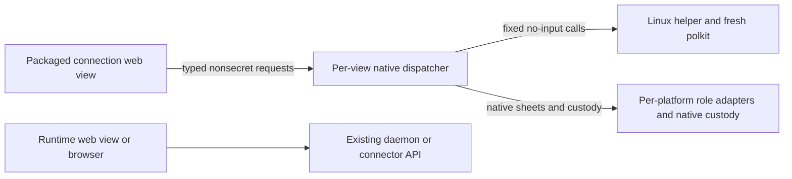

# Web UI to native connection bridge

18 November 2026 · TASK-17162 / root TASK-17160 · founder THR-379 seq2, seq10, seq12 · **Design proposal, not implementation or operating authority**

## 1. Scope, evidence and assumptions

Move connection presentation into shared web components while retaining native custody, permission prompts and exact-device approval. Use the selected in-process script-message bridge in a **separate, locally packaged connection web view**. Never attach this bridge to the runtime SPA web view, including the Mac's loopback proxy of a remote runtime. The connection view can work before connection and during daemon failure. It reuses the web build/design system; it is not fetched from the computer being connected to.

This PR updates this document only. It does not change authentication, helper methods, permissions, dependencies, existing screens, TASK-16779, installations or deployments. Engineering/security review and product review precede an implementation brief. Source inspection is not native or cross-device acceptance.

Source facts below are pinned to fetched `origin/main` **`87e4bea4220525712ffab7e751867feecfecd975`**. `file:line` references throughout refer to that tree. The original UX design merged as #1565; the current canonical file is [2026-11-16-one-click-remote-access.md](2026-11-16-one-click-remote-access.md), especially §§6–8. The founder rulings in this revision supersede conflicting platform-specific UI assumptions in that earlier design; they do not weaken its trust or R2 contracts. The additional UX authority is the supplied **Claude Design handoff**, `/home/benze/.happyranch/runtime/orgs/happyranch/workspaces/engineering_manager/output/TASK-16999/inputs/claude-design-remote-connection-handoff.md` (hereafter **H**, §§3, 5–11; state IDs L01–L20, M01–M23, X01–X08). H reconciles stale custom-server and trust-status paragraphs; it does not prove execution. The KB ruling `one-click-remote-access-fixed-operator-service-ruling` also removes custom-server selection and keeps home-network and outside-home acceptance separate.

### Settled requirements and explicit assumptions

- **Settled:** `call(command, data: string) -> Promise<string>` rejects with an error string; `on(eventName, handler(data: string))` returns unsubscribe. Native owns closed command/event allowlists (§7).
- **Settled:** a separate static connection web app is bundled inside **both** native apps (`app/mac/` and `packaging/linux/desktop/`) and opened from native controls. It runs without the daemon. The daemon-served SPA, plain browsers and remote paired runtime views get no bridge and hide this feature.
- **Settled role model:** HOST is the machine running the daemon being reached; CLIENT is the machine connecting remotely. Either Mac or Linux can serve either role. Public commands/events use `host.*` and `client.*`; platform names select native adapters, never product roles. Existing source names such as HOME, HomeInviteModel and Linux-specific UX IDs are historical implementation names, not restrictions on the target design.
- **Settled:** host invite display/copy, client invite paste/accept and device approval remain native, preferably small dialogs. Genuine OS permission UI shows the captured approval identity. Linux uses fresh polkit per mutation; the proposed Mac equivalent is detailed in §5.
- **Settled:** web screens replace the existing native connection screens. Those screens stay during development, then are removed when the web replacement ships (§10); they are not fallback screens. An unsupported/unsafe bridge is disabled and the **new** `happyranch connection` CLI supplies the same role actions (§9). No dependency-floor increase, web-process-extension substitution or loopback command API.
- **Assumption A1:** source at the pin above, not unmerged TASK-16779 work, defines what exists. R2's approved future methods are not assumed implemented. Missing methods remain unavailable until their authorized owner delivers them.
- **Assumption A2:** reuse existing React/TypeScript/Vite dependencies and design tokens, with a separate entry/build output; do not import authenticated runtime providers. Proposed paths/build commands below do not exist yet.
- **Assumption A3:** native OS, installed executable/bundle and protected backend are trusted. Web documents (including XSS in packaged content), network replies and labels are adversarial. Compromised administrators or arbitrary same-user native-code execution are outside the web-isolation claim.
- **Assumption A4:** supported native test venues and TASK-16779 backend/package deliverables will be available for implementation. Source inspection proves neither installed WebKit versions nor native/cross-device acceptance. No install, privileged registration or production change is authorized here.
- **Assumption A5:** the Mac host mechanism in §5 is a new proposal, not an extension already approved by R2. Founder decision and security qualification precede that implementation. Unsigned Mac **client** reconnect remains required and must not acquire a privileged-helper/signing dependency.

## 2. Step 0: current shells verified from source

| ID | Verified fact and source evidence |
| --- | --- |
| F1 | Linux verifies a release daemon port before returning `http://127.0.0.1:<port>/`: `packaging/linux/desktop/happyranch_window.py:548–559`. `show_web` creates `WebKit2.WebView`, connects `load-failed`, and calls `load_uri(url)`: same file `1027–1049`. It loads HTTP from the daemon, not a file/custom-scheme SPA. That construction passes no bearer or credential into the URL. |
| F2 | Linux selects GTK 3.0 and WebKit2 **4.1**: same file `902–907`. Debian packaging depends on `gir1.2-webkit2-4.1` without an engine-version lower bound: `packaging/linux/build-deb.sh:201–202`. “4.1” is the API/ABI namespace, not an engine version such as 2.40. |
| F3 | `runtime/remote_access/helper_control.py:27–30` defines only ApprovePending, RejectPending and RevokeSelected mutations. `runtime/remote_access/remote_access_helper.py:40–43` adds Status and NextDevice; generated D-Bus introspection has only an output string, no input. Dispatch rejects nonempty signatures/FDs and unknown methods at `145–152`. `scripts/test_remote_access_helper.py:249–254` explicitly expects unknown-method for Enable, Disable, ReplaceFailed, RefreshHomeAddress, IssueInvite and RetryPolicyRenewal. These approved future lifecycle methods are **not implemented D-Bus methods at this pin**. |
| F4 | Helper access checks the release UID, maintains a per-bus-caller selection cursor and captures the pending/selected protected record: `remote_access_helper.py:155–187`. Its polkit message includes the captured label, stable-ID fingerprint and comparison phrase; CheckAuthorization follows at `186–193`. After authorization it rechecks UID, snapshot, target and deadline before mutation: `233–245`; final precommit checks are at `254–264`. Policy uses `auth_admin`, not a keep authorization: `packaging/linux/polkit/ai.happyranch.remote-access.policy:4–18`. |
| F5 | The Linux card merged in [#1583](https://github.com/t-benze/happyranch/pull/1583) (`013c03905…`). Its `RemoteAccessPanel` is in `packaging/linux/desktop/happyranch_window.py:663–676`; it uses a dedicated bus connection and sends no supplied device identity. Request allowlist and zero-input `connection.call(..., None, ...)` are at `753–780`; pending/device buttons are at `854–877`. It is attached to startup/error content at `928–954` and around the runtime view at `1027–1042`. It is not a complete enable/invite/turn-off UI. |
| F6 | Mac `WebView` creates a JavaScript-enabled WKWebView with a navigation delegate and plain URLRequest: `app/mac/Sources/HappyRanchApp/ContentView.swift:55–71`. Local runtime URL construction is `http://127.0.0.1:<port>/`: `app/mac/Sources/HappyRanchSupervisor/RuntimeTransport.swift:16–22`. Healthy local probing sets `webViewURL`: `app/mac/Sources/HappyRanchApp/AppDelegate.swift:907–922,939–948`. The home-invite model's URL is observed into the same property at `87–90`. |
| F7 | Mac's managed client runtime is also HTTP loopback, but through **ClientBridge, an HTTP/SSE/WS proxy**, not a JS command bridge: `app/mac/Sources/HappyRanchSupervisor/ClientBridge.swift:43–64`. It intercepts bootstrap locally, strips SPA Authorization before forwarding (`1028–1042`), and returns a session credential (`1049–1063`). Device credential storage/injection remains native (`111–124,1145–1151`). Do not equate this proxy's loopback origin with locally authored content. |
| F8 | Mac navigation is unrestricted by this delegate when `verifiedHome` is false. When true, action URLs must match scheme/host/port; main-frame responses must be 2xx, match that origin and initially equal the expected root. Finish reports load only after that gate: `ContentView.swift:19–44`. There is no path/resource-bundle pin for all subsequent same-origin navigation in this gate. The flag is enabled for the managed client at `85–87`. |
| F9 | Neither shell currently installs a script-message handler or JS command bridge. Inspection of the web-view constructors (F1/F6), plus targeted searches across `packaging/linux`, `app/mac` and `web` for `WKScriptMessage`, `userContentController`, `UserContentManager`, `script-message`, `register_script`, `evaluateJavaScript`, `evaluate_javascript` and `webkit.messageHandlers`, found no registration/dispatch implementation. Linux's view construction has only the load-failed signal (F1); Mac has no WKUIDelegate/create-window implementation in `ContentView.swift:4–73`. There is no explicit Linux navigation/new-window/create policy in `show_web:1027–1057`, nor an explicit Mac popup policy in that wrapper. This describes app code, not a claim that framework defaults open or allow all popups. |
| F10 | The merged Mac connection work is [#1575](https://github.com/t-benze/happyranch/pull/1575) (`91ff3b7ae…`). `RemoteConnectionView.swift:178–231` contains the invite form, countdown, comparison phrase and cancellation. `HomeInviteModel.swift:8–27,35–65` owns home-client state with private credential/session members; `78–105` discovers saved homes and reconnects one saved home; `188–239` joins, pairs, waits, saves and opens. Its native load callback alone moves Opening to Connected (`334–350`). |
| F11 | `ManagedJoinModel.swift:9–54` is the older managed-network state model; do not mistake joined/online there for the home invite flow's loaded-UI criterion. `ManagedConnectionHealthView.swift:11–39` refreshes a native health record only while visible/active, on demand or every 60 seconds. The current home overlay is `HomeSessionStatus`, preserving save-failure UI over WKWebView: `ContentView.swift:285–313`. These are distinct seams to adapt, not evidence that all health presentation is already unified. |
| F12 | Saved credentials bind home/control-plane/stable-node identity, not display names, and keep the bearer private/redacted: `app/mac/Sources/HappyRanchSupervisor/SavedDeviceAccess.swift:4–49`. `LoginKeychainDeviceStore.swift:10–21,40–79,93–110` uses the login Keychain, a current-executable trusted-app ACL, nonsynchronizing records, create-only ordinary save and readback validation. No new JS serialization of these types is acceptable. Native removal stops the session, removes network state, then deletes the exact Keychain binding and records partial failures: `HomeInviteModel.swift:440–457`. |
| F13 | The web bundle is shared, not selected by shell detection: `runtime/daemon/routes/web_static.py:81–110` mounts assets, serves index at `/`, and falls back to index for SPA routes. `web/src/lib/auth.ts:21–39` bootstraps a relative `/api/v1/auth/bootstrap` and caches its bearer in sessionStorage; `web/src/lib/api/client.ts:81–92` sends it on same-origin requests. Targeted searches of `web/src` found no WebKit handler/native-host/UA-based shell capability detection. “Shell” in AppShell is web layout, not native authority. |
| F14 | Local daemon bootstrap already returns the master bearer to loopback SPA JS: `runtime/daemon/routes/auth.py:31–45`. The new bridge must not claim to remove this existing exposure. Remote gateway processing strips remote headers, reads the daemon bearer only for the verified loopback hop, and forwards through tracked streams: `runtime/remote_access/gateway.py:310–355`; injection is in `runtime/remote_access/forwarding.py:258–260`. Allowed HTTP relays response bytes: `runtime/remote_access/httpd.py:149–169`. Together with F13 this is how the same SPA/assets reach paired remote devices without embedding a native command channel. |
| F15 | Mac `SurfaceAllowList` is a method/route-sensitive **HTTP remote-surface** gate (`app/mac/Sources/HappyRanchSupervisor/SurfaceAllowList.swift:5–17,318–361`), denying bootstrap/registration remotely at `62–71`. It is not an origin/frame/navigation or JS-message gate. The Linux gateway similarly applies current policy and route matching (`runtime/remote_access/gateway.py:219–224,255–287`). Preserve both independently of the proposed bridge. |

### Inventory by role and platform: existing code versus missing work

These are source findings, not runtime verification. In addition to the cited definitions, targeted searches of `app/mac/Sources`, `packaging/linux/desktop`, `app/linux`, `runtime/remote_access` and `cli` covered host/client, invite, pairing, saved access, script handlers, SMAppService, XPC and Authorization Services. A reusable codec or installer does not prove a complete role adapter exists.

| Role / platform | Exists at the source pin (file:line) | Missing for this design / explicit qualification |
| --- | --- | --- |
| **Linux HOST** | `remote_access_helper.py:40–43,145–176` and `helper_control.py:27–30` expose **Status, ApprovePending, RejectPending, NextDevice, RevokeSelected** only. Native card dispatch is `happyranch_window.py:753–773`. `runtime/remote_access/invite_issuer.py:128–139` has an issuance core; `home_minter.py:107–110,217–235` has bounded mint/recovery logic. | Expected inventory **confirmed at the D-Bus seam**: **Enable, TurnOff (backend spelling Disable), IssueInvite are missing**. A core issuer/minter is not a wired IssueInvite method. No complete lifecycle UI, bridge adapter or native invite dialog. TASK-16779 owns lifecycle/security/recovery integration; this bridge must not call raw installer/admin paths to fill the gap. |
| **Mac HOST** | Local HOME role exists (`ConnectionRole.swift:24–41`). **Legacy DIY host support exists:** `AppDelegate.swift:1058,1090–1138` starts/stops HomeConnector, generates a pairing code and revokes a credential; `RemoteConnectionView.swift:29–148` shows address, code, devices and revoke. `HomeConnector.swift:208,246,300,441–469` owns listener lifecycle, live revoke and code redemption; `RealPairingStore.swift:97,108,134,178` owns code/pair/revoke/list. Separate current-user managed launchd installation exists (`runtime/remote_access/launchd_installer.py:1–6,560–572`). | **Not an empty host implementation, but not the required managed host ceremony.** No managed single-invite Enable/TurnOff/IssueInvite + pending-device Approve/Reject adapter, no trusted captured-device OS authorization prompt, no SMAppService/XPC/Authorization Services implementation in `app/mac/Sources`. DIY Generate Pairing Code is not IssueInvite, Start/Stop Connector is not managed Enable/TurnOff, and credential-parameter revoke cannot become a JS command. New managed host backend integration, protected selection and approval mechanism are needed. The launchd installer requires pre-provisioned config and is not an app-driven invite ceremony. |
| **Linux CLIENT** | GTK desktop lifecycle and runtime view exist (`happyranch_window.py:902–907,1027–1049`); its remote panel is the **host's** five-method D-Bus client (`663–676,753–773`). Shared invite/remote protocol modules exist, but their presence does not supply a Linux connecting-client app. | No Linux desktop invite accept/join/pair/wait/load state model, saved remote-access custody/reconnect/removal, client transport adapter or native paste dialog found in that source surface. New Linux client implementation and a platform-appropriate private credential store are required; do not miscount the host panel as this role. Secret-store choice remains open (§11). |
| **Mac CLIENT** | **Expected models confirmed:** HomeInviteModel phases/custody (`HomeInviteModel.swift:8–60`), saved discovery/auto-reconnect (`78–105`), invite join/pair/save/open (`111–239`), reconnect (`260–286`), save retry (`290–318`), native loaded-UI gate (`336–350`), cancel/retry (`395–422`), staged removal (`431–457`). Older ManagedJoinModel exists (`ManagedJoinModel.swift:9–54,171–200,265–299`); saved access/Keychain are F12. HomeInviteSession is `HomeInviteSession.swift:111–123`. | Needs bridge adapter, nonsecret projection and small native paste/target dialogs replacing the full connection form. Preserve unsigned saved reconnect, exact bindings, partial cleanup, persistent save failures and native loaded-UI criterion. Older managed/DIY models are not a substitute for the current single-invite flow or permission to expand manual-server UI. |

All four combinations lack the proposed JS bridge and separate static connection app (F9). **Inventory surprise versus a simple platform rename:** Mac already has legacy host behavior, while managed Mac host and Linux client need substantial new work. No source finding contradicts the brief's expected Linux-helper or Mac-client inventory. Existing strings such as “Awaiting Linux approval” (`HomeInviteModel.swift:19`) expose the old platform assumption; the later role-adapter/web slices must replace them with host terminology, without editing that code in this PR.

### Static app build and packaging boundary (proposed, not shipped)

| Boundary | Concrete target and existing packaging seam |
| --- | --- |
| Shared source/build | Put the independent entry, facade and screens under **`web/connection/`**, with `index.html`, `src/` and `vite.config.ts`; define future **`npm run build:connection`** in the existing `web/package.json`. Use existing React/TypeScript/Vite (`web/package.json:8–11`), the existing lockfile and self-contained local fonts/styles. Emit **`web/dist-connection/`** plus a literal resource manifest; never merge it into `web/dist/`, import `web/src/App`/auth bootstrap/router, or register its entry with the daemon. Shared pure components/tokens are permitted; audited imports must not drag in runtime network providers. No top-level dependency addition. |
| Mac bundle | Extend **`app/mac/scripts/build-app.sh`** to build this target in its existing isolated packaging producer and copy `dist-connection/` to **`HappyRanch.app/Contents/Resources/Connection/`** before sealing/signing. Current seams build web at `:306`, create Resources at `:317`, and copy daemon web assets at `:340`; those daemon assets remain separate. `Package.swift:50–54` currently defines the app target without connection resources. Native resolves the Connection directory from the app bundle, not a daemon URL or user preference. |
| Linux package | Extend **`packaging/linux/build-payload.sh`** to build/copy the same output to **`share/happyranch/desktop/connection/`** beside `happyranch_window.py` (existing desktop-copy seam `:190–192`; daemon-web copy `:154`). `packaging/linux/build-deb.sh:116–118,131–148` validates/stages that payload under **`/opt/happyranch-desktop/`**; add connection-manifest validation to that future seam. The desktop loader resolves its installed package prefix, independent of `HAPPYRANCH_WEB_DIST`/daemon state. No package floor change (`build-deb.sh:201–202`). |
| Native loading / isolation | Both native apps register a dedicated asset-only scheme, proposed **`happyranch-shell://connection/index.html`**, on their separate connection view: WKURLSchemeHandler / WebKitGTK URI-scheme handler. Pin the exact native-owned view, canonical origin and manifest entry, with bounded literal resource lookup; reject traversal, unknown paths, symlinks escaping the bundle and all network origins. Do not use `file://` with broad file access. If a target cannot establish the custom origin and frame rules, disable the bridge and use §9. Scheme URLs never carry commands/secrets. |
| CSP / network boundary | Package a CSP enforced by the loader: `default-src 'none'; script-src 'self'; style-src 'self'; img-src 'self'; font-src 'self'; connect-src 'none'; frame-src 'none'; object-src 'none'; base-uri 'none'; form-action 'none'`. Only manifest-local external scripts/styles; no inline/eval, remote resources, service workers, HTTP/WS API, iframe or popup. Native resource policy independently restricts requests to the manifest. Test engine-specific custom-scheme CSP/origin serialization; never authorize an opaque `null` origin. The daemon serves only its ordinary SPA (F13), with no injected facade or connection route. |

## 3. Selected transport and compatibility boundary

Use in-process script messages in the separately packaged view: WithReply on Mac and a named-world UserContentManager on Linux. The custom scheme serves assets only. Loopback HTTP/WS commands, daemon-mediated bridge routes, OS deep-link commands and an additional web-process extension are not selected alternatives. If an existing supported engine cannot prove isolation/structured delivery, disable its bridge and use the new CLI; do not raise dependency floors.

API evidence: Apple documents [WithReply](https://developer.apple.com/documentation/webkit/wkscriptmessagehandlerwithreply), [frame information](https://developer.apple.com/documentation/webkit/wkframeinfo) and [content worlds](https://developer.apple.com/documentation/webkit/wkcontentworld). The target is macOS 14 (`app/mac/Package.swift:25`), so use a named content world, a main-frame-only user script and WithReply. A plain handler plus structured callback is an internal transport alternative; either preserves the same §7 `call`/`on` facade.

On GTK API 4.1, ordinary [script-message-received](https://webkitgtk.org/reference/webkit2gtk/stable/signal.UserContentManager.script-message-received.html) dates from engine 2.8; [named-world registration](https://webkitgtk.org/reference/webkit2gtk/stable/method.UserContentManager.register_script_message_handler_in_world.html) from 2.22. [register_script_message_handler_with_reply](https://webkitgtk.org/reference/webkit2gtk/2.40.2/method.UserContentManager.register_script_message_handler_with_reply.html) and [script-message-with-reply-received](https://webkitgtk.org/reference/webkit2gtk/stable/signal.UserContentManager.script-message-with-reply-received.html) are available from **2.40**, including asynchronous replies. F2 does not guarantee that engine on every supported installation. Probe GI method/signal availability; use WithReply on qualifying targets, otherwise named-world messages plus correlated native delivery into that same world. Neither callback signature supplies Mac-style frameInfo. Never pretend `view.get_uri()` alone authenticates the sending frame. Test the isolation construction in §4 on minimum supported GTK targets before enabling mutations; missing proof/support disables the bridge and directs the operator to the new CLI (§9), without a dependency upgrade or network command API.

## 4. Recommendation and load-bearing threat model

### Placement and lifetime

Create a dedicated connection view with its own content manager/controller, web context/data store and local asset loader. Serve the fixed packaged entry at `happyranch-shell://connection/index.html`; this spelling is proposed, not an existing scheme. Resolve only a literal, bounded bundle manifest, never arbitrary filesystem paths, network fetches or caller URLs. No runtime API auth/bootstrap runs in this entry point. Use a separate origin and storage partition from daemon and ClientBridge content; no runtime cookies, service workers, web caches or authenticated app providers belong here.

The runtime WebView continues to load the existing local daemon or remote proxy. **It has no handler, injected facade, message forwarder or reference to the control view**, even when its URL is 127.0.0.1. A native menu/button opens the connection view while the runtime is loaded, starting, disconnected or failed. Keep the native Connection menu/button as the entry point, never a replacement native connection screen. On bridge failure it shows a short unavailable notice and CLI instructions, with no connection action controls. The normal browser-served SPA does not mount the connection feature or receive the facade.



### Native admission rules

1. **View identity:** register exactly on the connection view created by native code. Never on a shared default controller/manager. Native stores a document generation and loader identity. JS-provided origin, platform, frame flag, nonce, capabilities or request ID cannot grant access.
2. **Origin and resource pin:** accept only the exact canonical scheme/host/port and fixed entry resource loaded from the packaged manifest. No wildcard suffix, `localhost` alias, dynamic port heuristic, remote alias, file URL, `about:blank`, `data:`, `blob:`, inherited-origin document or arbitrary same-origin path. Hash-only UI state may stay in-document; it grants no navigation authority. Verify custom-origin serialization on both engines rather than accepting a generic opaque `null` origin.
3. **Frames/content worlds:** inject the facade/relay only into the main frame at document start. Use named isolated worlds; no direct page-world native handler. The small page facade exposes only §7 `call`/`on` and intentionally relays the closed schema to the isolated relay. Its fixed event dispatcher and transport callbacks stay internal, not additional page-visible methods. Accept relay messages only from the same top-level window and exact admitted document; no cross-window forwarding. On Mac also check native `message.webView`, `frameInfo.isMainFrame` and frame request/security origin on **every** message. Keep the generation/dispatch capability in native/isolated state, not in DOM or localStorage.
4. **GTK frame gap:** top-frame injection alone does not restrict where a globally registered channel could be used. Bind the handler only in the named world, inject relay code only in the admitted main frame, and allow no child frames at all in this control view. Enforce packaged CSP `default-src 'none'`, manifest-local script/style assets, `frame-src 'none'`, `object-src 'none'`, `base-uri 'none'`, `form-action 'none'`, `connect-src 'none'`; forbid inline/eval/remote scripts. Native navigation/resource policy must also refuse subframes, popups and embedded documents, including same-origin, srcdoc and inherited-origin cases. The GTK feasibility case must show no child frame can reach the handler/relay, including by accessing parent objects. If GTK cannot enforce this on a supported target, disable that bridge and report the gap; do not replace frame provenance with a JS `isTop` claim. Mac uses these document restrictions too.
5. **Navigation/popup pin:** cancel all out-of-manifest navigation, redirects, form targets, new-window and popup requests. Never copy a privileged configuration to a popup. Help links require an explicit native allowlisted external-open action and a separate unprivileged browser, not an arbitrary `openURL` bridge command. Any navigation start, redirect attempt, load failure, process crash, role change or view destruction immediately suspends admission, unregisters/detaches handlers and subscriptions, and invalidates its generation. Returning/back or loading the same URL does not restore authority: create a fresh connection view after a successful native loader admission. Check again before delivering every result/event.
6. **Execution lifetime:** serialize mutations; no prompt queue. Exempt `client.cancelAttempt` from the busy refusal for the attempt it targets: Cancel stays reachable during join, wait and load, with native confirmation and safe-point handling as specified in §7. Revalidate captured native target and generation before invoking the backend. A navigation cancels uncommitted work where safe and disconnects its dedicated bus caller; it is not proof an already-started mutation rolled back. Committed/uncertain effects stay in native state for an explicit new snapshot. Never deliver a stale completion to a replacement document or automatically replay it.

Content-world separation protects relay variables, **not the shared DOM or the user's interpretation of web UI**; Apple explicitly documents that distinction. Frame/origin rules constrain reachability, not XSS inside the admitted main document.

### Concrete adversaries and residual effects

| Scenario | Required result / residual risk |
| --- | --- |
| Paired device loads the same SPA through the connector, including inside its Mac runtime view | No native command channel. The Mac's native Connection menu opens its separately packaged local controls. Remote web scripts cannot create/open/control that privileged view or post messages into it. Existing paired runtime privileges remain governed by connector policy; pairing does not grant Linux helper authority or access to Mac credentials. |
| Plain browser opens the local daemon or guesses the control scheme | No registered native view/handler or injected facade; hide the connection feature. A scheme string, UA, global flag, matching bundle, facade presence or spoofed hello response is UX only, never admission. No HTTP route or port exposes these commands. |
| A malicious page is reached by navigation/redirect or tries window.open | Deny before content commits; suspend the old generation on the attempted transition. No inherited handler after redirect, history restore, blank popup, scheme switch or crash recovery. No response is sent into the new page. |
| Iframe or other window sends a forged envelope | Deny by native frame check on Mac and the tested frame-free/isolated-world construction on GTK. Never use claimed origin/frame fields. Same-origin parent access is included in tests, not assumed safe. |
| XSS in the ordinary runtime SPA | Can misuse the runtime privileges already held there, including existing local bootstrap exposure (F14). Cannot reach the native bridge in a separate view/partition. This proposal does not solve the daemon's existing bearer/XSS model. |
| XSS in the packaged connection UI | Can use `call`/`on` to read allowed status/labels, falsify web presentation, request allowed actions and cause prompt/availability pressure. String payloads still require closed-schema validation; event names remain fixed and data never becomes JS source. It cannot read invites, keys or Keychain bearers through this schema, supply Linux helper parameters, forge protected device identity, bypass fresh native permission or silently confirm destructive Mac actions. Bounds/no queue and native confirmations limit abuse; they do not make XSS harmless. |
| Malicious label or lookalike approval UI | Render labels as bounded text with controls/bidi handled; never HTML. An XSS/lookalike page can spoof any web approval prompt, comparison phrase or green badge. Actual approval must show the helper-captured device in native trusted UI (§5). Do not ask for OS credentials in HTML. |

## 5. R2 and native approval stay authoritative

For Linux, map each advertised command to one literal helper method and always call it with **zero inputs**. No device ID, fingerprint, label, address, URL, path, argv, config, environment, enrollment key, policy or auth flag supplied by JS crosses into D-Bus. Request IDs and UI metadata stop at the unprivileged dispatcher. The helper's protected release identity, fixed paths, caller UID checks, cursor and captured-record checks remain unchanged (F3–F5).

Use the dedicated bus connection per connection view; NextDevice cycles its helper-owned cursor. The web screen may show the current selection, but cannot select a Linux record by ID or race a supplied ID into approval/revoke. Disable cursor changes while an operation is in flight; the helper still enforces its own invariants. Each mutation starts a **fresh polkit prompt**, never a cached grant, remembered permission or bundle-level blanket consent. Enable/turn-off/issue and recovery commands can only be advertised after TASK-16779's separately authorized native lifecycle slices provide their fixed authenticated methods. The bridge never implements them with shell commands or alternate daemon routes.

**Chosen trusted approval indicator: the genuine polkit dialog's helper-composed text.** Preserve the actual captured OS-derived label, stable-ID fingerprint and comparison phrase currently supplied at `remote_access_helper.py:183–193`. Show the selected release runtime in native shell context; future helper lifecycle work must ensure the dialog or a tightly bound native confirmation identifies that runtime too. A web screen can explain the comparison, but its “Approve” click only requests the native ceremony. The protected record shown natively is the one revalidated/committed; a web label or screenshot is never the authority. Native qualification must demonstrate the supported desktop polkit agent actually renders that text accessibly; if it does not, hold approval and return the native-indicator gap to EM rather than silently falling back to HTML. A GTK sheet alone that trusts a JS-supplied identity is not an equivalent substitute.

For CLIENT on either platform, accepting an invite opens a small native paste/target-confirmation dialog. Remove saved computer and explicit saved-access replacement use a native default-Cancel sheet showing the captured local computer/binding description and precise local-only effect; connect/disconnect/cancel requests must receive native confirmation when initiated from web content. The dispatcher resolves any client saved-computer reference against its current native snapshot and revalidates after confirmation. A stale ref fails `stateChanged`. Existing automatic reconnect at native app startup can remain a native policy (F10); read/subscribe calls must not start new custody prompts or connections.

### Mac HOST: concrete proposed approval/privilege mechanism

**Recommendation: a new SMAppService LaunchDaemon with a narrow XPC interface, plus per-action Authorization Services. This is a NEW privileged mechanism the founder has not yet seen or approved.** Existing HomeConnector, current-user launchd installer and login Keychain do not provide it. This document proposes it for founder/security review only; it grants no helper installation, entitlement, authorization-database change or backend implementation. Do not make unsigned Mac client reconnect depend on this helper.

1. Bundle a fixed host helper and launchd plist inside the Mac app, registered through **SMAppService**. Run only the host service/custody operations that require this boundary; do not elevate the web view, entire app, daemon or ClientBridge. The fixed service owns the managed host's protected trust/selection records and uses approved backend integration from TASK-16779; it must not import the Linux systemd installer as a Mac implementation. Apple's [SMAppService documentation](https://developer.apple.com/documentation/servicemanagement/smappservice) supports app-bundled agents/daemons; registration approval alone is **not** per-device approval.
2. Permit only an installed, verified HappyRanch native app and its shipped CLI via XPC peer audit-token/code-identity checks and bound release UID/runtime. Match the peer executable's supported signing identity and bundle installation; no process-name/PID-only trust, arbitrary same-user clients, JS-supplied caller identity or arbitrary XPC object decoding. Define only fixed zero-input host action methods and bounded output projections; separate authorization-handshake metadata binds the helper-generated pending operation to its captured XPC peer and is never an action target argument or JS API; keep one helper-owned pending/selected target, one outstanding mutation and a deadline. Host Status/Next are non-authorizing; invite output is delivered only over this native channel to the native dialog, never serialized into JS.
3. For every mutation, the helper captures the protected target/runtime/generation and creates a one-shot pending operation. A native app/CLI approval coordinator uses a fresh **Authorization Services** reference and a per-action custom right with no shared/cached authorization, zero credential timeout and interaction required. The authorization prompt environment contains helper-composed action, runtime, sanitized actual device label, stable-ID fingerprint and comparison phrase. No web-supplied identity/prompt text. Never supply passwords or accept an HTML approval. Apple documents prompt data in [AuthorizationCopyRights](https://developer.apple.com/documentation/security/authorizationcopyrights(_:_:_:_:_:)) and warns that authorization can otherwise reuse cached credentials in [Authorization Concepts](https://developer.apple.com/library/archive/documentation/Security/Conceptual/authorization_concepts/02authconcepts/authconcepts.html).
4. Bind the native authorization exchange to that one helper-held operation and XPC peer; the helper verifies the granted exact right, rechecks target, generation, peer/UID, release binding and deadline immediately before commit, consumes the operation once, then destroys the authorization rights/reference. No preauthorization, grant reuse, queued prompts, arbitrary target arguments or generic privileged execute/install/config API. Cancellation/disconnect/timeout refuses before commit where provable; after dispatch, lost results remain unknown. A target swap requires a new ceremony.
5. **Qualification requirement, not a claimed property of the APIs:** a real OS-owned authorization prompt must display the complete captured identity accessibly, and every mutation must demonstrably prompt afresh. Fresh references alone do not prove this. A helper authorization token/right alone is not a durable operation authorization. If prompt rendering, peer validation, freshness or operation binding cannot be proven, keep Mac host mutations unavailable and return the gap to the founder. A custom native sheet, LocalAuthentication success without target binding, or System Settings helper approval alone cannot substitute for the required identity-bearing OS prompt.

Threat model: packaged-page XSS can request a permitted mutation or spoof web labels, but cannot select the helper's device, read invitation/signing material, forge a signed XPC peer or commit without the genuine OS ceremony. Malicious network/label data cannot choose privileged paths or code. Rate limits/no prompt queue constrain abuse. Root/helper compromise and an administrator replacing the app remain outside this claim; code signing alone does not protect a compromised allowed app. The new root service, custom rights, signed-helper distribution/update/removal and unauthorized-peer rejection add attack surface and review cost. **Unsigned Mac HOST distribution/identity validation is unresolved**; recommend qualifying a signed host artifact separately while preserving unsigned client support, with no unsigned “accept any peer” bypass. This is an explicit founder decision (§11), not an assumed signing requirement for clients.

## 6. Secrets and data minimization

| Material | Custody and web exposure |
| --- | --- |
| HOST invite, pair secret, join/enrollment key (both platforms) | Keep issuance result in native memory; display/copy the complete invite in a native sheet. Bridge returns only issuance outcome and authoritative expiry when supported. No raw invite/QR bytes in DOM, request/reply, event or clipboard-read command. Native Copy is an explicit user action; clipboard history/other apps are a residual risk, not erased by closing a sheet. Never automatically reissue after delivery uncertainty. |
| CLIENT accepted invite (both platforms) | **Require a small native paste/accept dialog**, not a web textarea. JS requests `client.acceptInvite` with the string `"{}"`. Native reads clipboard only after an explicit user paste, parses/validates and confirms the target; it clears the draft and reports nonsecret stage/outcome. Do not auto-read the clipboard. Native deep-link intake remains native and obeys the same confirmation path. A web invite field is technically feasible but would expose its complete enrollment authority to XSS, extensions, form instrumentation and errors; there is no strict need, so reject it for v1. |
| Saved device bearer, pending completion handle, private keys, home CA signing material, Keychain record bytes | Never serialize into bridge types. Keep SavedDeviceCredential/LoginKeychainDeviceStore and strict home transport behind native adapters. Linux client credentials require equivalent native custody once its store is selected (§11). No “debug”, get-secret, export-key, arbitrary clipboard or generic fetch/execute escape hatch. Public status must be a hand-written projection, not Codable/JSON serialization of internal models. |
| Existing web bearer | Existing runtime SPA bootstrap/sessionStorage exposure (F13/F14) remains in its unprivileged runtime view. It does not authenticate native commands and never enters the packaged control entry. Changing daemon auth is outside this proposal. |
| Display metadata | Allow bounded computer labels, home-network/operator context, deadlines, coarse state, comparison phrase where needed, and local opaque computer refs. Keep device fingerprints in privileged native comparison/details UI. Do not emit endpoints, node keys, internal paths, CA DER or full trust records to web diagnostics. Labels are not identity proof. |

No request/response bodies, invite fragments, bearer values, raw native exceptions, decoded invite fields or clipboard contents in logs, telemetry, console, accessibility announcements or error strings. Use closed error codes and localized web-owned copy. No analytics/session-replay instrumentation in the control entry. Crash/error handling must redact before serialization; debug builds do not get an exception. An optional support export needs a separately reviewed existing redacted channel; none is added here.

## 7. Shared typed protocol v1

One language-neutral closed schema, proposed under `protocol/native-connection-bridge.v1.json`, should define TS, Swift and Python projections/adapters without adding a top-level dependency. This path and generated artifacts are future scope, not files in this PR. Keep transport code separate from commands and model projections. Validate at runtime in native code even when TS types pass.

### JS-facing API (founder THR-379 seq2)

A native-injected object exposes exactly these two functions as the **only page-visible bridge surface**, in the admitted control document's page world only (§4). Its native transport/relay lives in the named isolated world; no facade is injected into runtime, browser, remote, child-frame or replacement documents. The object name is an implementation choice.

```ts
call(command: string, data: string): Promise<string>
on(eventName: string, handler: (data: string) => void): () => void
```

`call` sends a closed command ID asynchronously. `data` carries the proposed versioned schema's JSON `args` text (for example, `"{}"`); the resolved string carries its JSON `result` text. Native parses and strictly validates against the negotiated version, command and unchanged size bounds below. The facade/transport owns the envelope and `requestId`/version correlation internally, with no extra caller parameters. Failure rejects with a **string** carrying a closed JSON error object (`code`, `effect`, `recovery`), never an Error object or free-form backend message. Normalize facade/transport failures to that vocabulary with truthful effect semantics.

`on` accepts only the closed native event list: **`host.stateChanged` and `client.stateChanged` in v1**. The handler receives the proposed versioned snapshot/event JSON as a string. Unknown names throw/refuse locally before transport; native never emits names outside the list. The returned unsubscribe function detaches the listener; `on`/unsubscribe manage the existing one-per-view native stream internally, subject to generation teardown. The fixed dispatcher stays internal; no page-supplied callback name or executable string.

Absence of the facade means plain-browser behavior: hide the feature. Facade presence and a hello result are UX detection only, never authorization; native admission still governs every real request and delivery.

### Mapping the facade to native transports

These are adapter choices under §4, not additional JS APIs. Both deliver into the fixed isolated-world dispatcher, which relays only to the admitted control facade/listeners. Pass event names and JSON strings as structured arguments; never concatenate/interpolate command, result, event name or data into JavaScript source.

| Platform | `call` request/reply | Native event delivery for `on` |
| --- | --- | --- |
| Mac | The isolated relay uses [`WKScriptMessageHandlerWithReply`'s `postMessage`](https://developer.apple.com/documentation/webkit/wkscriptmessagehandlerwithreply) request/reply. Native validates the internal envelope and returns a structured success/error envelope; the facade resolves its result JSON string or rejects its closed error JSON string. Raw WebKit/backend errors never reach the page. | [`callAsyncJavaScript(_:arguments:in:in:completionHandler:)`](https://developer.apple.com/documentation/webkit/wkwebview/callasyncjavascript(_:arguments:in:in:completionhandler:)) invokes fixed dispatcher code with `eventName` and event JSON in `arguments`, targeting the admitted main frame and named content world (or equivalent structured delivery). Recheck generation before delivery. |
| Linux | The named-world [`register_script_message_handler_with_reply`](https://webkitgtk.org/reference/webkit2gtk/2.40.2/method.UserContentManager.register_script_message_handler_with_reply.html) handler receives `postMessage` via `script-message-with-reply-received` and replies asynchronously. The same internal envelope validation and facade string/error conversion apply. | [`webkit_web_view_call_async_javascript_function`](https://webkitgtk.org/reference/webkit2gtk/2.42.3/method.WebView.call_async_javascript_function.html) invokes fixed dispatcher code with `eventName` and event JSON in its `GVariant` arguments dictionary and named `world_name`, targeting the main frame (or equivalent structured delivery). Recheck generation before delivery. |

The GTK reply handler and `call_async_javascript_function` require engine 2.40; the 4.1 namespace alone proves neither. Preserve §3's installed-method/signal probes, named-world correlated-reply fallback and §4's frame-isolation proof. An older target needs equivalent structured delivery in that same world; if unavailable or unproven, disable the bridge and use the new CLI (§9). No interpolated-JS fallback, dependency-floor change or network command API is authorized. The facade adds no third function or change to the existing bounds.

### Internal transport schema

Illustrative wire shapes, with synthetic nonsecret values; these envelopes are internal to the facade/transport, not extra `call` parameters or resolved objects:

```json
{"protocol":"happyranch.connection","version":1,"requestId":"r1","command":"host.status","args":{}}
{"protocol":"happyranch.connection","version":1,"requestId":"r1","ok":true,"result":{"setup":"ready","runtime":"available","observation":"known","devices":[],"pending":null,"selected":null,"inviteState":"unknown","expiresAt":null}}
{"protocol":"happyranch.connection","version":1,"requestId":"r1","ok":false,"error":{"code":"permissionDenied","effect":"none","recovery":"explicitRetry"}}
{"protocol":"happyranch.connection","event":"client.stateChanged","data":{"version":1,"sequence":7,"observedAt":"2026-11-18T02:00:00Z","snapshot":{"stage":"opening","runtime":"unknown","savedAccess":"saved","route":"unknown","observedAt":"2026-11-18T02:00:00Z","observation":"known","computers":[{"computerRef":"c1","label":"Home computer"}],"activeComputerRef":"c1","expiresAt":null,"comparisonPhrase":null}}}
```

These are envelope examples; command results are discriminated types, not one arbitrary object. Reject extra keys, missing keys, invalid enum values, nested unknown fields and noncanonical types; booleans are not integers. Strings are bounded UTF-8 plain text. No executable callback strings or interpolated JS. Native event/reply delivery uses structured serialization and a fixed receiver, addressed to the admitted world/document.

| Native command allowlist | Parsed `data` / resolved string contents | Per-platform native adapter |
| --- | --- | --- |
| `bridge.hello` | `{"minVersion":1,"maxVersion":1}` → `{version:1, platform, roles, capabilities, observationLimits}` | Both native dispatchers; `platform` is `mac` or `linux`, `roles` uses `host`/`client`. No permission prompt or implicit role switch. |
| `host.status` | `{}` → HostSnapshot | Linux Status; Mac new managed host Status (§5). Neither assumes readiness from process presence. |
| `host.enable` | `{}` → ActionResult | Linux future fixed Enable; Mac future fixed Enable; actual lifecycle integration owned by TASK-16779. |
| `host.turnOff` | `{}` → ActionResult | Linux future fixed Disable; Mac future fixed TurnOff; not daemon Stop or legacy connector Stop. |
| `host.createInvite` | `{}` → ActionResult with `inviteState` and authoritative `expiresAt` or null | Both future fixed IssueInvite paths; native display/copy only. Never invite bytes in the result. |
| `host.approveDevice`, `host.rejectDevice` | `{}` → ActionResult | Linux ApprovePending/RejectPending; Mac future fixed ApprovePending/RejectPending with protected capture and genuine OS approval. |
| `host.nextDevice` | `{}` → HostSnapshot | Linux NextDevice; Mac future helper-owned NextDevice. No supplied device ID/cursor. |
| `host.revokeDevice` | `{}` → ActionResult | Linux RevokeSelected; Mac future RevokeSelected. Never pass a credential or web-selected device identity. |
| `client.status` | `{}` → ClientSnapshot | Mac model projection; Linux new client owner. Read-only, without starting credential reads, prompts or reconnect. |
| `client.acceptInvite` | `{}` → ActionResult | Mac native paste/target dialog → HomeInviteModel.accept; Linux new native dialog and client owner. Native owns the raw invite throughout. |
| `client.savedComputers` | `{}` → `{computers:[{computerRef,label}], savedAccess, observation}` | Mac saved discovery projection; Linux future saved-access store/model. Neither returns trust blobs or credentials. |
| `client.connectSaved`, `client.removeSaved` | `{"computerRef":"c1"}` → ActionResult | Mac reconnect/staged removal; Linux new equivalents. Ref ≤64 bytes, bound to current native snapshot/view, never a path/bearer/host device ID. Resolve and revalidate in native after confirmation. |
| `client.disconnect`, `client.cancelAttempt`, `client.retry`, `client.retrySave` | `{}` → ActionResult | Mac existing model functions with required confirmation/cancel semantics; Linux new equivalents. Disconnect preserves saved access; remove is local-only; retry never reuses spent authority. |
| `client.health` | `{}` → `{access,runtime,route,observedAt,observation}` | Mac F11 adapters; Linux new client health projection; unsupported/stale fields stay unknown. |

The entries above are the **entire page-callable command allowlist**, shared on both platforms. There is no `state.read` shortcut, generic execute/fetch or platform-namespaced command. Future `host.replaceFailed`, `host.refreshHomeAddress`, `host.retryPolicyRenewal` and host invite cancellation are reserved design gaps, **not v1 callable names**. Native rejects them as unsupported until a separately versioned schema/backend change. Native keep-running/runtime controls remain separate app functions. A role capability is exposed only when its actual backend is available, never because that OS usually plays that role.

Closed result projections (JSON object syntax describes the parsed contents; **all facade payloads remain strings**):

- **HostSnapshot:** `{setup, runtime, observation, devices, pending, selected, inviteState, expiresAt}`. `setup` is `off/pending/ready/paused/failed/unknown`; `runtime` is `available/offline/restarting/unknown`; `observation` is `known/stale/unavailable`. Devices (≤32), pending and selected expose only `{label, comparisonPhrase}`; unavailable lists are null rather than empty. No credentials, IDs, fingerprints or internal paths. `inviteState` is `none/issued/expired/used/unknown`, and `expiresAt` is an authoritative UTC string or null. A backend without a signal returns unknown/null, never a guessed expiry/reason.
- **ClientSnapshot:** `{stage,runtime,savedAccess,route,observedAt,observation,computers,activeComputerRef,expiresAt,comparisonPhrase}`. Stage and custody enums are below; `computers` uses the saved-computers projection, null if unavailable; active ref and optional deadline/phrase are null unless known. A phase-only backend does not invent a separate saving stage.
- **ActionResult:** `{effect,hostDenial,hostCleanup,localCleanup,networkCleanup,inviteState,expiresAt,host,client}`. Effect is `none/confirmed/unknown`; each cleanup and host-denial dimension is `confirmed/incomplete/unknown/notApplicable`. Host/client are fresh snapshots or null when not relevant/observable; invite metadata is null/unknown unless supported. Opening a dialog is acknowledged with `effect:none`; a subsequent event or completed native result records the outcome. Never call dialog-open, request dispatch or an optimistic web change a completed mutation.
- **Health:** access is `allowed/accessDenied/revokedConfirmed/unknown`, route is `direct/relay/unknown`; observation time is a native UTC value or null. Connected requires the native expected release-UI load gate, not just allowed access or network join.

**Native event allowlist:** `host.stateChanged` and `client.stateChanged` only. `on` data is a JSON string containing `{version:1,sequence,observedAt,snapshot}`, with the corresponding HostSnapshot or ClientSnapshot. Sequence is a positive, monotonically increasing integer per role/view generation; observation time is native UTC. Native starts each role subscription with a full snapshot, coalesces changes and keeps one underlying stream per view; unsubscribe is idempotent and detaches only that listener, stopping the native stream when no listeners remain. Unknown event names synchronously throw the closed `unsupportedCommand` error **string** and cannot create a native subscription. No JS callback name or code is forwarded. Teardown detaches all listeners.

Capability discovery reports exact page-callable command IDs (as listed above), supported observation fields and `availability` (`available`, `unavailable`, `unsupportedVersion`). It is UX information, never authorization. A capability is advertised only if its native backend exists and view admission succeeds. Permission is requested per action, not during hello; missing capability disables that action with an honest native-app/update explanation. Unknown commands fail closed rather than falling through to strings passed to an executor.

Bounds/lifetime: request ≤4 KiB, response/event ≤32 KiB, device count ≤32 (existing helper bound), one ordinary mutation and one native prompt at a time (attempt-targeted cancellation below bypasses only the mutation slot), at most eight concurrent reads, bounded subscriptions (one per view). Reject excess with `busy`/`invalidRequest`, without queueing; `client.cancelAttempt` is exempt from the one-mutation busy refusal for its captured attempt and never queues prompts. Request IDs are correlation only: bound them to 64 ASCII characters and the native document generation. Retain up to 64 admitted mutation IDs/outcomes without eviction during a generation; same-ID/different-body refuses, exact duplicate returns the recorded outcome without repeating effects. At the bound, refuse further ordinary mutations; retain reads and one separate cancellation record for the active attempt so exhaustion cannot block Cancel. Repeated Cancel requests share that record without repeating effects or stacking/queueing prompts. Require native reopening with refreshed state for further ordinary mutations, never silently rotate generations or replay work. Client loss leads to state read and an explicit new user action after reconciliation. Set deadlines natively, including the helper's existing 120-second authorization bound (F3/F4), with a bounded transport margin. A client timeout is not cancellation or `effect:none`.

Native pushes full nonsecret snapshots as the fixed role events `host.stateChanged` / `client.stateChanged` to `on` listeners when model state changes. A host adapter may coalesce bounded Status polling while visible; a client adapter observes its native model. No new SSE/WS server. Each stream starts with a snapshot, increasing integer sequence and native observation time. Missing sequence, process restart or suspended view requires a new snapshot; no applying stale deltas. Events never replay secrets, auth decisions or pending handles. The native generation binds delivery; any identifier exposed to JS carries no authority. After mutations, reread backend state rather than optimistically editing lists. Health refresh respects native visibility/cadence and exposes stale/unknown after failure.

### Local attempt cancellation (M04–M08/M23)

Cancel stays reachable during `joining`, `pairing`, `waitingApproval` and `opening`, including while join/pair replies or the release UI load are pending. Native captures the current attempt and admitted document generation for `client.cancelAttempt`; `{}` supplies no target authority. Cancellation bypasses the targeted attempt's mutation slot, not native admission or confirmation. A stale attempt/generation fails `stateChanged`/`documentChanged` with `effect:none` and cannot cancel a newer attempt.

For web-initiated Cancel in those states or interruptible `saving`, show a genuine native confirmation naming the captured computer and explaining the local-only effect; default to keeping the attempt. Hold progression to Connected while that confirmation is open. If a native target-confirmation or Keychain permission sheet is already active, focus it and use its own Cancel as the cancellation confirmation; do not stack or queue another prompt. Dismissing the cancellation confirmation keeps the still-current attempt with `effect:none`; revalidate before any continuation. A Cancel chosen directly in the native attempt sheet needs no second confirmation.

Confirmed Cancel clears the local attempt, pending handle and sensitive drafts, invalidates its native attempt token within the captured document generation, and stops join/pair/wait/load work where safe. Every join, pair, save and load completion must recheck that token and generation before changing state or starting follow-on work; a late completion is discarded and can never reconnect or reach Connected. **Interrupting a Keychain write/readback in `saving` is unsafe:** cancellation confirmation remains reachable, but after confirmation defer native teardown to the safe point after that write/readback. Keep the attempt invalidated and show `stopping` with an explanation that the storage step cannot be interrupted; never advance to opening/Connected. Preserve the observed save outcome and any incomplete/unknown cleanup; cancellation does not erase already saved access. Report `effect:confirmed` only for confirmed local cancellation; an unconfirmed stop/cleanup uses `outcomeUnknown`/`effect:unknown` and explicit recovery, without automatic reconnect. Local cancellation never promises host-side invalidation, unenrollment or rollback of dispatched/committed work; host denial and cleanup remain independently observed or unknown. Early remote rejection remains indistinguishable from pending/lost completion as recorded in M23.

### Error and state semantics

Use separate dimensions: host setup (`off/pending/ready/paused/failed/unknown`); client stage (`idle/validating/joining/pairing/waitingApproval/saving/opening/connected/stopping/failed`); runtime (`available/offline/restarting/unknown`); saved access (`none/saved/notSaved/needsPermission/removalIncomplete/unknown`); route (`direct/relay/unknown`, plus freshness); effect (`none/confirmed/unknown`); host denial and local/host/network cleanup each (`confirmed/incomplete/unknown/notApplicable`). An unavailable observation is not an empty list, Off, Removed, Revoked or Ready.

Closed error vocabulary: `invalidRequest`, `unsupportedVersion`, `unsupportedCommand`, `notLocalShell`, `documentChanged`, `busy`, `permissionDenied`, `stateChanged`, `expired`, `unavailable`, `outcomeUnknown`, `invalidInvite`, `newInviteRequired`, `networkUnavailable`, `trustMismatch`, `identityChanged`, `runtimeUnavailable`, `accessDenied`, `revokedConfirmed`, `keychainLocked`, `keychainDenied`, `saveFailed`, `removalIncomplete`. Recovery is an enum: `refresh`, `explicitRetry`, `newInviteOnHost`, `nativePermission`, `nativeRecovery`, `operatorRecovery`, `none`. No free-form backend error string.

Map helper `invalid-request/unknown-method` to the corresponding schema errors, `wrong-uid` to unavailable native capability (never another credential path), `busy` to busy, `changed` to stateChanged, `expired` to expired, and confirmed `denied` to permissionDenied with no mutation. Do not call an ambiguous transport failure “cancelled — no change”: disconnected/unavailable/timeout **after dispatch** carries unknown effect until independently resolved. An early local validation/admission refusal has effect none. A successful request acknowledgement is not completion; report confirmed only from the native operation's supported result. AccessDenied is not proof of explicit revocation; Revoked requires a positive authoritative signal. Native web-load callbacks, never JS `connected:true`, own Connected.

## 8. UX state coverage and current signal gaps

The design envelope can represent unknowns and partial outcomes, but cannot manufacture evidence absent from the backend. H uses L/M labels for historical Linux-host/Mac-client journeys. Here those are **host/client state families on either platform**, not platform restrictions. Mac client adapter findings do not imply a Linux implementation exists (see inventory). The table maps **every H state** to the proposed projection/action and identifies current omissions. In this historical state map, “existing”/“Adapter” refers to the cited Linux host or Mac client behavior; the opposite-platform role still requires the new implementation identified in §2. A new bridge adapter is required even for existing behavior; it is not behavioral PASS. All web screens/projections are unimplemented. The §7 spec state table at `2026-11-16-one-click-remote-access.md:663–672`, its recovery semantics at `674–708`, and §8 acceptance at `709–772` remain the acceptance contract; H refines presentation and explicitly identifies unsupported signals.

| UX ID | Bridge projection / action | Gap or preservation requirement |
| --- | --- | --- |
| L01 | Setup status + Enable entry | Status can show coarse off/unavailable; absence, never-configured and completed cleanup are not distinguished. |
| L02 | Explanation → native Enable | Enable not wired (F3); disabled until backend available. |
| L03 | Operation progress → ready | No Enable stage/readiness transaction API at helper seam; cannot emit detailed progress or fabricate percent. |
| L04 | Recognized failure → ReplaceFailed | No helper method or recognized-replacement result; reserved dependency. Never infer failure from stopped service. |
| L05 | Ready / Add device | Status exists; Add requires absent IssueInvite. Ready is not a connected client. |
| L06 | Create invite/auth/rate limit | Method and authoritative retry-time result absent. |
| L07 | Native invite sheet + web expiry | Issuance/delivery/expiry metadata absent from current helper; Copy stays native. |
| L08 | Expired/used | Helper public pending metadata omits expiry and consumed reason; no exact deadline/cause from Status. |
| L09 | Replace/cancel invitation | Replacement issuance not wired; explicit host cancellation lacks a supported method. Offer Close with expiry disclosure, never “cancelled”. |
| L10 | Pending approval → genuine OS prompt | Linux polkit backend exists; Mac §5 mechanism is new; public status has label/fingerprint/phrase but no pending deadline (`helper_control.py:54–56`). Actual identity remains native. |
| L11 | Rejected/expired/cancelled pending | A successful native Reject can confirm that action; Status alone cannot explain disappearance or distinguish expiry/cancellation. |
| L12 | Device list / NextDevice | Existing bounded list/cursor; no per-device live connection evidence. Do not add ID selection inputs to Linux. |
| L13 | Native selected-device revoke | Existing backend; lost/failing reply cannot separately prove denial vs stream closure/cleanup from coarse Status. Preserve unknown. |
| L14 | Turn-off explanation/confirmation | Fixed Disable not wired; no runtime Stop substitution. |
| L15 | Denial + cleanup progress/result | Helper lacks these component outcomes; cannot claim full Off or cleanup success. |
| L16 | Off / re-enable | Coarse off is observable, complete prior disable cleanup is not; Enable absent. |
| L17 | Remote setup / runtime availability | Helper phase+ready can support coarse offline/restarting copy; exact cause not guaranteed. Runtime controls stay native and separate. |
| L18 | Keep-running availability | Outside this schema/helper. Keep existing native opt-in, default off and partial-state repair; do not hide it when restyling remote settings. |
| L19 | Paused + policy recovery | Coarse paused exists; renewal cause/deadline and RetryPolicyRenewal are absent at seam. |
| L20 | Address changed + refresh | Host address observation and fixed RefreshHomeAddress absent at seam. No JS-supplied address. |
| M01 | Role choice / open local controls | Native entry opens the packaged app without daemon; the app offers host/client role presentation on either platform. Role selection alone grants no capability. No role-switch privileged command in v1. |
| M02 | Accept invite → native paste | Adapter; validation errors are categories, never reflected input. |
| M03 | Native target confirmation | Native sheet must be added/adapted; current parsed target details alone do not establish separate consent (F10). Labels are not attestation. |
| M04 | Joining + deadline | Adapter; model joining exists. Bound operation; elapsed time is not percent complete. Cancel remains reachable with §7 native confirmation; late join cannot resume a cancelled attempt. |
| M05 | Pairing/requesting approval | Adapter over pairing stage; network join alone is not access. §7 Cancel bypasses the targeted busy operation; late pairing cannot reopen it. |
| M06 | Waiting/phrase/deadline | Adapter; preserve actual expiresAt and §7 native-confirmed local Cancel, clearing the attempt without promising host invalidation. |
| M07 | Authorizing/saving | Save mechanism exists; a distinct transient saving phase is not currently in Phase (F10). Can show coarse securing/opening plus persistent save outcome, or add native nonsecret stage later. §7 Cancel invalidates the attempt; unsafe Keychain write/readback finishes before teardown, with save/cleanup outcomes preserved. |
| M08 | Opening release UI | Adapter; native authorized navigation/load gate only (F8/F10). §7 Cancel stays reachable during load; a late load cannot reach Connected. |
| M09 | Connected + health line | Adapter; unify existing distinct health seams. Direct/relay only if observed/fresh; otherwise checking. No available source signal means unknown, not inferred route. |
| M10 | Expired/used | Expiry supported; exact used/invalidation cause may be indistinguishable before expiry. Do not invent “used” from a denial. |
| M11 | Authorization incomplete/new invite | Adapter; preserve spent authority and separate partial-node cleanup. |
| M12 | Network unavailable | Adapter; cannot positively infer away-from-home or exact proxy cause from timeout. |
| M13 | Trust mismatch | Adapter; no Trust anyway or changed trust roots. |
| M14 | Runtime unavailable | Adapter only where native distinguishes runtime failure; otherwise generic home/network unavailable. Preserve saved grant. |
| M15 | Saved reconnect | Adapter; exact saved binding/native Keychain and load gate preserved. One unreadable home must not hide others. |
| M16 | Needs Keychain permission | Adapter; unlock/consent stays native; never broaden ACL or silently recreate inaccessible item. |
| M17 | Not saved + Retry save | Adapter; warning remains reachable over runtime UI and after opening Connection view. Losing memory may require new invite. |
| M18 | Revoked/re-pair | Only positive native revocation evidence allows this label; generic access denial remains accessDenied/new-invite guidance. Local erasure may fail independently. |
| M19 | Same-home address recovery | Native mechanism exists (HomeInviteModel.swift:128–169); explicit native confirmation needed for updated metadata. Do not claim it invalidated every old unredeemed invite. |
| M20 | Identity changed / legacy trust | Adapter; new invite/approval and native replacement consent, never repin from label/address. |
| M21 | Disconnect | Adapter; retain saved access; stopping failure remains visible and late callbacks cannot reopen. |
| M22 | Remove / removal incomplete | Adapter over staged erasure (F12); verify exact local absence. No claim of host revoke. |
| M23 | Cancel / approval rejected | §7 native-confirmed Cancel clears the local attempt and fences late completions; it promises no host invalidation or rollback. **Early remote rejection is not distinguishable from pending/lost completion** per H §11; without local cancellation, remain waiting until supported expiry/error, without a fabricated event. |
| X01 | Independent denial/local/host/network cleanup | Mac removal has some categories; complete host/component split absent. Unknown stays visible, not generalized to Off/Removed. |
| X02 | Interrupted replacement/upgrade | Protected transaction detail and resume method not exposed by current helper. Reserved integration. |
| X03 | Installation conflict | Current helper lacks a bounded ownership/conflict projection. Operator recovery only when positively classified, not raw exception text. |
| X04 | Second device / individual revoke | Existing list/cursor/per-device operations; invite creation missing, two-device native acceptance still needed. Duplicate labels require native identity comparison. |
| X05 | Permission cancelled vs unknown effects | Helper denial before commit supports no-change; transport failure cannot supply that certainty. Preserve separate outcomes, no queued retry. |
| X06 | Turn off / re-enable / offline client | Disable/Enable methods and full cleanup evidence absent. An offline client cannot report local deletion; host denial and client cleanup remain independent. |
| X07 | Policy expiration/renewal | Coarse paused status only; missing renewal action and detailed cause, plus client may only see access loss. |
| X08 | Signed storage migration | **Deferred annotation only**, not a v1 capability or precondition for unsigned reconnect. |

Additional acceptance constraints: preserve single-use ≤five-minute native deadlines (spec `282–325`); lost issuance/delivery needs a fresh authorized ceremony, not replay. Never reset protected identity/revocations to repair a screen. No custom-server, manual key, endpoint or environment-selection controls; H §§1–3 and the fixed-operator-service KB ruling control stale alternatives. Home-network success is labelled accordingly and does not establish outside-home acceptance. Build web-owned English and Simplified Chinese strings together per `AGENTS.md:167–173,229–237`; H's optional translation note does not lower the repository delivery requirement. Keyboard/focus/error/contrast, meaningful stage announcements and persistent warnings follow H §8; sensitive invite text is never automatically announced.

## 9. Browser hiding and the NEW CLI fallback

The daemon-served SPA does not mount this feature and receives no native handlers, facade or connection assets. Plain browsers and remote paired runtime views hide it. The packaged connection entry uses bounded hello negotiation (for example one second for hello only); presence/version negotiation is UX detection, never authorization. Do not probe ports, infer authority from UA/OS/127.0.0.1, ask the daemon if it is native, or accept a JS-origin claim.

When bundle loading, version negotiation, structured delivery or frame isolation cannot be established, **disable/unregister the entire bridge**. The native Connection entry shows only an unavailable explanation and the local CLI command/help. It does not expose old or new native fallback connection screens. This includes older WebKitGTK with unproven frame isolation; neither dependency-floor changes nor a new loopback API are allowed.

**None of the following user-facing commands exists today.** `cli/main.py:161–185` registers current commands without a connection command group. Existing `runtime/remote_access/cli.py:50–85` is a lower-level config-driven `happyranch-connector` interface, including DIY pair/revoke; the frozen daemon's installer entry is also not this CLI. Do not advertise either as the new fallback or forward arbitrary options into them.

Proposed local grammar: **`happyranch connection host <action>`** and **`happyranch connection client <action>`**, plus `happyranch connection status` for nonsecret platform/role availability. These commands work without a healthy daemon or web view and call the **same native role services**, not the bridge or daemon API. Role names mean the current machine's role, independently of OS.

| New CLI commands | Linux path | Mac path |
| --- | --- | --- |
| `host status`, `host devices`, `host next-device` | Fixed Status / Status / NextDevice on a dedicated D-Bus connection. | New host XPC Status / Status / NextDevice (§5); legacy DIY list is not a managed substitute. |
| `host approve-device`, `host reject-device`, `host revoke-device` | Fixed ApprovePending / RejectPending / RevokeSelected, **zero inputs and a fresh polkit prompt for every mutation**. | Same future captured-target host XPC operations and fresh identity-bearing Authorization Services prompt as the app. |
| `host enable`, `host turn-off`, `host create-invite` | Future fixed Enable / Disable / IssueInvite, once TASK-16779 supplies them. No direct installer/systemd/admin bypass. | Future managed host lifecycle/issuance behind §5; existing current-user launchd components may be reused by their native owner, not invoked with arbitrary CLI config. |
| `client status`, `client accept-invite`, `client saved-computers`, `client connect-saved`, `client disconnect`, `client cancel-attempt` | New Linux client service using shared strict invite/transport protocol; native paste/target dialog and private credential owner (§11). | Extract/reuse HomeInviteModel/HomeInviteSession and native Keychain services behind a local app/CLI IPC owner; these SwiftUI models are not directly callable from Python today. |
| `client remove-saved`, `client retry`, `client retry-save`, `client health` | New Linux client owner; same cleanup, consent, retry and truthful health rules as bridge. | Same native saved-access, staged removal, retry and health owners as the app. No new bearer export. |

The CLI is a new local consumer/adaptor, not another authorization service. For Linux `next-device`/`revoke-device`, keep the same D-Bus connection alive through native selection/confirmation and mutation: a new process per command cannot inherit the helper's per-bus cursor. `revoke-device` therefore performs a bounded interactive Status/NextDevice selection in its own invocation and then invokes RevokeSelected with no arguments; never add `--device-id` or a generic D-Bus method parameter. Other host mutations also capture natively. Mac uses the same helper-owned selection rule. `connect-saved`/`remove-saved` use a native selection dialog with current binding validation, not a credential/path flag.

Invite commands open the required small native display/copy or paste/accept dialog. No raw invite in argv, environment, stdout, shell history, piped JSON or JS; no automatic clipboard read. The fallback does not require a web engine, but **does require a local desktop session** for these dialogs and genuine OS prompts. A headless session returns a closed `unavailable` error with recovery `nativePermission` and no mutation; this design does not invent headless approvals or a secret-printing mode. CLI status/errors use the same closed nonsecret states/effects; post-dispatch loss never retries automatically. A compiled native client entry/IPC route is new packaging work, included in §10; no network listener is added. Access checks remain native and cannot be bypassed by invoking CLI instead of the app.

## 10. Ordered delivery, removal and effort

Estimates are engineering days, not commitments or elapsed calendar days. They assume A1–A5 and existing locked build tools. No new tests/CI triggers are added by **this docs-only PR**. Future implementation tests use supported native/standalone venues and existing lint/static lanes: no retired Python/Web Vitest suite, ad hoc Product E2E or live host installation.

| Order | Slice | Days | Exit evidence / dependency |
| --- | --- | --- | --- |
| 1 | Shared closed schema + string-only JS facade + static app shell, loaders and both packaging boundaries | **3–4** | Allowlist/error/event/unsubscribe vectors; daemon-down entry; exact custom-origin/resource admission; prove GTK frame isolation or disabled bridge/CLI guidance. Runtime SPA has zero handlers. |
| 2a | HOST adapter: Linux | **2–3** | Existing five methods map to zero-input D-Bus; fresh polkit/target revalidation; consume separately delivered Enable/Disable/IssueInvite when available. No backend duplicate ownership. |
| 2b | HOST adapter: Mac, proposed privileged approval owner | **6–9** | Founder decision first; new helper/XPC/authorization integration, protected capture and actual OS identity/fresh-prompt evidence; reuse existing host cores only where compatible. Missing managed backend is a TASK-16779 dependency, not counted as already shipped. |
| 3a | CLIENT adapter: Linux | **4–6** | New join/pair/wait/load/cancel model and private saved-access integration using shared strict protocol; credential-store decision first; no automatic reconnect after cancelled attempt. |
| 3b | CLIENT adapter: Mac | **2–3** | Adapt HomeInviteModel/ManagedJoinModel seams; small native paste/consent dialogs, Keychain, unsigned saved reconnect and native loaded-UI gate. No secret projection. |
| 4 | Shared web connection screens on both roles/platforms | **3–4** | H state families/unknowns; en + zh-CN; keyboard/focus/accessibility; Cancel reachable while busy; persistent save/cleanup warnings; native sensitive dialogs only. |
| 5 | NEW CLI fallback and local native-owner packaging | **3–4** | Both role command groups, shared native owners, same-bus host selection, native-only invite IO/OS prompts; operates with web bridge disabled and daemon down. Unsupported backends stay unavailable. |
| 6 | Existing native-screen removal at replacement shipment | **1–2** | Remove specified presentation only after the gate below; retain models/custody/menu/native sensitive dialogs. No hidden fallback copy. |
| 7 | Integrated native/lifecycle/negative tests and independent qualification | **4–6** | Packaged engines on both platforms, all four role combinations, two-device/revoke/reopen/cancellation/unknown effects, security/product review and scoped QA. Record missing venues NOT RUN. |
| | **Total** | **28–41** | Excludes separately owned unfinished backend/service delivery, production provisioning and outside-home operating acceptance; includes role-adapter/CLI/static packaging integration. |

Earlier estimate: **14–20 + 3–5 = 17–25 days** (original bridge/migration plus possible GTK extension). Revised total is **11–16 days higher at the range endpoints**. The GTK-extension contingency is removed because unsafe targets use CLI. Added scope is real four-way host/client coverage (particularly new managed Mac host and Linux client), a new Mac approval boundary, and a new packaged CLI/native-owner route. Static packaging and removal are now explicit deliverables rather than an incidental SPA reuse/fallback assumption. Mac client/codecs and existing Linux five-method host path remain reusable. New host service implementation/provisioning beyond adapter integration could increase the program total: TASK-16779 must size that separately; these estimates do not hide it in “existing native code.”

**Recommendation to EM/founder:** review the **new privileged Mac mechanism** and **28–41-day estimate**, materially above 17–25, before implementation allocation. Do not start helper registration or assume founder approval from this spec. EM owns the escalation in THR-379. TASK-16779 remains active owner of backend/security/recovery/packaging; share interfaces and consume its delivered changes, never edit its branches or duplicate its native-only screen polish. Founder has already stopped new native-only connection-screen polish; that is no longer an open recommendation.

### Replacement/removal gate

- **What goes:** Linux #1583 `RemoteAccessPanel` card/status/list/details/buttons and its `attach_remote` presentation at `happyranch_window.py:663–900,928–954,1040`; Mac #1575 `RemoteConnectionView`/`HomeInviteForm` connection form, stages/countdown/saved-list presentation, the connection-sheet body (`ContentView.swift:314`) and connection health/save-warning presentation migrated to the web view. Preserve unrelated daemon startup/runtime controls and the established DIY compatibility backend without expanding it. Any retained compatibility presentation must live in the replacement web app; old full native connection screens are removed.
- **What stays native:** menu/button entry; small invite display/copy/paste/target dialogs; genuine OS device approval; Keychain/credential custody; protected host selection; explicit destructive consent; release-load verification and operation models. Move persistent save-failure warnings into an equally reachable web connection entry/indicator, keeping the actual native failure state. These are owners/sensitive dialogs, not fallback connection screens.
- **When:** existing native screens remain during development. Ship the web version and remove their presentation in the same replacement release, after independent security review, product UX check and scoped native qualification demonstrate startup/daemon-down/recovery parity, both roles on both platforms, truthful missing capabilities, accessible Cancel and saved-warning reachability, unsigned Mac client quit/reopen, and the CLI path on bridge-disabled targets. Do not remove working screens at schema merge or preserve them as a post-ship fallback. If the gate is unmet, the replacement has not shipped.

Required future integrated cases: string-only payloads/rejections, unknown/extra/oversize data, role/platform capability mismatches, fixed event names/unsubscribe, fake facade in browser versus no native channel, wrong origin/path/frame/srcdoc/about/data/blob, parent access/popups/redirects, process crash/navigation/auth races, duplicate mutation IDs and bounded saturation, secret canaries in every output/log sink, fresh genuine OS prompt with actual captured identity, target/UID swap and unauthorized XPC peers, no queued prompts, Keychain/secret-store denial/save/delete failures, Cancel through join/pair/wait/save/load and safe-point teardown, stale callbacks unable to reconnect/reach Connected, second-device independent revoke/turn-off/unknown cleanup, paired-runtime and plain-browser hiding, disabled old-engine bridge with CLI parity, packaged assets without daemon/network, and native-screen absence after replacement shipment. Source/static review is not behavioral acceptance; missing signals remain unknown, missing runs NOT RUN.

## 11. Genuinely open decisions

Placement, role naming, native sensitive dialogs, no native fallback screens, browser hiding and the CLI fallback are **decided** by THR-379 and are not choices in this table.

| Open decision / owner | Recommendation and dependency |
| --- | --- |
| **Founder:** new Mac HOST privileged/approval mechanism and its distribution boundary | Review §5's SMAppService/XPC + per-action Authorization Services proposal as new privileged work. Decide signed host qualification versus a separately designed unsigned-host identity mechanism; never waive peer checks or make unsigned clients require it. Genuine OS prompt identity/freshness must be proven before enabling mutations. |
| **Founder / EM:** revised delivery envelope and missing managed host backend sizing | Review 28–41 adapter/UI/CLI days versus prior 17–25; TASK-16779 supplies a separate managed-backend/service estimate and interface handoff. Do not infer implementation allocation, install or production authority. |
| **Security / EM:** Linux CLIENT saved credential custody | Recommend desktop Secret Service through a native owner, with nonsynchronizing exact-binding records and explicit locked/unavailable errors; verify installed/package availability and access prompts before selecting. A new dependency or encrypted-file fallback needs its own approved scope. No plaintext saved bearer or silent custody downgrade. |

Qualification work is not a new founder decision: native owners/security must prove custom-scheme origin/CSP/frame isolation and the Mac identity-bearing OS prompt/one-operation binding. Unproven engine means CLI as already decided; unavailable mutation means disabled capability.

Backend signal gaps in §8 remain tracked dependencies, not founder choices to invent readiness, expiry, early rejection or cleanup proof. No open item reopens R2, strict trust, fixed operator services, outside-home acceptance, or no-secrets-in-JS.
