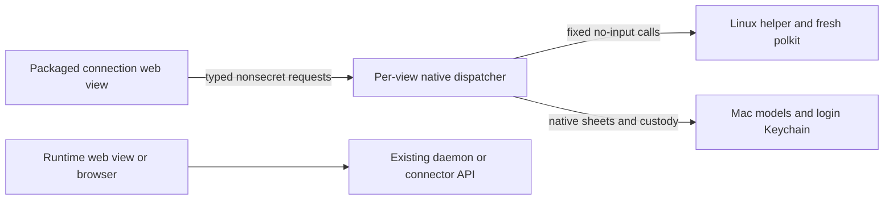

# Web UI to native connection bridge

17 November 2026 · TASK-17001 · THR-379, following THR-327 seq550 · **Design proposal, not implementation or operating authority**

## 1. Scope, evidence and assumptions

Move connection presentation into shared web components while retaining native custody, permission prompts and exact-device approval. Recommend an in-process script-message bridge in a **separate, locally packaged connection web view**. Never attach this bridge to the runtime SPA web view, including the Mac's loopback proxy of a remote runtime. The connection view can work before connection and during daemon failure. It reuses the web build/design system; it is not fetched from the computer being connected to.

This PR adds this document only. It does not change authentication, helper methods, permissions, dependencies, existing screens, TASK-16779, installations or deployments. Engineering/security review and product review precede an implementation brief. Source inspection is not native or cross-device acceptance.

Source facts below are pinned to fetched `origin/main` **`d8a3e12888e2009c527fd423d81c6c3129703ae6`**. `file:line` references throughout refer to that tree. The original UX design merged as #1565; the current canonical file is [2026-11-16-one-click-remote-access.md](2026-11-16-one-click-remote-access.md), especially §§6–8. The additional UX authority is the supplied **Claude Design handoff**, `/home/benze/.happyranch/runtime/orgs/happyranch/workspaces/engineering_manager/output/TASK-16999/inputs/claude-design-remote-connection-handoff.md` (hereafter **H**, §§3, 5–11; state IDs L01–L20, M01–M23, X01–X08). H reconciles stale custom-server and trust-status paragraphs; it does not prove execution. The KB ruling `one-click-remote-access-fixed-operator-service-ruling` also removes custom-server selection and keeps home-network and outside-home acceptance separate.

Explicit assumptions and limits:

- **Founder-confirmed requirement (THR-379 seq2, signatures confirmed by EM):** the only page-visible bridge functions are asynchronous `call(command: string, data: string) -> Promise<string>` (rejecting with an error string) and `on(eventName: string, handler: (data: string) => void) -> unsubscribe function`. Native defines a fixed event-name list. Section 7 specifies their string/schema and transport mapping; this requirement is settled, unlike the placement decisions in §11.
- “R2 actions” means the approved zero-input contract, not a claim that all actions have merged implementations. The merged helper exposes only five methods (F3). H §11 explicitly anticipates unfinished lifecycle wiring. The missing methods are dependencies in this proposal, never inferred as callable. If the implementation brief instead requires them to be already available, stop and reconcile that premise before building.
- “Local trusted shell's own top-level web view” means native-created, native-owned **local control content**, not any page that happens to have a loopback URL. This conservative interpretation excludes remote content even inside the Mac app. Founder should ratify this placement (§11).
- Reusing the web UI means shared source/components and a packaged connection entry point, not automatically mounting the entire authenticated runtime app in a privileged context. Packaging that entry point and its isolated origin is new work, included in estimates.
- The OS, packaged native executable, local bundle and root helper are trusted. A compromised same-user process or administrator is outside this bridge's isolation claim. Web content, device labels, network responses and even an otherwise trusted web document with XSS are adversarial inputs.
- Source establishes the WebKitGTK API namespace, not the installed engine's exact version (F2). Reply support must be probed on supported package targets. No claim of universal installed availability is made.

## 2. Step 0: current shells verified from source

| ID | Verified fact and source evidence |
| --- | --- |
| F1 | Linux verifies a release daemon port before returning `http://127.0.0.1:<port>/`: `packaging/linux/desktop/happyranch_window.py:548–559`. `show_web` creates `WebKit2.WebView`, connects `load-failed`, and calls `load_uri(url)`: same file `1027–1049`. It loads HTTP from the daemon, not a file/custom-scheme SPA. That construction passes no bearer or credential into the URL. |
| F2 | Linux selects GTK 3.0 and WebKit2 **4.1**: same file `902–907`. Debian packaging depends on `gir1.2-webkit2-4.1` without an engine-version lower bound: `packaging/linux/build-deb.sh:190–194`. “4.1” is the API/ABI namespace, not an engine version such as 2.40. |
| F3 | `runtime/remote_access/helper_control.py:27–30` defines only ApprovePending, RejectPending and RevokeSelected mutations. `runtime/remote_access/remote_access_helper.py:40–43` adds Status and NextDevice; generated D-Bus introspection has only an output string, no input. Dispatch rejects nonempty signatures/FDs and unknown methods at `145–152`. `scripts/test_remote_access_helper.py:249–254` explicitly expects unknown-method for Enable, Disable, ReplaceFailed, RefreshHomeAddress, IssueInvite and RetryPolicyRenewal. These approved future lifecycle methods are **not implemented D-Bus methods at this pin**. |
| F4 | Helper access checks the release UID, maintains a per-bus-caller selection cursor and captures the pending/selected protected record: `remote_access_helper.py:155–187`. Its polkit message includes the captured label, stable-ID fingerprint and comparison phrase; CheckAuthorization follows at `186–193`. After authorization it rechecks UID, snapshot, target and deadline before mutation: `233–245`; final precommit checks are at `254–264`. Policy uses `auth_admin`, not a keep authorization: `packaging/linux/polkit/ai.happyranch.remote-access.policy:4–18`. |
| F5 | The Linux card merged in [#1583](https://github.com/t-benze/happyranch/pull/1583) (`013c03905…`). Its `RemoteAccessPanel` is in `packaging/linux/desktop/happyranch_window.py:663–676`; it uses a dedicated bus connection and sends no supplied device identity. Request allowlist and zero-input `connection.call(..., None, ...)` are at `753–780`; pending/device buttons are at `854–877`. It is attached to startup/error content at `928–954` and around the runtime view at `1027–1042`. It is not a complete enable/invite/turn-off UI. |
| F6 | Mac `WebView` creates a JavaScript-enabled WKWebView with a navigation delegate and plain URLRequest: `app/mac/Sources/HappyRanchApp/ContentView.swift:55–71`. Local runtime URL construction is `http://127.0.0.1:<port>/`: `app/mac/Sources/HappyRanchSupervisor/RuntimeTransport.swift:16–22`. Healthy local probing sets `webViewURL`: `app/mac/Sources/HappyRanchApp/AppDelegate.swift:907–922,939–948`. The home-invite model's URL is observed into the same property at `87–90`. |
| F7 | Mac's managed client runtime is also HTTP loopback, but through **ClientBridge, an HTTP/SSE/WS proxy**, not a JS command bridge: `app/mac/Sources/HappyRanchSupervisor/ClientBridge.swift:43–64`. It intercepts bootstrap locally, strips SPA Authorization before forwarding (`1028–1042`), and returns a session credential (`1049–1063`). Device credential storage/injection remains native (`111–124,1145–1151`). Do not equate this proxy's loopback origin with locally authored content. |
| F8 | Mac navigation is unrestricted by this delegate when `verifiedHome` is false. When true, action URLs must match scheme/host/port; main-frame responses must be 2xx, match that origin and initially equal the expected root. Finish reports load only after that gate: `ContentView.swift:19–44`. There is no path/resource-bundle pin for all subsequent same-origin navigation in this gate. The flag is enabled for the managed client at `85–87`. |
| F9 | Neither shell currently installs a script-message handler or JS command bridge. Inspection of the web-view constructors (F1/F6), plus targeted searches across `packaging/linux`, `app/mac` and `web` for `WKScriptMessage`, `userContentController`, `UserContentManager`, `script-message`, `register_script`, `evaluateJavaScript`, `evaluate_javascript` and `webkit.messageHandlers`, found no registration/dispatch implementation. Linux's view construction has only the load-failed signal (F1); Mac has no WKUIDelegate/create-window implementation in `ContentView.swift:4–73`. There is no explicit Linux navigation/new-window/create policy in `show_web:1027–1057`, nor an explicit Mac popup policy in that wrapper. This describes app code, not a claim that framework defaults open or allow all popups. |
| F10 | The merged Mac connection work is [#1575](https://github.com/t-benze/happyranch/pull/1575) (`91ff3b7ae…`). `RemoteConnectionView.swift:178–231` contains the invite form, countdown, comparison phrase and cancellation. `HomeInviteModel.swift:8–27,35–65` owns home-client state with private credential/session members; `78–105` discovers saved homes and reconnects one saved home; `188–239` joins, pairs, waits, saves and opens. Its native load callback alone moves Opening to Connected (`334–350`). |
| F11 | `ManagedJoinModel.swift:9–54` is the older managed-network state model; do not mistake joined/online there for the home invite flow's loaded-UI criterion. `ManagedConnectionHealthView.swift:11–39` refreshes a native health record only while visible/active, on demand or every 60 seconds. The current home overlay is `HomeSessionStatus`, preserving save-failure UI over WKWebView: `ContentView.swift:285–313`. These are distinct seams to adapt, not evidence that all health presentation is already unified. |
| F12 | Saved credentials bind home/control-plane/stable-node identity, not display names, and keep the bearer private/redacted: `app/mac/Sources/HappyRanchSupervisor/SavedDeviceAccess.swift:4–49`. `LoginKeychainDeviceStore.swift:10–21,40–79,93–110` uses the login Keychain, a current-executable trusted-app ACL, nonsynchronizing records, create-only ordinary save and readback validation. No new JS serialization of these types is acceptable. Native removal stops the session, removes network state, then deletes the exact Keychain binding and records partial failures: `HomeInviteModel.swift:440–457`. |
| F13 | The web bundle is shared, not selected by shell detection: `runtime/daemon/routes/web_static.py:81–110` mounts assets, serves index at `/`, and falls back to index for SPA routes. `web/src/lib/auth.ts:21–39` bootstraps a relative `/api/v1/auth/bootstrap` and caches its bearer in sessionStorage; `web/src/lib/api/client.ts:81–92` sends it on same-origin requests. Targeted searches of `web/src` found no WebKit handler/native-host/UA-based shell capability detection. “Shell” in AppShell is web layout, not native authority. |
| F14 | Local daemon bootstrap already returns the master bearer to loopback SPA JS: `runtime/daemon/routes/auth.py:31–45`. The new bridge must not claim to remove this existing exposure. Remote gateway processing strips remote headers, reads the daemon bearer only for the verified loopback hop, and forwards through tracked streams: `runtime/remote_access/gateway.py:310–355`; injection is in `runtime/remote_access/forwarding.py:258–260`. Allowed HTTP relays response bytes: `runtime/remote_access/httpd.py:149–169`. Together with F13 this is how the same SPA/assets reach paired remote devices without embedding a native command channel. |
| F15 | Mac `SurfaceAllowList` is a method/route-sensitive **HTTP remote-surface** gate (`app/mac/Sources/HappyRanchSupervisor/SurfaceAllowList.swift:5–17,318–361`), denying bootstrap/registration remotely at `62–71`. It is not an origin/frame/navigation or JS-message gate. The Linux gateway similarly applies current policy and route matching (`runtime/remote_access/gateway.py:219–224,255–287`). Preserve both independently of the proposed bridge. |

The source agrees with H's distinction between existing presentation and required lifecycle wiring. Earlier “#1575 still open”/trust-pending text in the historical spec (§7, lines 639–645) is superseded by merged source, not used to infer a weaker trust path. No unresolved source contradiction is used as a design premise.

## 3. Options

| Option | Security and reachability | Effort / testability |
| --- | --- | --- |
| **A. In-process script messages**: WKScriptMessageHandler or WithReply on Mac; WebKitGTK UserContentManager on Linux | No listening socket or daemon route. Can bind to one native view and document lifetime. Needs explicit frame/origin/navigation checks; handler registration alone is insufficient. Page-world XSS can exercise the allowed facade, so native prompts/custody remain essential. | **M**, two small transport adapters plus shared schema. Real web-view negative tests are essential; native dispatch/schema tests are easy to isolate. Recommend reply APIs where present; correlated asynchronous replies otherwise. |
| **B. Native loopback HTTP/WS command API** | Loopback is reachable by browsers and other local software; remote SPA served through a loopback proxy is still remote content. CORS does not prevent all mutation requests. Requires independent session capability, Host/Origin checks, CSRF protection, no ambient-cookie auth, listener lifetime and WS authorization. Still cannot inherently prove one native frame initiated a socket request. | **L**, ~4–7 days for transport/security alone, plus both app integrations. HTTP fixtures are convenient, but DNS rebinding, browser/PNA behavior, port lifetime and WS tests add work. Reusing ClientBridge would conflate runtime traffic with local device authority. Reject for the stated view-only requirement. |
| **C. Custom URL scheme as command transport** | Links, redirects, iframe navigation and OS-level deep links are poor command authority. Request data can leak through history/URLs. Return values/events and frame attribution need extra machinery. A scheme handler is useful for serving fixed local assets, **not** for `scheme://approve?...` mutations. | **M/L**, ~3–5 transport days; lifecycle and replay behavior harder to exercise. Use only the asset-serving part with A. No secret-bearing command URLs. |
| **D. Daemon-mediated routes or native socket agent** | Daemon routes are potentially browser/connector reachable and add authorization/custody scope. A Unix socket is not directly callable by web JS; it still needs A/B/C. Existing Linux D-Bus/private helper IPC stays the native backend, not a new public web endpoint. | **L**, ~5–8 days before UX work and separate auth/route-policy review. Transport tests are feasible; reachability conflicts with this scope. Reject. |
| **E. Linux WebKit web-process extension with frame-aware IPC** | Credible fallback if the shipped GTK API cannot establish frame isolation. Native frame provenance can be stronger than a page-provided origin field; adds a separate process/plugin surface. | **L**, ~3–5 additional Linux days and packaging/native tests. Do not silently substitute it or broaden a handler to all pages. Return the feasibility result to EM for rescope. |

API evidence: Apple documents [WithReply](https://developer.apple.com/documentation/webkit/wkscriptmessagehandlerwithreply), [frame information](https://developer.apple.com/documentation/webkit/wkframeinfo) and [content worlds](https://developer.apple.com/documentation/webkit/wkcontentworld). The target is macOS 14 (`app/mac/Package.swift:25`), so use a named content world, a main-frame-only user script and WithReply. A plain handler plus structured callback is an internal transport alternative; either preserves the same §7 `call`/`on` facade.

On GTK API 4.1, ordinary [script-message-received](https://webkitgtk.org/reference/webkit2gtk/stable/signal.UserContentManager.script-message-received.html) dates from engine 2.8; [named-world registration](https://webkitgtk.org/reference/webkit2gtk/stable/method.UserContentManager.register_script_message_handler_in_world.html) from 2.22. [register_script_message_handler_with_reply](https://webkitgtk.org/reference/webkit2gtk/2.40.2/method.UserContentManager.register_script_message_handler_with_reply.html) and [script-message-with-reply-received](https://webkitgtk.org/reference/webkit2gtk/stable/signal.UserContentManager.script-message-with-reply-received.html) are available from **2.40**, including asynchronous replies. F2 does not guarantee that engine on every supported installation. Probe GI method/signal availability; use WithReply on qualifying targets, otherwise named-world messages plus correlated native delivery into that same world. Neither callback signature supplies Mac-style frameInfo. Never pretend `view.get_uri()` alone authenticates the sending frame. Test the isolation construction in §4 on minimum supported GTK targets before enabling mutations; missing proof/support leaves bridge capabilities unavailable, without a network API fallback or dependency upgrade in this design.

## 4. Recommendation and load-bearing threat model

### Placement and lifetime

Create a dedicated connection view with its own content manager/controller, web context/data store and local asset loader. Serve a fixed packaged entry at a native-controlled origin such as `happyranch-shell://connection/`; this spelling is proposed, not an existing scheme. Resolve only a literal, bounded bundle manifest, never arbitrary filesystem paths, network fetches or caller URLs. No runtime API auth/bootstrap runs in this entry point. Use a separate origin and storage partition from daemon and ClientBridge content; no runtime cookies, service workers, web caches or authenticated app providers belong here.

The runtime WebView continues to load the existing local daemon or remote proxy. **It has no handler, injected facade, message forwarder or reference to the control view**, even when its URL is 127.0.0.1. A native menu/button opens the connection view while the runtime is loaded, starting, disconnected or failed. Retain a minimal native Connection menu/failure fallback until that entry works independently of a healthy daemon. The normal browser-served bundle can contain the shared components/client library, but obtains no native endpoint from that fact.



### Native admission rules

1. **View identity:** register exactly on the connection view created by native code. Never on a shared default controller/manager. Native stores a document generation and loader identity. JS-provided origin, platform, frame flag, nonce, capabilities or request ID cannot grant access.
2. **Origin and resource pin:** accept only the exact canonical scheme/host/port and fixed entry resource loaded from the packaged manifest. No wildcard suffix, `localhost` alias, dynamic port heuristic, remote alias, file URL, `about:blank`, `data:`, `blob:`, inherited-origin document or arbitrary same-origin path. Hash-only UI state may stay in-document; it grants no navigation authority. Verify custom-origin serialization on both engines rather than accepting a generic opaque `null` origin.
3. **Frames/content worlds:** inject the facade/relay only into the main frame at document start. Use named isolated worlds; no direct page-world native handler. The small page facade exposes only §7 `call`/`on` and intentionally relays the closed schema to the isolated relay. Its fixed event dispatcher and transport callbacks stay internal, not additional page-visible methods. Accept relay messages only from the same top-level window and exact admitted document; no cross-window forwarding. On Mac also check native `message.webView`, `frameInfo.isMainFrame` and frame request/security origin on **every** message. Keep the generation/dispatch capability in native/isolated state, not in DOM or localStorage.
4. **GTK frame gap:** top-frame injection alone does not restrict where a globally registered channel could be used. Bind the handler only in the named world, inject relay code only in the admitted main frame, and allow no child frames at all in this control view. Enforce packaged CSP `default-src 'none'`, manifest-local script/style assets, `frame-src 'none'`, `object-src 'none'`, `base-uri 'none'`, `form-action 'none'`, `connect-src 'none'`; forbid inline/eval/remote scripts. Native navigation/resource policy must also refuse subframes, popups and embedded documents, including same-origin, srcdoc and inherited-origin cases. The GTK feasibility case must show no child frame can reach the handler/relay, including by accessing parent objects. If GTK cannot enforce this on a supported target, disable that bridge and report the gap; do not replace frame provenance with a JS `isTop` claim. Mac uses these document restrictions too.
5. **Navigation/popup pin:** cancel all out-of-manifest navigation, redirects, form targets, new-window and popup requests. Never copy a privileged configuration to a popup. Help links require an explicit native allowlisted external-open action and a separate unprivileged browser, not an arbitrary `openURL` bridge command. Any navigation start, redirect attempt, load failure, process crash, role change or view destruction immediately suspends admission, unregisters/detaches handlers and subscriptions, and invalidates its generation. Returning/back or loading the same URL does not restore authority: create a fresh connection view after a successful native loader admission. Check again before delivering every result/event.
6. **Execution lifetime:** serialize mutations; no prompt queue. Revalidate captured native target and generation before invoking the backend. A navigation cancels uncommitted work where safe and disconnects its dedicated bus caller; it is not proof an already-started mutation rolled back. Committed/uncertain effects stay in native state for an explicit new snapshot. Never deliver a stale completion to a replacement document or automatically replay it.

Content-world separation protects relay variables, **not the shared DOM or the user's interpretation of web UI**; Apple explicitly documents that distinction. Frame/origin rules constrain reachability, not XSS inside the admitted main document.

### Concrete adversaries and residual effects

| Scenario | Required result / residual risk |
| --- | --- |
| Paired device loads the same SPA through the connector, including inside its Mac runtime view | No native command channel. The Mac's native Connection menu opens its separately packaged local controls. Remote web scripts cannot create/open/control that privileged view or post messages into it. Existing paired runtime privileges remain governed by connector policy; pairing does not grant Linux helper authority or access to Mac credentials. |
| Plain browser opens the local daemon or guesses the control scheme | No registered native view/handler or injected facade; hide the connection feature. A scheme string, UA, global flag, matching bundle, facade presence or spoofed hello response is UX only, never admission. No HTTP route or port exposes these commands. |
| A malicious page is reached by navigation/redirect or tries window.open | Deny before content commits; suspend the old generation on the attempted transition. No inherited handler after redirect, history restore, blank popup, scheme switch or crash recovery. No response is sent into the new page. |
| Iframe or other window sends a forged envelope | Deny by native frame check on Mac and the tested frame-free/isolated-world construction on GTK. Never use claimed origin/frame fields. Same-origin parent access is included in tests, not assumed safe. |
| XSS in the ordinary runtime SPA | Can misuse the runtime privileges already held there, including existing local bootstrap exposure (F14). Cannot reach the native bridge in a separate view/partition. This proposal does not solve the daemon's existing bearer/XSS model. |
| XSS in the packaged connection UI | Can use `call`/`on` to read allowed status/labels, falsify web presentation, request allowed actions and cause prompt/availability pressure. String payloads still require closed-schema validation; event names remain fixed and data never becomes JS source. It cannot read invites, keys or Keychain bearers through this schema, supply Linux helper parameters, forge protected device identity, bypass fresh native permission or silently confirm destructive Mac actions. Bounds/no queue and native confirmations limit abuse; they do not make XSS harmless. |
| Malicious label or lookalike approval UI | Render labels as bounded text with controls/bidi handled; never HTML. An XSS/lookalike page can spoof any web approval prompt, comparison phrase or green badge. Actual approval must show the helper-captured device in native trusted UI (§5). Do not ask for OS credentials in HTML. |

## 5. R2 and native approval stay authoritative

For Linux, map each advertised command to one literal helper method and always call it with **zero inputs**. No device ID, fingerprint, label, address, URL, path, argv, config, environment, enrollment key, policy or auth flag supplied by JS crosses into D-Bus. Request IDs and UI metadata stop at the unprivileged dispatcher. The helper's protected release identity, fixed paths, caller UID checks, cursor and captured-record checks remain unchanged (F3–F5).

Use the dedicated bus connection per connection view; NextDevice cycles its helper-owned cursor. The web screen may show the current selection, but cannot select a Linux record by ID or race a supplied ID into approval/revoke. Disable cursor changes while an operation is in flight; the helper still enforces its own invariants. Each mutation starts a **fresh polkit prompt**, never a cached grant, remembered permission or bundle-level blanket consent. Enable/turn-off/issue and recovery commands can only be advertised after TASK-16779's separately authorized native lifecycle slices provide their fixed authenticated methods. The bridge never implements them with shell commands or alternate daemon routes.

**Chosen trusted approval indicator: the genuine polkit dialog's helper-composed text.** Preserve the actual captured OS-derived label, stable-ID fingerprint and comparison phrase currently supplied at `remote_access_helper.py:183–193`. Show the selected release runtime in native shell context; future helper lifecycle work must ensure the dialog or a tightly bound native confirmation identifies that runtime too. A web screen can explain the comparison, but its “Approve” click only requests the native ceremony. The protected record shown natively is the one revalidated/committed; a web label or screenshot is never the authority. Native qualification must demonstrate the supported desktop polkit agent actually renders that text accessibly; if it does not, hold approval and return the native-indicator gap to EM rather than silently falling back to HTML. A GTK sheet alone that trusts a JS-supplied identity is not an equivalent substitute.

On Mac, accepting an invite opens a genuine native paste/target-confirmation sheet. Remove saved computer and explicit saved-access replacement use a native default-Cancel sheet showing the captured local computer/binding description and precise local-only effect; connect/disconnect/cancel requests must receive native confirmation when initiated from web content. The dispatcher resolves any Mac computer reference against its current native snapshot and revalidates after confirmation. A stale ref fails `stateChanged`. Existing automatic reconnect at native app startup can remain a native policy (F10); read/subscribe calls must not start new custody prompts or connections.

## 6. Secrets and data minimization

| Material | Custody and web exposure |
| --- | --- |
| Linux invite, pair secret, join/enrollment key | Keep issuance result in native memory; display/copy the complete invite in a native sheet. Bridge returns only issuance outcome and authoritative expiry when supported. No raw invite/QR bytes in DOM, request/reply, event or clipboard-read command. Native Copy is an explicit user action; clipboard history/other apps are a residual risk, not erased by closing a sheet. Never automatically reissue after delivery uncertainty. |
| Mac accepted invite | **Prefer native paste/sheet** over a web textarea. JS requests `mac.acceptInvite` with `{}`. Native reads clipboard only after an explicit user paste, parses/validates and confirms the target; it clears the draft and reports nonsecret stage/outcome. Do not auto-read the clipboard. Native deep-link intake remains native and obeys the same confirmation path. A web invite field is technically feasible but would expose its complete enrollment authority to XSS, extensions, form instrumentation and errors; there is no strict need, so reject it for v1. |
| Saved device bearer, pending completion handle, private keys, home CA signing material, Keychain record bytes | Never serialize into bridge types. Keep SavedDeviceCredential/LoginKeychainDeviceStore and strict home transport behind native adapters. No “debug”, get-secret, export-key, arbitrary clipboard or generic fetch/execute escape hatch. Public status must be a hand-written projection, not Codable/JSON serialization of internal models. |
| Existing web bearer | Existing runtime SPA bootstrap/sessionStorage exposure (F13/F14) remains in its unprivileged runtime view. It does not authenticate native commands and never enters the packaged control entry. Changing daemon auth is outside this proposal. |
| Display metadata | Allow bounded computer labels, home-network/operator context, deadlines, coarse state, comparison phrase where needed, and local opaque computer refs. Keep device fingerprints in privileged native comparison/details UI. Do not emit endpoints, node keys, internal paths, CA DER or full trust records to web diagnostics. Labels are not identity proof. |

No request/response bodies, invite fragments, bearer values, raw native exceptions, decoded invite fields or clipboard contents in logs, telemetry, console, accessibility announcements or error strings. Use closed error codes and localized web-owned copy. No analytics/session-replay instrumentation in the control entry. Crash/error handling must redact before serialization; debug builds do not get an exception. An optional support export needs a separately reviewed existing redacted channel; none is added here.

## 7. Shared typed protocol v1

One language-neutral closed schema, proposed under `protocol/native-connection-bridge.v1.json`, should define TS, Swift and Python projections/adapters without adding a top-level dependency. This path and generated artifacts are future scope, not files in this PR. Keep transport code separate from commands and model projections. Validate at runtime in native code even when TS types pass.

### JS-facing API (founder THR-379 seq2)

A native-injected object exposes exactly these two functions as the **only page-visible bridge surface**, in the admitted control document's page world only (§4). Its native transport/relay lives in the named isolated world; no facade is injected into runtime, browser, remote, child-frame or replacement documents. The object name is an implementation choice.

```ts
call(command: string, data: string): Promise<string>
on(eventName: string, handler: (data: string) => void): () => void
```

`call` sends a closed command ID asynchronously. `data` carries the existing versioned schema's JSON `args` text (for example, `"{}"`); the resolved string carries its JSON `result` text. Native parses and strictly validates against the negotiated version, command and unchanged size bounds below. The facade/transport owns the envelope and `requestId`/version correlation internally, with no extra caller parameters. Failure rejects with a **string** carrying the existing closed JSON error object (`code`, `effect`, `recovery`), never an Error object or free-form backend message. Normalize facade/transport failures to that vocabulary with truthful effect semantics.

`on` accepts only the closed native event list: **`stateChanged` in v1**. The handler receives the existing versioned snapshot/event JSON as a string. Unknown names throw/refuse locally before transport; native never emits names outside the list. The returned unsubscribe function detaches the listener; `on`/unsubscribe manage the existing one-per-view native stream internally, subject to generation teardown. The fixed dispatcher stays internal; no page-supplied callback name or executable string.

Absence of the facade means plain-browser behavior: hide the feature. Facade presence and a hello result are UX detection only, never authorization; native admission still governs every real request and delivery.

### Mapping the facade to native transports

These are adapter choices under §4, not additional JS APIs. Both deliver into the fixed isolated-world dispatcher, which relays only to the admitted control facade/listeners. Pass event names and JSON strings as structured arguments; never concatenate/interpolate command, result, event name or data into JavaScript source.

| Platform | `call` request/reply | Native event delivery for `on` |
| --- | --- | --- |
| Mac | The isolated relay uses [`WKScriptMessageHandlerWithReply`'s `postMessage`](https://developer.apple.com/documentation/webkit/wkscriptmessagehandlerwithreply) request/reply. Native validates the internal envelope and returns a structured success/error envelope; the facade resolves its result JSON string or rejects its closed error JSON string. Raw WebKit/backend errors never reach the page. | [`callAsyncJavaScript(_:arguments:in:in:completionHandler:)`](https://developer.apple.com/documentation/webkit/wkwebview/callasyncjavascript(_:arguments:in:in:completionhandler:)) invokes fixed dispatcher code with `eventName` and event JSON in `arguments`, targeting the admitted main frame and named content world (or equivalent structured delivery). Recheck generation before delivery. |
| Linux | The named-world [`register_script_message_handler_with_reply`](https://webkitgtk.org/reference/webkit2gtk/2.40.2/method.UserContentManager.register_script_message_handler_with_reply.html) handler receives `postMessage` via `script-message-with-reply-received` and replies asynchronously. The same internal envelope validation and facade string/error conversion apply. | [`webkit_web_view_call_async_javascript_function`](https://webkitgtk.org/reference/webkit2gtk/2.42.3/method.WebView.call_async_javascript_function.html) invokes fixed dispatcher code with `eventName` and event JSON in its `GVariant` arguments dictionary and named `world_name`, targeting the main frame (or equivalent structured delivery). Recheck generation before delivery. |

The GTK reply handler and `call_async_javascript_function` require engine 2.40; the 4.1 namespace alone proves neither. Preserve §3's installed-method/signal probes, named-world correlated-reply fallback and §4's frame-isolation proof. An older target needs equivalent structured delivery in that same world; if unavailable or unproven, disable the capability with native fallback. No interpolated-JS fallback, dependency-floor change or network command API is authorized. The facade adds no third function or change to the existing bounds.

### Internal transport schema

Illustrative wire shapes, with synthetic nonsecret values; these envelopes are internal to the facade/transport, not extra `call` parameters or resolved objects:

```json
{"protocol":"happyranch.connection","version":1,"requestId":"r1","command":"linux.status","args":{}}
{"protocol":"happyranch.connection","version":1,"requestId":"r1","ok":true,"result":{"phase":"ready","runtime":"available","observation":"known"}}
{"protocol":"happyranch.connection","version":1,"requestId":"r1","ok":false,"error":{"code":"permissionDenied","effect":"none","recovery":"explicitRetry"}}
{"protocol":"happyranch.connection","version":1,"event":"stateChanged","sequence":7,"snapshot":{"phase":"opening","savedAccess":"saved","route":"unknown"}}
```

These are envelope examples; command results are discriminated types, not one arbitrary object. Reject extra keys, missing keys, invalid enum values, nested unknown fields and noncanonical types; booleans are not integers. Strings are bounded UTF-8 plain text. No executable callback strings or interpolated JS. Native event/reply delivery uses structured serialization and a fixed receiver, addressed to the admitted world/document.

| Command | Args / nonsecret result | Linux / Mac support at the source pin |
| --- | --- | --- |
| `bridge.hello` | `{minVersion:1,maxVersion:1}` → selected version, platform, capabilities and observation limits | Proposed transport only. Native chooses intersection; no compatible version means disabled. |
| `state.read` | `{}` → full platform snapshot | Proposed projection through `call`; read-only, with no credential reads/mutations. |
| `state.subscribe`, `state.unsubscribe` (internal stream operations) | `{}` → initial snapshot and generation-local stream / detach | Owned by `on` and its returned unsubscribe function, not additional page-visible functions or commands for page callers. Read-only; no credential reads/mutations. |
| `linux.status` | `{}` → coarse helper phase, readiness, bounded devices/pending/selection | Existing Status backend (F3); preserve unknown rather than enrich without evidence. |
| `linux.enable` | `{}` → native authorization/outcome and fresh status | Future fixed Enable, currently unavailable. |
| `linux.turnOff` | `{}` → independently observed denial and cleanup outcome | Future fixed Disable, currently unavailable; not runtime Stop. |
| `linux.createInvite` | `{}` → native sheet opened; later issued/unknown and expiry metadata | Future fixed IssueInvite, currently unavailable. Actual invite stays native. |
| `linux.approveDevice`, `linux.rejectDevice` | `{}` → confirmed/failed/uncertain outcome, then fresh Status | Existing ApprovePending/RejectPending. No supplied device target. |
| `linux.nextDevice` | `{}` → helper-selected device snapshot | Existing NextDevice, no supplied cursor/ID. |
| `linux.revokeDevice` | `{}` → confirmed/failed/uncertain outcome, then fresh Status | Existing RevokeSelected. Confirmation follows protected capture. |
| `mac.acceptInvite` | `{}` → native paste/target sheet and attempt phase | Adapter over HomeInviteModel; no raw invite parameter. |
| `mac.savedComputers` | `{}` → labels, ephemeral refs, save/discovery warnings | Native projection of discovered state; never credentials/trust blobs. |
| `mac.connectSaved`, `mac.removeSaved` | `{computerRef:"c1"}` → native confirmation and connection/removal state | Existing native reconnect/removal logic, new adapter. Ref is ≤64 bytes, local to current snapshot/view; never a filesystem path, bearer or Linux device ID. |
| `mac.disconnect`, `mac.cancelAttempt`, `mac.retry`, `mac.retrySave` | `{}` → native-confirmed action on captured current attempt | Existing model functions, new adapters. Retry never infers that a spent invitation is reusable. Replacement consent is native, not a JS boolean. |
| `mac.health` | `{}` → bounded access/runtime/observed-route line with freshness | Adapt existing health seams (F11). Unknown route stays unknown; no fabricated quality scores. |

Reserve, but do **not advertise**, `linux.replaceFailed`, `linux.refreshHomeAddress`, `linux.retryPolicyRenewal`, and host invite cancellation. Their UX needs are recorded below; the bridge does not create a new privileged method to fill them. Native keep-running/role/runtime controls remain separately discoverable; they are not part of this Linux helper command surface.

Capability discovery reports exact page-callable command IDs (excluding internal stream operations), supported observation fields and `availability` (`available`, `unavailable`, `unsupportedVersion`). It is UX information, never authorization. A capability is advertised only if its native backend exists and view admission succeeds. Permission is requested per action, not during hello; missing capability disables that action with an honest native-app/update explanation. Unknown commands fail closed rather than falling through to strings passed to an executor.

Bounds/lifetime: request ≤4 KiB, response/event ≤32 KiB, device count ≤32 (existing helper bound), one mutation/native prompt at a time, at most eight concurrent reads, bounded subscriptions (one per view). Reject excess with `busy`/`invalidRequest`, without queueing. Request IDs are correlation only: bound them to 64 ASCII characters and the native document generation. Retain up to 64 admitted mutation IDs/outcomes without eviction during a generation; same-ID/different-body refuses, exact duplicate returns the recorded outcome without repeating effects. At the bound, refuse further mutations; retain reads and require native reopening with refreshed state, never silently rotate generations or replay work. Client loss leads to state read and an explicit new user action after reconciliation. Set deadlines natively, including the helper's existing 120-second authorization bound (F3/F4), with a bounded transport margin. A client timeout is not cancellation or `effect:none`.

Native pushes full nonsecret snapshots as the fixed `stateChanged` event to `on` listeners when model state changes; Linux may coalesce bounded Status polling while visible, Mac may observe its existing model. No new SSE/WS server. Each stream starts with a snapshot, increasing integer sequence and native observation time. Missing sequence, process restart or suspended view requires a new snapshot; no applying stale deltas. Events never replay secrets, auth decisions or pending handles. The native generation binds delivery; any identifier exposed to JS carries no authority. After mutations, reread backend state rather than optimistically editing lists. Health refresh respects native visibility/cadence and exposes stale/unknown after failure.

### Error and state semantics

Use separate dimensions: host setup (`off/pending/ready/paused/failed/unknown`); client stage (`idle/validating/joining/pairing/waitingApproval/saving/opening/connected/stopping/failed`); runtime (`available/offline/restarting/unknown`); saved access (`none/saved/notSaved/needsPermission/removalIncomplete/unknown`); route (`direct/relay/unknown`, plus freshness); effect (`none/confirmed/unknown`); host denial and local/host/network cleanup each (`confirmed/incomplete/unknown/notApplicable`). An unavailable observation is not an empty list, Off, Removed, Revoked or Ready.

Closed error vocabulary: `invalidRequest`, `unsupportedVersion`, `unsupportedCommand`, `notLocalShell`, `documentChanged`, `busy`, `permissionDenied`, `stateChanged`, `expired`, `unavailable`, `outcomeUnknown`, `invalidInvite`, `newInviteRequired`, `networkUnavailable`, `trustMismatch`, `identityChanged`, `runtimeUnavailable`, `accessDenied`, `revokedConfirmed`, `keychainLocked`, `keychainDenied`, `saveFailed`, `removalIncomplete`. Recovery is an enum: `refresh`, `explicitRetry`, `newInviteOnLinux`, `nativePermission`, `nativeRecovery`, `operatorRecovery`, `none`. No free-form backend error string.

Map helper `invalid-request/unknown-method` to the corresponding schema errors, `wrong-uid` to unavailable native capability (never another credential path), `busy` to busy, `changed` to stateChanged, `expired` to expired, and confirmed `denied` to permissionDenied with no mutation. Do not call an ambiguous transport failure “cancelled — no change”: disconnected/unavailable/timeout **after dispatch** carries unknown effect until independently resolved. An early local validation/admission refusal has effect none. A successful request acknowledgement is not completion; report confirmed only from the native operation's supported result. AccessDenied is not proof of explicit revocation; Revoked requires a positive authoritative signal. Native web-load callbacks, never JS `connected:true`, own Connected.

## 8. UX state coverage and current signal gaps

The design envelope can represent unknowns and partial outcomes, but cannot manufacture evidence absent from the backend. The table maps **every H state** to the proposed projection/action and identifies current omissions. “Adapter” means native behavior exists in source but a new bridge adapter is still required; it is not behavioral PASS. All web screens/projections are unimplemented. The §7 spec state table at `2026-11-16-one-click-remote-access.md:663–672`, its recovery semantics at `674–708`, and §8 acceptance at `709–772` remain the acceptance contract; H refines presentation and explicitly identifies unsupported signals.

| UX ID | Bridge projection / action | Gap or preservation requirement |
| --- | --- | --- |
| L01 | Setup status + Enable entry | Status can show coarse off/unavailable; absence, never-configured and completed cleanup are not distinguished. |
| L02 | Explanation → native Enable | Enable not wired (F3); disabled until backend available. |
| L03 | Operation progress → ready | No Enable stage/readiness transaction API at helper seam; cannot emit detailed progress or fabricate percent. |
| L04 | Recognized failure → ReplaceFailed | No helper method or recognized-replacement result; reserved dependency. Never infer failure from stopped service. |
| L05 | Ready / Add device | Status exists; Add requires absent IssueInvite. Ready is not a connected Mac. |
| L06 | Create invite/auth/rate limit | Method and authoritative retry-time result absent. |
| L07 | Native invite sheet + web expiry | Issuance/delivery/expiry metadata absent from current helper; Copy stays native. |
| L08 | Expired/used | Helper public pending metadata omits expiry and consumed reason; no exact deadline/cause from Status. |
| L09 | Replace/cancel invitation | Replacement issuance not wired; explicit host cancellation lacks a supported method. Offer Close with expiry disclosure, never “cancelled”. |
| L10 | Pending approval → native polkit | Existing backend; public status has label/fingerprint/phrase but no pending deadline (`helper_control.py:54–56`). Actual identity remains native. |
| L11 | Rejected/expired/cancelled pending | A successful local Reject can confirm that action; Status alone cannot explain disappearance or distinguish expiry/cancellation. |
| L12 | Device list / NextDevice | Existing bounded list/cursor; no per-device live connection evidence. Do not add ID selection inputs to Linux. |
| L13 | Native selected-device revoke | Existing backend; lost/failing reply cannot separately prove denial vs stream closure/cleanup from coarse Status. Preserve unknown. |
| L14 | Turn-off explanation/confirmation | Fixed Disable not wired; no runtime Stop substitution. |
| L15 | Denial + cleanup progress/result | Helper lacks these component outcomes; cannot claim full Off or cleanup success. |
| L16 | Off / re-enable | Coarse off is observable, complete prior disable cleanup is not; Enable absent. |
| L17 | Remote setup / runtime availability | Helper phase+ready can support coarse offline/restarting copy; exact cause not guaranteed. Runtime controls stay native and separate. |
| L18 | Keep-running availability | Outside this schema/helper. Keep existing native opt-in, default off and partial-state repair; do not hide it when restyling remote settings. |
| L19 | Paused + policy recovery | Coarse paused exists; renewal cause/deadline and RetryPolicyRenewal are absent at seam. |
| L20 | Address changed + refresh | Host address observation and fixed RefreshHomeAddress absent at seam. No JS-supplied address. |
| M01 | Role choice / open local controls | Retain native bootstrap/role switch until separate packaged entry can launch without daemon. New role-control commands are outside v1. |
| M02 | Accept invite → native paste | Adapter; validation errors are categories, never reflected input. |
| M03 | Native target confirmation | Native sheet must be added/adapted; current parsed target details alone do not establish separate consent (F10). Labels are not attestation. |
| M04 | Joining + deadline | Adapter; model joining exists. Bound operation; elapsed time is not percent complete. |
| M05 | Pairing/requesting approval | Adapter over pairing stage; network join alone is not access. |
| M06 | Waiting/phrase/deadline | Adapter; preserve actual expiresAt and local Cancel semantics. |
| M07 | Authorizing/saving | Save mechanism exists; a distinct transient saving phase is not currently in Phase (F10). Can show coarse securing/opening plus persistent save outcome, or add native nonsecret stage later. |
| M08 | Opening release UI | Adapter; native authorized navigation/load gate only (F8/F10). |
| M09 | Connected + health line | Adapter; unify existing distinct health seams. Direct/relay only if observed/fresh; otherwise checking. No available source signal means unknown, not inferred route. |
| M10 | Expired/used | Expiry supported; exact used/invalidation cause may be indistinguishable before expiry. Do not invent “used” from a denial. |
| M11 | Authorization incomplete/new invite | Adapter; preserve spent authority and separate partial-node cleanup. |
| M12 | Network unavailable | Adapter; cannot positively infer away-from-home or exact proxy cause from timeout. |
| M13 | Trust mismatch | Adapter; no Trust anyway or changed trust roots. |
| M14 | Runtime unavailable | Adapter only where native distinguishes runtime failure; otherwise generic home/network unavailable. Preserve saved grant. |
| M15 | Saved reconnect | Adapter; exact saved binding/native Keychain and load gate preserved. One unreadable home must not hide others. |
| M16 | Needs Keychain permission | Adapter; unlock/consent stays native; never broaden ACL or silently recreate inaccessible item. |
| M17 | Not saved + Retry save | Adapter; warning remains reachable over runtime UI and after opening Connection view. Losing memory may require new invite. |
| M18 | Revoked/re-pair | Only positive native revocation evidence allows this label; generic access denial remains accessDenied/new-invite guidance. Local erasure may fail independently. |
| M19 | Same-home address recovery | Native mechanism exists (HomeInviteModel.swift:128–169); explicit native confirmation needed for updated metadata. Do not claim it invalidated every old unredeemed invite. |
| M20 | Identity changed / legacy trust | Adapter; new invite/approval and native replacement consent, never repin from label/address. |
| M21 | Disconnect | Adapter; retain saved access; stopping failure remains visible and late callbacks cannot reopen. |
| M22 | Remove / removal incomplete | Adapter over staged erasure (F12); verify exact local absence. No claim of host revoke. |
| M23 | Cancel / approval rejected | Local cancellation is observable. **Early remote rejection is not distinguishable from pending/lost completion** per H §11; remain waiting until supported expiry/error, without a fabricated event. |
| X01 | Independent denial/local/host/network cleanup | Mac removal has some categories; complete host/component split absent. Unknown stays visible, not generalized to Off/Removed. |
| X02 | Interrupted replacement/upgrade | Protected transaction detail and resume method not exposed by current helper. Reserved integration. |
| X03 | Installation conflict | Current helper lacks a bounded ownership/conflict projection. Operator recovery only when positively classified, not raw exception text. |
| X04 | Second device / individual revoke | Existing list/cursor/per-device operations; invite creation missing, two-device native acceptance still needed. Duplicate labels require native identity comparison. |
| X05 | Permission cancelled vs unknown effects | Helper denial before commit supports no-change; transport failure cannot supply that certainty. Preserve separate outcomes, no queued retry. |
| X06 | Turn off / re-enable / offline client | Disable/Enable methods and full cleanup evidence absent. An offline Mac cannot report local deletion; host denial and client cleanup remain independent. |
| X07 | Policy expiration/renewal | Coarse paused status only; missing renewal action and detailed cause, plus client may only see access loss. |
| X08 | Signed storage migration | **Deferred annotation only**, not a v1 capability or precondition for unsigned reconnect. |

Additional acceptance constraints: preserve single-use ≤five-minute native deadlines (spec `282–325`); lost issuance/delivery needs a fresh authorized ceremony, not replay. Never reset protected identity/revocations to repair a screen. No custom-server, manual key, endpoint or environment-selection controls; H §§1–3 and the fixed-operator-service KB ruling control stale alternatives. Home-network success is labelled accordingly and does not establish outside-home acceptance. Build web-owned English and Simplified Chinese strings together per `AGENTS.md:167–173,229–237`; H's optional translation note does not lower the repository delivery requirement. Keyboard/focus/error/contrast, meaningful stage announcements and persistent warnings follow H §8; sensitive invite text is never automatically announced.

## 9. Browser fallback and detection

The web client checks for the narrow `call`/`on` facade. If absent, use plain-browser behavior and hide local connection management. If present, perform bounded hello/version negotiation through `call` (for example, one second for hello only); no compatible reply means hide management, or show a disabled “Manage connections in the desktop app” entry where needed for discoverability. Do not poll ports, infer authority from UA/OS/hostname/127.0.0.1, put secrets in URL flags or ask the daemon whether it is native. Remote paired devices retain ordinary runtime functionality; they get no host setup controls from the shared bundle.

A malicious browser script can fake a facade or hello and render its own UI. This is only UX detection; it creates no native handler or authorization. Every real command still passes native view/document/schema checks and required native prompts. Removing a web button is not an access control. Native Connection menu and minimal error fallback remain available if the web bundle/protocol cannot load, so daemon downtime cannot strand saved-access removal or reconnect management.

## 10. Ordered slices, effort and program impact

Estimates are engineering days, not delivery commitments; assume existing web/native owners and supported Linux/Darwin test venues. No installs/deploys or live acceptance are authorized by these estimates.

| Order | Slice | Size / rough days | Exit evidence and dependency |
| --- | --- | --- | --- |
| 1 | Shared closed schema, projections and `call`/`on` facade; packaged connection entry/build boundary | **M, 2–3** | String args/results/closed errors, fixed events/unsubscribe, internal correlation and negotiation/unknown-command/size handling; no runtime auth providers in entry. Product approves placement and current-gap copy; security accepts threat model first. |
| 2 | Linux loader, isolated-world transport, view/navigation/frame enforcement; adapters for existing five methods | **L, 3–4** | First prove GTK minimum-version named-world/frame/popup isolation and async reply support in a disposable native venue. Then fixed zero-input forwarding, native polkit identity and teardown. No future helper method implemented here. |
| 3 | Mac loader/WithReply transport, local native sheets and nonsecret model adapters | **M/L, 3–4** | Main-frame/view checks, Keychain/saved-binding preservation, native paste/target/removal confirmation and loaded-UI criterion on actual unsigned Mac. Runtime proxy view has zero handlers. |
| 4 | Shared web screens/components and accessible localized state presentation | **M, 3–4** | H state map, disabled unsupported actions, startup/offline/menu reachability, persistent save/cleanup warning and safe native handoffs. Build on stable adapters, not guessed signals. |
| 5 | Integrated negative/lifecycle tests and independent review/qualification | **L, 3–5** | Cases below across both engines, source/static lanes and authorized native venues. This is additional integration effort; focused tests travel with slices 1–4. |

Total **14–20 engineering days** for the migration/bridge, excluding unfinished TASK-16779 helper lifecycle backends, service readiness, additional native indicators if polkit text fails, E's possible GTK fallback and cross-device operating acceptance. The two-function facade is included in the existing client/adapter estimates; string encoding introduces no additional transport or slice. Native owners can parallelize slices 2/3 after slice 1; EM owns sequencing, resource/venue assignments and any implementation dispatch. Do not turn this estimate into a program stop or allocation.

Required test design before implementation: closed-schema vectors shared across both native parsers; string-only args/results and closed-string rejections; fixed event names, unknown-name refusal, unsubscribe/teardown and structured delivery of injection-shaped strings; incompatible versions and absent facade; browser/remote-proxy no-handler case; top frame success versus same/cross-origin iframe, srcdoc/about/data/blob and parent-access attempts; allowed origin with wrong path/resource, redirects, popups/history and crash recreation; navigation during pending auth and delayed replies; duplicate/changed request IDs and the mutation-admission bound; busy/no-prompt-queue/oversize flood; synthetic secret canaries absent from all response/event/error/log sinks; XSS requesting approval/removal showing actual native target and requiring fresh user decision; polkit target swap/UID/disconnect refusal; Keychain denied/locked/save/delete failure; cancel late result; saved reconnect and new-invite recovery; independent revoke/turn-off and unknown cleanup; loaded expected UI before Connected; stale/unknown route. Use supported native/standalone venues and lint/static lanes; no restoration of retired Python/Web Vitest suites, ad hoc Product E2E or live host installation. Product acceptance on real packaged devices remains distinct from bridge transport tests. Missing signals/venues are recorded NOT RUN, not PASS.

**TASK-16779 / THR-327 impact — recommendation only:**

- Move #1583's Linux card/status/device-list/details presentation and buttons into shared connection components. Leave the existing native card as fallback until the local entry works in startup/error states and replacement acceptance is complete. Enable/invite/turn-off screens are still required work, not merged screens to “delete”.
- Move #1575's Mac invite journey explanation, stage/countdown, saved-computer list, reconnect/removal state and health line into shared components. Retain native invite paste/target sheet, Keychain dialogs, destructive confirmation, menu/role/bootstrap affordance and warning fallback; keep compatibility-only DIY secondary without expanding it. Do not copy raw technical target fields into normal web screens.
- **Keep** helper, D-Bus/polkit, protected selection/capture, install/recovery/issuance backends, strict home transport/proxy, credential/Keychain custody, native device approval indicator and release-load verification native. The new bridge is an unprivileged adapter to those owners, not a replacement authorization layer.
- **Recommend pausing further native-only layout/polish duplication after EM reconciles active work**, and directing new presentation effort into shared components once placement is accepted. **Keep in-flight backend/security/recovery/packaging and acceptance work**, plus minimal native UI fixes needed for the existing working flow. Do not cancel or edit active tasks/branches, or remove merged screens, on this document's authority. EM owns the actual stop/keep decision and communication in THR-379; this task posts there neither directly nor indirectly.

## 11. Open founder decisions

These are prospective design choices for EM to present after independent security and product review. They do not reopen the already approved R2 permissions or strict home-only trust contract.

| Decision | Recommended answer |
| --- | --- |
| Does “web connection UI” permit a locally packaged, separate connection view opened from native menus, rather than injecting commands into the remote-loaded runtime SPA? | **Yes.** Share web components and visual language, isolate authority from all browser/connector content, and remain usable before connection/when daemon is down. Direct inline remote-runtime controls would require a different reviewed threat model, not a fallback in this plan. |
| May invite entry/display/copy and actual approval/destructive identity confirmation remain native? | **Yes.** Web owns explanation/progress/management; native paste and copy keep enrollment authority out of JS, and genuine polkit/native sheets make the actual target trustworthy despite web spoofing/XSS. |
| What is the first bridge milestone while host lifecycle integration is unfinished? | **Existing five Linux methods + Mac native adapters**, with missing actions explicitly unavailable. Add approved fixed lifecycle capabilities only as TASK-16779's native slices land with supported signals; do not widen helper inputs. Full one-invite product acceptance still requires those remaining backends. |
| Should new native UI presentation work continue in parallel? | **Keep correctness/security/recovery and necessary fallback work; pause duplicate presentation polish after EM's active-task reconciliation.** Migrate incrementally, retaining working native screens until shared replacements are qualified. |
| What happens on GTK targets without proven reply/frame isolation support? | **Disable bridge capability with native fallback**, first test named-world correlated replies on the existing dependency profile. Do not raise dependency floors, add a web-process extension or expose loopback commands without a separate scoped decision. |

No founder choice is needed to allow remote pages to invoke local actions: this proposal categorically excludes that reachability. Unresolved implementation signal gaps remain explicit dependencies, not a request to weaken approval, custody or compatibility.
